# FinMate — ERD khái niệm và ERD vật lý

> Sinh ngày 2026-11-03 từ nhánh `feat/forecast-complete` (commit `47435c8`, gồm Phase 1–56).
> **Nguồn:** không đọc tay từ code. Dựng một PostgreSQL 16 trống, chạy **toàn bộ** migration của hai service
> (34 EF Core migration của backend tới `AddTransactionAnomalies`; alembic của ai-service tới revision `0031`), rồi đọc
> catalog (`pg_class`, `pg_attribute`, `pg_constraint`, `pg_indexes`). Mọi cột, kiểu, khóa, CHECK và index dưới đây là thứ
> thực sự tồn tại trong database, kể cả phần viết bằng SQL thô trong migration. Mô tả nghiệp vụ và cách chia nhóm là viết tay.
>
> Không gồm: schema `hangfire` (Hangfire tự tạo lúc chạy, không thuộc migration), bảng lịch sử migration
> (`__EFMigrationsHistory`, `alembic_version`), Redis (cache, mã OTP email).

## Mục lục

1. [Kết quả kiểm tra](#1-kết-quả-kiểm-tra)
2. [ERD khái niệm (conceptual)](#2-erd-khái-niệm-conceptual)
3. [ERD vật lý (physical)](#3-erd-vật-lý-physical)

## 1. Kết quả kiểm tra

Hai database tách biệt hoàn toàn (không FK chéo, không dùng chung): **`finmate_main`** của backend và **`finmate_ai`** của ai-service.
`ocr-service` không có database (đọc/ghi qua ai-service); `stt-service` và `rasa` cũng không có.

| | `finmate_main` (backend) | `finmate_ai` (ai-service) |
| --- | --- | --- |
| Bảng | 36 | 34 (+ 3 view) |
| Cột | 392 | 308 |
| Khóa ngoại | 50 | 31 |
| CHECK | 76 | 94 |
| UNIQUE constraint / unique index | 0 / 33 | 20 / 26 |
| Index (không tính PK) | 81 | 62 |
| Bảng xóa mềm (`deleted_at`) | 8 | 0 |

### 1.1 Code khớp database

| Kiểm tra | Kết quả |
| --- | --- |
| Bảng trong DB ↔ cấu hình EF (`IEntityTypeConfiguration<>`) | 36 / 36, không thừa không thiếu |
| Bảng trong DB ↔ model SQLAlchemy (`__tablename__`) | 34 / 34, không thừa không thiếu |
| `dotnet ef migrations has-pending-model-changes` | Sạch — model EF khớp migration |
| `alembic check` | "No new upgrade operations detected" — model SQLAlchemy khớp migration |
| File trong `Domain/Entities` không phải bảng | `ConsentVersions`, `FinanceSignals` (lớp hằng số tĩnh); `NotificationPreferences` là value object nằm trong bảng `users` |

### 1.2 Quy tắc của dự án, kiểm trên schema thật

| Quy tắc (AGENTS.md / CONVENTIONS.md) | Kết quả |
| --- | --- |
| Không có cột `timestamp without time zone` | Đạt — mọi mốc thời gian là `timestamptz` (ngày thuần dùng `date`) |
| Tiền là `BIGINT` | Đạt — mọi cột `*_cents`, `*amount*`, `*balance*` là `bigint`. `double precision` chỉ dùng cho độ tin cậy và chỉ số đánh giá model |
| Khóa chính là UUID | Đạt, trừ các **khóa tự nhiên có chủ ý**: `secret_store.name` (cả hai DB), `vietqr_banks.bin`; bên AI: `kb_categories.slug`, `kb_item_categories.item_key`, `ml_item_feedback(item_key, user_id_hash)`, `ops_usage_daily(day, metric)`. Không bảng nào dùng khóa số tự tăng |
| AI DB không chứa `user_id` thật | Đạt — 8 bảng chỉ có `user_id_hash` (SHA-256); id giao dịch backend cũng chỉ ở dạng hash (`ml_user_feedback.backend_transaction_id_hash`); người sửa luật là `actor_hash` |
| Dữ liệu theo người dùng phải có `user_id` | Đạt — 22 bảng backend có `user_id`; 19 bảng có FK tới `users` với ON DELETE CASCADE (xóa cứng một user là một câu `DELETE`) |
| Enum lưu TEXT + CHECK | Đạt gần hết. **Ngoại lệ:** `ai_results.transaction_type` là enum `TransactionType` trong code nhưng không có CHECK (lệch CONVENTIONS, rủi ro thấp vì chỉ backend ghi). `audit_logs.event_type`, `*.category_source`, các cột `source`/`reason` bên AI là chuỗi tự do, không phải enum |
| FK có index | Backend: đạt, cả 50 FK. AI: **17 FK không có index ở cột đầu** — phần lớn trỏ tới `kb_categories(slug)` (bảng nhỏ, gần như không xóa), còn lại là `ml_label_events.feedback_id`, `ml_model_versions.training_job_id`, `ml_user_feedback.batch_id`, `ops_analyze_log.(pattern_id, raw_sample_id, duplicate_of_request_id)`. Không sai, chỉ chậm khi xóa / cập nhật dòng được trỏ tới |

### 1.3 Cột trỏ tới bảng khác nhưng không có FK (có chủ ý)

| Cột | Lý do |
| --- | --- |
| `audit_logs.user_id`, `data_deletion_requests.user_id` | Phải còn lại sau khi xóa cứng user (`UserHardDeleter` chỉ xóa dòng `users`, phần còn lại đi theo cascade) |
| `goal_contributions.user_id` | Lặp lại để lọc theo người dùng; vòng đời đi theo `saving_goals` (CASCADE) |
| `transaction_anomalies.category_id` | Ảnh chụp danh mục lúc phát hiện bất thường, dùng tra phản hồi "bình thường" (BR-11.4) |
| `ai_results.duplicate_request_id`, `*.category_slug` bên backend | Giá trị do ai-service trả về (khác database) |
| Mọi `user_id_hash`, `backend_request_id`, `backend_transaction_id_hash`, `ml_training_samples.scan_id` bên AI | Liên kết logic sang backend — xem 2.3 |

### 1.4 Đã thử và không có lỗi

- Xóa cứng một user có giao dịch chuyển khoản giữa hai ví của chính họ: `transactions.financial_account_id` / `counter_account_id` là
  ON DELETE RESTRICT, trong khi `users` cascade sang cả `financial_accounts` lẫn `transactions`. Đã chạy thử trên database dựng từ migration:
  một câu `DELETE FROM users` xóa sạch, không bị RESTRICT chặn.

### 1.5 Ký hiệu Mermaid

| Ký hiệu | Nghĩa |
| --- | --- |
| `\|\|--o{` | Một – nhiều; phía "một" bắt buộc (FK NOT NULL) |
| `o\|--o{` | Một – nhiều; phía "một" tùy chọn (FK cho phép NULL) |
| `\|\|--o\|` | Một – một (FK có UNIQUE) |
| `..` (nét đứt) | Quan hệ logic, **không có FK** trong database |

## 2. ERD khái niệm (conceptual)

Mức nghiệp vụ: thực thể và quan hệ, không có cột. Tên thực thể là tên class trong code (C# entity / SQLAlchemy model); nhãn quan hệ là cột khóa ngoại tạo ra quan hệ đó.

### 2.1 Backend — `finmate_main` (36 thực thể)

Vẽ chung mọi quan hệ trong một sơ đồ thì không đọc được (User nối tới gần hết các thực thể), nên tách làm hai:

- **(a) User và dữ liệu thuộc về User**: 19 FK `user_id` → `users` (nét liền, đều ON DELETE CASCADE) và 3 quan hệ logic không có FK (nét đứt).
- **(b) Quan hệ giữa các thực thể còn lại**: User không vẽ lại ở đây; thực thể nào thuộc User thì xem cột *Thuộc User* ở bảng bên dưới.

#### (a) User và dữ liệu thuộc về User

```mermaid
erDiagram
    User ||--o{ Budget : "user_id"
    User o|--o{ Category : "user_id"
    User ||--o{ CounterpartyCategoryOverride : "user_id"
    User ||--o{ DailySummary : "user_id"
    User ||--o{ DeviceToken : "user_id"
    User ||--o{ FinancialAccount : "user_id"
    User ||--o{ ForecastAlert : "user_id"
    User ||--o{ MethodRecommendation : "user_id"
    User ||--o{ NotificationLog : "user_id"
    User ||--o{ QrTransferIntent : "user_id"
    User ||--o{ ReceiptScan : "user_id"
    User ||--o{ RecurringItem : "user_id"
    User ||--o{ RefreshToken : "user_id"
    User ||--o{ SavingGoal : "user_id"
    User ||--o{ SpendingInsight : "user_id"
    User ||--o{ Transaction : "user_id"
    User ||--o{ TransactionAnomaly : "user_id"
    User ||--o{ UserMethod : "user_id"
    User ||--o{ UserSurveyAnswer : "user_id"
    User o|..o{ AuditLog : "user_id (không FK)"
    User ||..o{ DataDeletionRequest : "user_id (không FK)"
    User ||..o{ GoalContribution : "user_id (không FK)"
```

#### (b) Quan hệ giữa các thực thể còn lại

```mermaid
erDiagram
    NotificationLog ||--o| AiResult : "notification_log_id"
    Budget ||--o{ BudgetPeriod : "budget_id"
    Category o|--o{ Budget : "category_id"
    Category ||--o{ CounterpartyCategoryOverride : "category_id"
    Category o|--o{ DailySummary : "top_category_id"
    ProviderConfig o|--o{ FinancialAccount : "provider_config_id"
    SavingGoal ||--o{ GoalContribution : "saving_goal_id"
    FinanceMethod ||--o{ MethodGoalTemplate : "method_id"
    GoalTemplate ||--o{ MethodGoalTemplate : "template_id"
    FinanceMethod ||--o{ MethodRecommendation : "primary_method_id"
    FinanceMethod o|--o{ MethodRecommendation : "support_method_id"
    FinancialAccount o|--o{ NotificationLog : "financial_account_id"
    Category o|--o{ QrTransferIntent : "category_id"
    Transaction o|--o{ QrTransferIntent : "matched_transaction_id"
    ReceiptScan ||--o{ ReceiptScanItem : "scan_id"
    ReceiptScan ||--o{ ReceiptScanLink : "scan_id"
    Transaction ||--o| ReceiptScanLink : "transaction_id"
    Category o|--o{ RecurringItem : "category_id"
    FinancialAccount o|--o{ RecurringItem : "financial_account_id"
    GoalTemplate o|--o{ SavingGoal : "goal_template_id"
    UserMethod o|--o{ SavingGoal : "user_method_id"
    Category o|--o{ SpendingInsight : "category_id"
    SurveyQuestion ||--o{ SurveyOption : "question_id"
    Transaction ||--o| TransactionAnomaly : "transaction_id"
    Category o|--o{ Transaction : "category_id"
    FinancialAccount o|--o{ Transaction : "counter_account_id"
    FinancialAccount ||--o{ Transaction : "financial_account_id"
    NotificationLog o|--o| Transaction : "notification_log_id"
    SavingGoal o|--o{ Transaction : "saving_goal_id"
    FinanceMethod ||--o{ UserMethod : "method_id"
    MethodRecommendation o|--o{ UserMethod : "recommendation_id"
    Category o|..o{ TransactionAnomaly : "category_id (ảnh chụp, không FK)"
    AuditLog
    DataDeletionRequest
    DeviceToken
    ForecastAlert
    RefreshToken
    SecretEntry
    SystemConfigVersion
    UserSurveyAnswer
    VietQrBank
```

| Thực thể | Bảng | Thuộc User | Ý nghĩa |
| --- | --- | --- | --- |
| **AiResult** | `ai_results` |  | Kết quả pipeline AI cho một thông báo (1–1 với `notification_logs`): nhãn, số tiền, độ tin cậy từng bước, phiên bản model. |
| **AuditLog** | `audit_logs` | ✓ (không FK) | Nhật ký sự kiện bảo mật và thao tác quản trị (hằng `AuditEvents`). Không có FK tới `users` để nhật ký còn lại sau khi xóa cứng. |
| **Budget** | `budgets` | ✓ | Ngân sách tháng: tổng (`category_id` NULL) hoặc theo danh mục; `limit_cents` là hạn mức áp cho các kỳ được tạo về sau. |
| **BudgetPeriod** | `budget_periods` |  | Một kỳ (tháng) của ngân sách: snapshot hạn mức, đã chi (tính sẵn), mốc đã gửi cảnh báo T1 / T2 / vượt. |
| **Category** | `categories` | ✓ | Danh mục: hệ thống (`user_id` NULL, `slug` bất biến) hoặc riêng của người dùng. |
| **CounterpartyCategoryOverride** | `counterparty_category_overrides` | ✓ | Danh mục người dùng chốt cho một người nhận (theo BIN + số tài khoản). |
| **DailySummary** | `daily_summaries` | ✓ | Tổng thu / chi theo ngày, tính sẵn bởi `DailySummaryJob`. |
| **DataDeletionRequest** | `data_deletion_requests` | ✓ (không FK) | Yêu cầu xóa tài khoản; `DataDeletionJob` xóa cứng khi tới hạn. Không có FK tới `users` để bản ghi còn lại sau khi xóa cứng. |
| **DeviceToken** | `device_tokens` | ✓ | Token FCM của thiết bị. Một token thuộc đúng một user (UNIQUE trên `token`). |
| **FinanceMethod** | `finance_methods` |  | Phương pháp quản lý tài chính (13 cách): tham số, điều kiện phù hợp, bố cục màn hình chính, phiên bản. |
| **FinancialAccount** | `financial_accounts` | ✓ | Ví của người dùng (ngân hàng, ví điện tử, tiền mặt); `balance_cents` là số dư tính sẵn; `include_in_forecast` cho dự báo. |
| **ForecastAlert** | `forecast_alerts` | ✓ | Hộp thư cảnh báo dự báo: chống lặp theo `(user_id, kind, dedup_key)`, hẹn giờ gửi, phản hồi "không chính xác". |
| **GoalContribution** | `goal_contributions` | ✓ (không FK) | Khoản góp vào mục tiêu. `user_id` lặp lại để lọc theo người dùng (không có FK riêng; xóa theo mục tiêu). |
| **GoalTemplate** | `goal_templates` |  | Mẫu mục tiêu do quản trị viên quản lý. |
| **MethodGoalTemplate** | `method_goal_templates` |  | Bảng nối phương pháp ↔ mẫu mục tiêu. |
| **MethodRecommendation** | `method_recommendations` | ✓ | Một lần đề xuất phương pháp (AI hoặc luật): phương pháp chính + hỗ trợ, lý do, ảnh chụp tín hiệu. |
| **NotificationLog** | `notification_logs` | ✓ | Thông báo ngân hàng nhận từ app: nội dung gốc, `content_hash` chống trùng, trạng thái xử lý, số lần thử lại. |
| **ProviderConfig** | `provider_configs` |  | Ngân hàng / ví điện tử được hỗ trợ (package Android). `provider_key` bất biến; tắt bằng `is_active`, không xóa. |
| **QrTransferIntent** | `qr_transfer_intents` | ✓ | Ý định chuyển khoản khi quét VietQR; được khớp với giao dịch từ thông báo ngân hàng (`matched_transaction_id`). |
| **ReceiptScan** | `receipt_scans` | ✓ | Một lần quét hóa đơn: kết quả OCR, cửa hàng, tổng tiền, danh mục đề xuất. Không lưu ảnh. |
| **ReceiptScanItem** | `receipt_scan_items` |  | Từng món trên hóa đơn (`parent_position` cho món con). |
| **ReceiptScanLink** | `receipt_scan_links` |  | Nối lần quét với giao dịch đã tạo (khi tách hóa đơn theo nhóm món, một lần quét sinh nhiều giao dịch). |
| **RecurringItem** | `recurring_items` | ✓ | Khoản định kỳ (hóa đơn, thu nhập) cho dự báo: tự phát hiện hoặc thêm tay; ngày đến hạn kế tiếp, trạng thái. |
| **RefreshToken** | `refresh_tokens` | ✓ | Refresh token, chỉ lưu SHA-256; xoay vòng (`replaced_by_token_hash`) và thu hồi. |
| **SavingGoal** | `saving_goals` | ✓ | Mục tiêu tiết kiệm: số tiền cần, đã góp (tính sẵn), hạn chót, trạng thái; có thể tạo từ mẫu / theo phương pháp. |
| **SecretEntry** | `secret_store` |  | Khóa bên thứ ba mã hóa AES-256-GCM (bản riêng của ai-service). |
| **SpendingInsight** | `spending_insights` | ✓ | Insight chi tiêu (hiện chỉ còn sinh loại so với tháng trước). |
| **SurveyOption** | `survey_options` |  | Lựa chọn của câu hỏi, kèm tín hiệu ẩn danh (`signals`). |
| **SurveyQuestion** | `survey_questions` |  | Câu hỏi khảo sát đầu vào (`show_if` để hỏi có điều kiện). |
| **SystemConfigVersion** | `system_config_versions` |  | Các phiên bản cấu hình hệ thống (JSON) có lịch sử và hoàn tác. |
| **Transaction** | `transactions` | ✓ | Giao dịch thu / chi / chuyển khoản giữa hai ví (`counter_account_id`). Nguồn: thông báo, nhập tay, giọng nói, hóa đơn, chat…; trạng thái nháp / đã xác nhận; `client_request_id` chống gửi lại; cờ loại khỏi dữ liệu dự báo. |
| **TransactionAnomaly** | `transaction_anomalies` | ✓ | Đánh dấu chi tiêu bất thường (một dòng mỗi giao dịch) và phản hồi của người dùng. `category_id` là ảnh chụp lúc phát hiện, không có FK. |
| **User** | `users` |  | Tài khoản người dùng: đăng nhập email/Google, vai trò, khóa tài khoản, xóa mềm; các mốc đồng ý điều khoản / AI / dữ liệu huấn luyện; ngưỡng cảnh báo T1/T2; cài đặt dự báo. Các cột `push_enabled`, `budget_alerts_enabled`, `forecast_alerts_enabled` là value object `NotificationPreferences` nằm chung bảng. |
| **UserMethod** | `user_methods` | ✓ | Phương pháp người dùng đang / đã dùng (vai trò chính / hỗ trợ, tham số riêng). |
| **UserSurveyAnswer** | `user_survey_answers` | ✓ | Câu trả lời của người dùng, theo mã câu hỏi / mã lựa chọn. |
| **VietQrBank** | `vietqr_banks` |  | Danh bạ ngân hàng VietQR, khóa tự nhiên là BIN 6 số. |

### 2.2 AI Service — `finmate_ai` (34 thực thể)

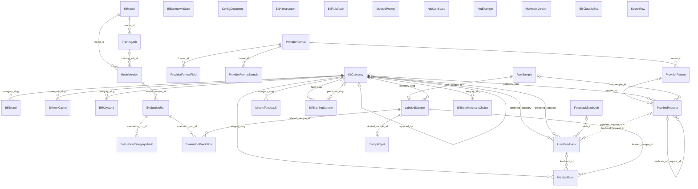

| Thực thể | Bảng | Ý nghĩa |
| --- | --- | --- |
| **BillAiInstruction** | `kb_ai_instructions` | Luật phân loại món cho Gemini; đúng một dòng `is_active`. |
| **BillBrand** | `kb_brands` | Thương hiệu / cửa hàng → danh mục, dùng phân loại hóa đơn. |
| **BillClassifyStat** | `ops_usage_daily` | Bộ đếm theo ngày (khóa `day` + `metric`); chỉ số đếm, không dữ liệu người dùng. |
| **BillItemCache** | `kb_item_categories` | Bộ nhớ chung: tên món → danh mục (câu trả lời của Gemini), không có cột người dùng. |
| **BillKeyword** | `kb_keywords` | Từ khóa → danh mục (có độ ưu tiên). |
| **BillRuleAudit** | `kb_audit_log` | Nhật ký thay đổi luật qua API quản trị (trước / sau, `actor_hash`), dùng để hoàn tác. |
| **BillTrainingSample** | `ml_training_samples` | Dữ liệu hóa đơn đã lọc + nhãn cuối của người dùng (chỉ khi đồng ý chia sẻ); `scan_id` là id lần quét bên backend. |
| **BillUnknownScan** | `bill_unknown_scans` | Hóa đơn của cửa hàng chưa nhận ra (chỉ khi người dùng đồng ý); được dọn khi quá hạn. |
| **BillUserMerchantChoice** | `user_merchant_memory` | Cửa hàng → danh mục người dùng đã chốt, theo `user_id_hash`. |
| **ConfigDocument** | `config_documents` | Cấu hình của ai-service (JSON) có phiên bản. |
| **EvaluationCategoryMetric** | `ml_evaluation_category_metrics` | Precision / recall / F1 theo từng nhãn của một lần đánh giá. |
| **EvaluationPrediction** | `ml_evaluation_predictions` | Dự đoán từng mẫu trong một lần đánh giá. |
| **EvaluationRun** | `ml_evaluation_runs` | Lần đánh giá một phiên bản trên một split. |
| **FeedbackBatchJob** | `ml_feedback_batches` | Lô xử lý phản hồi thành mẫu gắn nhãn. |
| **KbCategory** | `kb_categories` | Danh mục phía AI (đồng bộ từ backend); `replaced_by` khi đổi taxonomy. |
| **LabeledSample** | `ml_labeled_samples` | Mẫu đã gắn nhãn (tài chính?, loại, số tiền, cửa hàng, danh mục); `is_gold` cho bộ chuẩn. |
| **MethodPrompt** | `kb_method_prompts` | Prompt đề xuất phương pháp tài chính, có phiên bản; một bản `is_active`. |
| **MlItemFeedback** | `ml_item_feedback` | Danh mục người dùng chốt cho một tên món (khóa `item_key` + `user_id_hash`). |
| **MlLabelEvent** | `ml_label_events` | Lịch sử từng lần gắn / sửa nhãn. |
| **MlModel** | `ml_models` | Danh mục các model (mã, loại, nhà cung cấp). |
| **ModelVersion** | `ml_model_versions` | Phiên bản model: đường dẫn artifact, trạng thái (candidate / active …), chỉ số. |
| **NluCandidate** | `nlu_candidates` | Câu người dùng mà NLU chưa chắc, chờ duyệt để thành ví dụ. |
| **NluExample** | `nlu_examples` | Câu ví dụ huấn luyện NLU (intent, split). |
| **NluModelVersion** | `nlu_model_versions` | Phiên bản model Rasa và kết quả đánh giá. |
| **PipelineRequest** | `ops_analyze_log` | Mỗi lần gọi `/analyze`: kết quả từng bước, độ tin cậy, phiên bản model / cấu hình. `backend_request_id` là id `notification_logs` bên backend. |
| **ProviderFormat** | `kb_provider_formats` | Định dạng thông báo của từng ngân hàng / ví, có phiên bản và trạng thái. |
| **ProviderFormatField** | `kb_provider_format_fields` | Trường cần bóc của một định dạng (map sang trường giao dịch, chuẩn hóa, cờ nhạy cảm). |
| **ProviderFormatSample** | `kb_provider_format_samples` | Thông báo mẫu kèm kết quả mong đợi để kiểm định dạng. |
| **ProviderPattern** | `kb_provider_patterns` | Regex bóc thông báo theo định dạng (luật trích xuất). |
| **RawSample** | `ml_raw_samples` | Thông báo gốc dùng làm dữ liệu huấn luyện (có `notification_body`), theo `user_id_hash`. |
| **SampleSplit** | `ml_sample_splits` | Chia mẫu vào train / validation / test (cố định theo seed). |
| **SecretRow** | `secret_store` | Khóa bên thứ ba mã hóa AES-256-GCM (bản riêng của ai-service). |
| **TrainingJob** | `ml_training_jobs` | Lần huấn luyện: tham số, số mẫu, hash bộ dữ liệu, trạng thái. |
| **UserFeedback** | `ml_user_feedback` | Phản hồi sửa danh mục từ backend; id giao dịch chỉ lưu dạng hash. |

### 2.3 Liên kết giữa hai database (logic, không có FK)

Hai database không bao giờ JOIN với nhau. Bên AI không biết id người dùng thật: mọi liên kết đi qua giá trị backend gửi kèm trong
lời gọi API, và id người dùng luôn đã được băm SHA-256 trước khi rời backend.

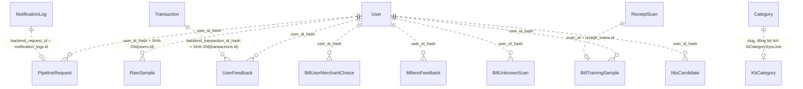

| Phía backend | Phía AI | Cách nối |
| --- | --- | --- |
| `users.id` | `*.user_id_hash` (8 bảng) | SHA-256 của id; không đảo ngược được |
| `notification_logs.id` | `ops_analyze_log.backend_request_id` (UNIQUE) | Gửi kèm `POST /api/v1/analyze`; `ml_user_feedback.pipeline_request_id` cũng mang giá trị này |
| `transactions.id` | `ml_user_feedback.backend_transaction_id_hash` | SHA-256, gửi kèm phản hồi sửa danh mục |
| `receipt_scans.id` | `ml_training_samples.scan_id` (PK) | Chỉ khi người dùng đồng ý đóng góp dữ liệu |
| `categories.slug` (danh mục hệ thống) | `kb_categories.slug` | `AiCategorySyncJob` đồng bộ mỗi giờ |
| `ai_results` (bản sao kết quả) | `ops_analyze_log` | Backend lưu lại kết quả nó nhận được; hai bản độc lập |

## 3. ERD vật lý (physical)

Mức PostgreSQL 16: cột, kiểu, NULL, mặc định, PK / FK / UK, CHECK, index — đọc thẳng từ catalog của database sau khi chạy hết migration. Mỗi nhóm nghiệp vụ có một sơ đồ Mermaid và bảng chi tiết cho từng bảng. Trong sơ đồ, `nullable` = cột cho phép NULL; `UK` = cột duy nhất một mình (UNIQUE constraint hoặc unique index không điều kiện).

### 3.1 Backend — `finmate_main`

#### 3.1.1 Người dùng, phiên đăng nhập, quyền riêng tư

```mermaid
erDiagram
    users {
        uuid id PK
        varchar(320) email UK
        text password_hash "nullable"
        varchar(200) display_name
        varchar(20) role
        boolean push_enabled
        boolean budget_alerts_enabled
        boolean is_locked
        timestamptz created_at
        timestamptz updated_at
        timestamptz deleted_at "nullable"
        varchar(255) google_id "nullable"
        bigint monthly_income_cents "nullable"
        timestamptz email_verified_at "nullable"
        timestamptz ai_consent_at "nullable"
        integer ai_consent_version "nullable"
        timestamptz terms_accepted_at "nullable"
        integer terms_version "nullable"
        timestamptz training_consent_at "nullable"
        integer training_consent_version "nullable"
        timestamptz onboarding_completed_at "nullable"
        varchar(20) onboarding_status
        timestamptz survey_ai_consent_at "nullable"
        integer survey_ai_consent_version "nullable"
        integer alert_t1_pct "nullable"
        integer alert_t2_pct "nullable"
        bigint forecast_reserve_cents "nullable"
        boolean forecast_alerts_enabled
        bigint low_balance_threshold_cents "nullable"
        smallint quiet_hours_end_minute "nullable"
        smallint quiet_hours_start_minute "nullable"
    }
    refresh_tokens {
        uuid id PK
        uuid user_id FK
        varchar(64) token_hash UK
        timestamptz expires_at
        timestamptz created_at
        timestamptz revoked_at "nullable"
        varchar(64) replaced_by_token_hash "nullable"
    }
    device_tokens {
        uuid id PK
        uuid user_id FK
        text token UK
        text platform
        timestamptz created_at
        timestamptz last_seen_at
    }
    data_deletion_requests {
        uuid id PK
        uuid user_id
        timestamptz requested_at
        timestamptz scheduled_hard_delete_at
        timestamptz processed_at "nullable"
        varchar(20) status
    }
    audit_logs {
        uuid id PK
        uuid user_id "nullable"
        varchar(100) event_type
        jsonb metadata "nullable"
        varchar(45) ip_address "nullable"
        timestamptz created_at
    }
    users ||--o{ refresh_tokens : "user_id"
    users ||--o{ device_tokens : "user_id"
    users ||--o{ budgets : "user_id"
    users o|--o{ categories : "user_id"
    users ||--o{ counterparty_category_overrides : "user_id"
    users ||--o{ daily_summaries : "user_id"
    users ||--o{ financial_accounts : "user_id"
    users ||--o{ forecast_alerts : "user_id"
    users ||--o{ method_recommendations : "user_id"
    users ||--o{ notification_logs : "user_id"
    users ||--o{ qr_transfer_intents : "user_id"
    users ||--o{ receipt_scans : "user_id"
    users ||--o{ recurring_items : "user_id"
    users ||--o{ saving_goals : "user_id"
    users ||--o{ spending_insights : "user_id"
    users ||--o{ transaction_anomalies : "user_id"
    users ||--o{ transactions : "user_id"
    users ||--o{ user_methods : "user_id"
    users ||--o{ user_survey_answers : "user_id"
    users o|..o{ audit_logs : "user_id (không FK)"
    users ||..o{ data_deletion_requests : "user_id (không FK)"
    users ||..o{ goal_contributions : "user_id (không FK)"
```

Bảng ngoài nhóm xuất hiện trong sơ đồ (chỉ để nối quan hệ, xem cột ở nhóm của chúng): `budgets`, `categories`, `counterparty_category_overrides`, `daily_summaries`, `financial_accounts`, `forecast_alerts`, `method_recommendations`, `notification_logs`, `qr_transfer_intents`, `receipt_scans`, `recurring_items`, `saving_goals`, `spending_insights`, `transaction_anomalies`, `transactions`, `user_methods`, `user_survey_answers`.

##### `users` — User

Tài khoản người dùng: đăng nhập email/Google, vai trò, khóa tài khoản, xóa mềm; các mốc đồng ý điều khoản / AI / dữ liệu huấn luyện; ngưỡng cảnh báo T1/T2; cài đặt dự báo. Các cột `push_enabled`, `budget_alerts_enabled`, `forecast_alerts_enabled` là value object `NotificationPreferences` nằm chung bảng.

| # | Cột | Kiểu | NULL | Mặc định | Khóa |
| --- | --- | --- | --- | --- | --- |
| 1 | `id` | uuid |  | `gen_random_uuid()` | PK |
| 2 | `email` | varchar(320) |  |  | UK |
| 3 | `password_hash` | text | có |  |  |
| 4 | `display_name` | varchar(200) |  |  |  |
| 5 | `role` | varchar(20) |  |  |  |
| 6 | `push_enabled` | boolean |  |  |  |
| 7 | `budget_alerts_enabled` | boolean |  |  |  |
| 8 | `is_locked` | boolean |  | `false` |  |
| 9 | `created_at` | timestamptz |  |  |  |
| 10 | `updated_at` | timestamptz |  |  |  |
| 11 | `deleted_at` | timestamptz | có |  |  |
| 12 | `google_id` | varchar(255) | có |  |  |
| 13 | `monthly_income_cents` | bigint | có |  |  |
| 14 | `email_verified_at` | timestamptz | có |  |  |
| 15 | `ai_consent_at` | timestamptz | có |  |  |
| 16 | `ai_consent_version` | integer | có |  |  |
| 17 | `terms_accepted_at` | timestamptz | có |  |  |
| 18 | `terms_version` | integer | có |  |  |
| 19 | `training_consent_at` | timestamptz | có |  |  |
| 20 | `training_consent_version` | integer | có |  |  |
| 21 | `onboarding_completed_at` | timestamptz | có |  |  |
| 22 | `onboarding_status` | varchar(20) |  | `'pending'::character varying` |  |
| 23 | `survey_ai_consent_at` | timestamptz | có |  |  |
| 24 | `survey_ai_consent_version` | integer | có |  |  |
| 25 | `alert_t1_pct` | integer | có |  |  |
| 26 | `alert_t2_pct` | integer | có |  |  |
| 27 | `forecast_reserve_cents` | bigint | có |  |  |
| 28 | `forecast_alerts_enabled` | boolean |  | `true` |  |
| 29 | `low_balance_threshold_cents` | bigint | có |  |  |
| 30 | `quiet_hours_end_minute` | smallint | có |  |  |
| 31 | `quiet_hours_start_minute` | smallint | có |  |  |

Ràng buộc:
- CHECK `chk_users_alert_thresholds`: `((alert_t1_pct IS NULL) AND (alert_t2_pct IS NULL)) OR ((alert_t1_pct IS NOT NULL) AND (alert_t2_pct IS NOT NULL) AND (alert_t1_pct >= 1) AND (alert_t1_pct < alert_t2_pct) AND (alert_t2_pct <= 99))`
- CHECK `chk_users_forecast_reserve`: `(forecast_reserve_cents IS NULL) OR (forecast_reserve_cents >= 0)`
- CHECK `chk_users_low_balance_threshold`: `(low_balance_threshold_cents IS NULL) OR (low_balance_threshold_cents >= 0)`
- CHECK `chk_users_onboarding_completed_at`: `(onboarding_status = 'pending') = (onboarding_completed_at IS NULL)`
- CHECK `chk_users_onboarding_status`: `onboarding_status IN ('pending', 'completed', 'skipped')`
- CHECK `chk_users_quiet_hours`: `((quiet_hours_start_minute IS NULL) AND (quiet_hours_end_minute IS NULL)) OR (((quiet_hours_start_minute >= 0) AND (quiet_hours_start_minute <= 1439)) AND ((quiet_hours_end_minute >= 0) AND (quiet_hours_end_minute <= 1439)))`
- CHECK `chk_users_role`: `role IN ('user', 'admin')`
- CHECK `chk_users_survey_ai_consent`: `(survey_ai_consent_version IS NULL) = (survey_ai_consent_at IS NULL)`

Index:
- UNIQUE `uq_users_email` `(email)`
- UNIQUE `uq_users_google_id` `(google_id) WHERE google_id IS NOT NULL`

##### `refresh_tokens` — RefreshToken

Refresh token, chỉ lưu SHA-256; xoay vòng (`replaced_by_token_hash`) và thu hồi.

| # | Cột | Kiểu | NULL | Mặc định | Khóa |
| --- | --- | --- | --- | --- | --- |
| 1 | `id` | uuid |  | `gen_random_uuid()` | PK |
| 2 | `user_id` | uuid |  |  | FK → `users.id` |
| 3 | `token_hash` | varchar(64) |  |  | UK |
| 4 | `expires_at` | timestamptz |  |  |  |
| 5 | `created_at` | timestamptz |  |  |  |
| 6 | `revoked_at` | timestamptz | có |  |  |
| 7 | `replaced_by_token_hash` | varchar(64) | có |  |  |

Khóa ngoại:
- `user_id` → `users(id)` ON DELETE CASCADE

Index:
- `idx_refresh_tokens_user_id` `(user_id)`
- UNIQUE `uq_refresh_tokens_token_hash` `(token_hash)`

##### `device_tokens` — DeviceToken

Token FCM của thiết bị. Một token thuộc đúng một user (UNIQUE trên `token`).

| # | Cột | Kiểu | NULL | Mặc định | Khóa |
| --- | --- | --- | --- | --- | --- |
| 1 | `id` | uuid |  | `gen_random_uuid()` | PK |
| 2 | `user_id` | uuid |  |  | FK → `users.id` |
| 3 | `token` | text |  |  | UK |
| 4 | `platform` | text |  |  |  |
| 5 | `created_at` | timestamptz |  |  |  |
| 6 | `last_seen_at` | timestamptz |  |  |  |

Khóa ngoại:
- `user_id` → `users(id)` ON DELETE CASCADE

Ràng buộc:
- CHECK `chk_device_tokens_platform`: `platform IN ('android', 'ios', 'web')`

Index:
- `idx_device_tokens_user_id` `(user_id)`
- UNIQUE `uq_device_tokens_token` `(token)`

##### `data_deletion_requests` — DataDeletionRequest

Yêu cầu xóa tài khoản; `DataDeletionJob` xóa cứng khi tới hạn. Không có FK tới `users` để bản ghi còn lại sau khi xóa cứng.

| # | Cột | Kiểu | NULL | Mặc định | Khóa |
| --- | --- | --- | --- | --- | --- |
| 1 | `id` | uuid |  | `gen_random_uuid()` | PK |
| 2 | `user_id` | uuid |  |  |  |
| 3 | `requested_at` | timestamptz |  |  |  |
| 4 | `scheduled_hard_delete_at` | timestamptz |  |  |  |
| 5 | `processed_at` | timestamptz | có |  |  |
| 6 | `status` | varchar(20) |  |  |  |

Ràng buộc:
- CHECK `chk_data_deletion_requests_status`: `status IN ('pending', 'processed', 'cancelled')`

Index:
- `idx_data_deletion_requests_requested_at_id` `(requested_at, id)`
- `idx_data_deletion_requests_scheduled_hard_delete_at` `(scheduled_hard_delete_at)`

##### `audit_logs` — AuditLog

Nhật ký sự kiện bảo mật và thao tác quản trị (hằng `AuditEvents`). Không có FK tới `users` để nhật ký còn lại sau khi xóa cứng.

| # | Cột | Kiểu | NULL | Mặc định | Khóa |
| --- | --- | --- | --- | --- | --- |
| 1 | `id` | uuid |  | `gen_random_uuid()` | PK |
| 2 | `user_id` | uuid | có |  |  |
| 3 | `event_type` | varchar(100) |  |  |  |
| 4 | `metadata` | jsonb | có |  |  |
| 5 | `ip_address` | varchar(45) | có |  |  |
| 6 | `created_at` | timestamptz |  |  |  |

Index:
- `idx_audit_logs_created_at` `(created_at)`
- `idx_audit_logs_user_id` `(user_id)`

#### 3.1.2 Ví, danh mục, giao dịch, thông báo ngân hàng

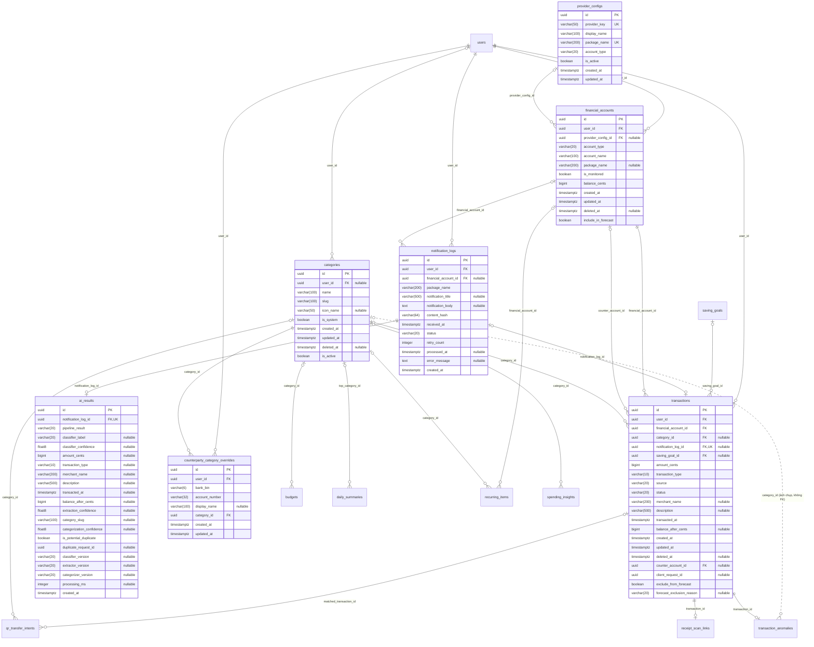

Bảng ngoài nhóm xuất hiện trong sơ đồ (chỉ để nối quan hệ, xem cột ở nhóm của chúng): `budgets`, `daily_summaries`, `qr_transfer_intents`, `receipt_scan_links`, `recurring_items`, `saving_goals`, `spending_insights`, `transaction_anomalies`, `users`.

##### `provider_configs` — ProviderConfig

Ngân hàng / ví điện tử được hỗ trợ (package Android). `provider_key` bất biến; tắt bằng `is_active`, không xóa.

| # | Cột | Kiểu | NULL | Mặc định | Khóa |
| --- | --- | --- | --- | --- | --- |
| 1 | `id` | uuid |  | `gen_random_uuid()` | PK |
| 2 | `provider_key` | varchar(50) |  |  | UK |
| 3 | `display_name` | varchar(100) |  |  |  |
| 4 | `package_name` | varchar(200) |  |  | UK |
| 5 | `account_type` | varchar(20) |  |  |  |
| 6 | `is_active` | boolean |  | `true` |  |
| 7 | `created_at` | timestamptz |  |  |  |
| 8 | `updated_at` | timestamptz |  |  |  |

Ràng buộc:
- CHECK `chk_provider_configs_account_type`: `account_type IN ('bank', 'ewallet')`

Index:
- UNIQUE `uq_provider_configs_package_name` `(package_name)`
- UNIQUE `uq_provider_configs_provider_key` `(provider_key)`

##### `financial_accounts` — FinancialAccount

Ví của người dùng (ngân hàng, ví điện tử, tiền mặt); `balance_cents` là số dư tính sẵn; `include_in_forecast` cho dự báo.

| # | Cột | Kiểu | NULL | Mặc định | Khóa |
| --- | --- | --- | --- | --- | --- |
| 1 | `id` | uuid |  | `gen_random_uuid()` | PK |
| 2 | `user_id` | uuid |  |  | FK → `users.id` |
| 3 | `provider_config_id` | uuid | có |  | FK → `provider_configs.id` |
| 4 | `account_type` | varchar(20) |  |  |  |
| 5 | `account_name` | varchar(100) |  |  |  |
| 6 | `package_name` | varchar(200) | có |  |  |
| 7 | `is_monitored` | boolean |  | `true` |  |
| 8 | `balance_cents` | bigint |  | `0` |  |
| 9 | `created_at` | timestamptz |  |  |  |
| 10 | `updated_at` | timestamptz |  |  |  |
| 11 | `deleted_at` | timestamptz | có |  |  |
| 12 | `include_in_forecast` | boolean |  | `true` |  |

Khóa ngoại:
- `provider_config_id` → `provider_configs(id)` ON DELETE RESTRICT
- `user_id` → `users(id)` ON DELETE CASCADE

Ràng buộc:
- CHECK `chk_financial_accounts_account_type`: `account_type IN ('bank', 'ewallet', 'cash')`

Index:
- `IX_financial_accounts_provider_config_id` `(provider_config_id)`
- `idx_financial_accounts_user_id` `(user_id)`
- UNIQUE `uq_financial_accounts_user_package` `(user_id, package_name) WHERE (package_name IS NOT NULL) AND (deleted_at IS NULL)`

##### `categories` — Category

Danh mục: hệ thống (`user_id` NULL, `slug` bất biến) hoặc riêng của người dùng.

| # | Cột | Kiểu | NULL | Mặc định | Khóa |
| --- | --- | --- | --- | --- | --- |
| 1 | `id` | uuid |  | `gen_random_uuid()` | PK |
| 2 | `user_id` | uuid | có |  | FK → `users.id` |
| 3 | `name` | varchar(100) |  |  |  |
| 4 | `slug` | varchar(100) |  |  |  |
| 5 | `icon_name` | varchar(50) | có |  |  |
| 6 | `is_system` | boolean |  | `false` |  |
| 7 | `created_at` | timestamptz |  |  |  |
| 8 | `updated_at` | timestamptz |  |  |  |
| 9 | `deleted_at` | timestamptz | có |  |  |
| 10 | `is_active` | boolean |  | `true` |  |

Khóa ngoại:
- `user_id` → `users(id)` ON DELETE CASCADE

Index:
- UNIQUE `uq_categories_system_slug` `(slug) WHERE (user_id IS NULL) AND (deleted_at IS NULL)`
- UNIQUE `uq_categories_user_slug` `(user_id, slug) WHERE (user_id IS NOT NULL) AND (deleted_at IS NULL)`

##### `transactions` — Transaction

Giao dịch thu / chi / chuyển khoản giữa hai ví (`counter_account_id`). Nguồn: thông báo, nhập tay, giọng nói, hóa đơn, chat…; trạng thái nháp / đã xác nhận; `client_request_id` chống gửi lại; cờ loại khỏi dữ liệu dự báo.

| # | Cột | Kiểu | NULL | Mặc định | Khóa |
| --- | --- | --- | --- | --- | --- |
| 1 | `id` | uuid |  | `gen_random_uuid()` | PK |
| 2 | `user_id` | uuid |  |  | FK → `users.id` |
| 3 | `financial_account_id` | uuid |  |  | FK → `financial_accounts.id` |
| 4 | `category_id` | uuid | có |  | FK → `categories.id` |
| 5 | `notification_log_id` | uuid | có |  | FK → `notification_logs.id` · UK |
| 6 | `saving_goal_id` | uuid | có |  | FK → `saving_goals.id` |
| 7 | `amount_cents` | bigint |  |  |  |
| 8 | `transaction_type` | varchar(10) |  |  |  |
| 9 | `source` | varchar(20) |  |  |  |
| 10 | `status` | varchar(20) |  |  |  |
| 11 | `merchant_name` | varchar(200) | có |  |  |
| 12 | `description` | varchar(500) | có |  |  |
| 13 | `transacted_at` | timestamptz |  |  |  |
| 14 | `balance_after_cents` | bigint | có |  |  |
| 15 | `created_at` | timestamptz |  |  |  |
| 16 | `updated_at` | timestamptz |  |  |  |
| 17 | `deleted_at` | timestamptz | có |  |  |
| 18 | `counter_account_id` | uuid | có |  | FK → `financial_accounts.id` |
| 19 | `client_request_id` | uuid | có |  |  |
| 20 | `exclude_from_forecast` | boolean |  | `false` |  |
| 21 | `forecast_exclusion_reason` | varchar(20) | có |  |  |

Khóa ngoại:
- `category_id` → `categories(id)` ON DELETE SET NULL
- `counter_account_id` → `financial_accounts(id)` ON DELETE RESTRICT
- `financial_account_id` → `financial_accounts(id)` ON DELETE RESTRICT
- `notification_log_id` → `notification_logs(id)` ON DELETE SET NULL
- `saving_goal_id` → `saving_goals(id)` ON DELETE SET NULL
- `user_id` → `users(id)` ON DELETE CASCADE

Ràng buộc:
- CHECK `chk_transactions_forecast_exclusion`: `((exclude_from_forecast = false) AND (forecast_exclusion_reason IS NULL)) OR ((exclude_from_forecast = true) AND forecast_exclusion_reason IN ('one_off', 'user_marked'))`
- CHECK `chk_transactions_source`: `source IN ('notification', 'manual', 'voice', 'receipt')`
- CHECK `chk_transactions_status`: `status IN ('draft', 'confirmed')`
- CHECK `chk_transactions_transaction_type`: `transaction_type IN ('debit', 'credit', 'transfer')`
- CHECK `chk_transactions_transfer_shape`: `((transaction_type = 'transfer') AND (counter_account_id IS NOT NULL) AND (counter_account_id <> financial_account_id) AND (category_id IS NULL)) OR ((transaction_type <> 'transfer') AND (counter_account_id IS NULL))`

Index:
- UNIQUE `IX_transactions_notification_log_id` `(notification_log_id)`
- `IX_transactions_saving_goal_id` `(saving_goal_id)`
- `idx_transactions_category_id` `(category_id)`
- `idx_transactions_counter_account_id` `(counter_account_id)`
- `idx_transactions_financial_account_id` `(financial_account_id)`
- `idx_transactions_user_transacted_at` `(user_id, transacted_at, id)`
- UNIQUE `uq_transactions_user_client_request_id` `(user_id, client_request_id) WHERE client_request_id IS NOT NULL`

##### `notification_logs` — NotificationLog

Thông báo ngân hàng nhận từ app: nội dung gốc, `content_hash` chống trùng, trạng thái xử lý, số lần thử lại.

| # | Cột | Kiểu | NULL | Mặc định | Khóa |
| --- | --- | --- | --- | --- | --- |
| 1 | `id` | uuid |  | `gen_random_uuid()` | PK |
| 2 | `user_id` | uuid |  |  | FK → `users.id` |
| 3 | `financial_account_id` | uuid | có |  | FK → `financial_accounts.id` |
| 4 | `package_name` | varchar(200) |  |  |  |
| 5 | `notification_title` | varchar(500) | có |  |  |
| 6 | `notification_body` | text | có |  |  |
| 7 | `content_hash` | varchar(64) |  |  |  |
| 8 | `received_at` | timestamptz |  |  |  |
| 9 | `status` | varchar(20) |  |  |  |
| 10 | `retry_count` | integer |  | `0` |  |
| 11 | `processed_at` | timestamptz | có |  |  |
| 12 | `error_message` | text | có |  |  |
| 13 | `created_at` | timestamptz |  |  |  |

Khóa ngoại:
- `financial_account_id` → `financial_accounts(id)` ON DELETE SET NULL
- `user_id` → `users(id)` ON DELETE CASCADE

Ràng buộc:
- CHECK `chk_notification_logs_status`: `status IN ('pending', 'processed', 'failed', 'ignored')`

Index:
- `IX_notification_logs_financial_account_id` `(financial_account_id)`
- `idx_notification_logs_status_retry_count` `(status, retry_count)`
- `idx_notification_logs_user_content_hash` `(user_id, content_hash)`

##### `ai_results` — AiResult

Kết quả pipeline AI cho một thông báo (1–1 với `notification_logs`): nhãn, số tiền, độ tin cậy từng bước, phiên bản model.

| # | Cột | Kiểu | NULL | Mặc định | Khóa |
| --- | --- | --- | --- | --- | --- |
| 1 | `id` | uuid |  | `gen_random_uuid()` | PK |
| 2 | `notification_log_id` | uuid |  |  | FK → `notification_logs.id` · UK |
| 3 | `pipeline_result` | varchar(20) |  |  |  |
| 4 | `classifier_label` | varchar(20) | có |  |  |
| 5 | `classifier_confidence` | float8 | có |  |  |
| 6 | `amount_cents` | bigint | có |  |  |
| 7 | `transaction_type` | varchar(10) | có |  |  |
| 8 | `merchant_name` | varchar(200) | có |  |  |
| 9 | `description` | varchar(500) | có |  |  |
| 10 | `transacted_at` | timestamptz | có |  |  |
| 11 | `balance_after_cents` | bigint | có |  |  |
| 12 | `extraction_confidence` | float8 | có |  |  |
| 13 | `category_slug` | varchar(100) | có |  |  |
| 14 | `categorization_confidence` | float8 | có |  |  |
| 15 | `is_potential_duplicate` | boolean |  | `false` |  |
| 16 | `duplicate_request_id` | uuid | có |  |  |
| 17 | `classifier_version` | varchar(20) | có |  |  |
| 18 | `extractor_version` | varchar(20) | có |  |  |
| 19 | `categorizer_version` | varchar(20) | có |  |  |
| 20 | `processing_ms` | integer | có |  |  |
| 21 | `created_at` | timestamptz |  |  |  |

Khóa ngoại:
- `notification_log_id` → `notification_logs(id)` ON DELETE CASCADE

Ràng buộc:
- CHECK `chk_ai_results_pipeline_result`: `pipeline_result IN ('financial', 'non_financial', 'uncertain', 'extraction_failed', 'error')`

Index:
- UNIQUE `uq_ai_results_notification_log_id` `(notification_log_id)`

##### `counterparty_category_overrides` — CounterpartyCategoryOverride

Danh mục người dùng chốt cho một người nhận (theo BIN + số tài khoản).

| # | Cột | Kiểu | NULL | Mặc định | Khóa |
| --- | --- | --- | --- | --- | --- |
| 1 | `id` | uuid |  | `gen_random_uuid()` | PK |
| 2 | `user_id` | uuid |  |  | FK → `users.id` |
| 3 | `bank_bin` | varchar(6) |  |  |  |
| 4 | `account_number` | varchar(32) |  |  |  |
| 5 | `display_name` | varchar(100) | có |  |  |
| 6 | `category_id` | uuid |  |  | FK → `categories.id` |
| 7 | `created_at` | timestamptz |  |  |  |
| 8 | `updated_at` | timestamptz |  |  |  |

Khóa ngoại:
- `category_id` → `categories(id)` ON DELETE CASCADE
- `user_id` → `users(id)` ON DELETE CASCADE

Ràng buộc:
- CHECK `chk_counterparty_category_overrides_bin`: `bank_bin ~ '^[0-9]{6}$'`

Index:
- `IX_counterparty_category_overrides_category_id` `(category_id)`
- UNIQUE `uq_counterparty_category_overrides_user_account` `(user_id, bank_bin, account_number)`

#### 3.1.3 Hóa đơn và chuyển khoản QR

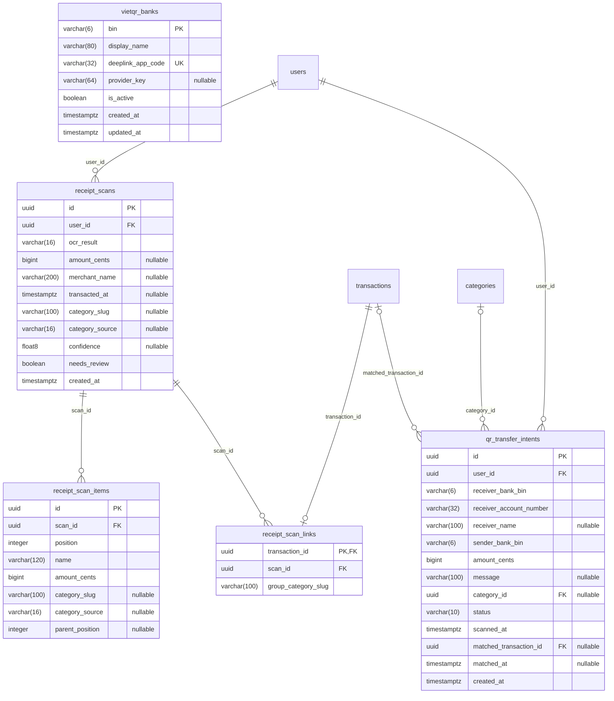

Bảng ngoài nhóm xuất hiện trong sơ đồ (chỉ để nối quan hệ, xem cột ở nhóm của chúng): `categories`, `transactions`, `users`.

##### `receipt_scans` — ReceiptScan

Một lần quét hóa đơn: kết quả OCR, cửa hàng, tổng tiền, danh mục đề xuất. Không lưu ảnh.

| # | Cột | Kiểu | NULL | Mặc định | Khóa |
| --- | --- | --- | --- | --- | --- |
| 1 | `id` | uuid |  | `gen_random_uuid()` | PK |
| 2 | `user_id` | uuid |  |  | FK → `users.id` |
| 3 | `ocr_result` | varchar(16) |  |  |  |
| 4 | `amount_cents` | bigint | có |  |  |
| 5 | `merchant_name` | varchar(200) | có |  |  |
| 6 | `transacted_at` | timestamptz | có |  |  |
| 7 | `category_slug` | varchar(100) | có |  |  |
| 8 | `category_source` | varchar(16) | có |  |  |
| 9 | `confidence` | float8 | có |  |  |
| 10 | `needs_review` | boolean |  | `false` |  |
| 11 | `created_at` | timestamptz |  |  |  |

Khóa ngoại:
- `user_id` → `users(id)` ON DELETE CASCADE

Ràng buộc:
- CHECK `chk_receipt_scans_amount_positive`: `(amount_cents IS NULL) OR (amount_cents > 0)`
- CHECK `chk_receipt_scans_ocr_result`: `ocr_result IN ('success', 'no_amount', 'unreadable')`

Index:
- `idx_receipt_scans_user_created` `(user_id, created_at DESC)`

##### `receipt_scan_items` — ReceiptScanItem

Từng món trên hóa đơn (`parent_position` cho món con).

| # | Cột | Kiểu | NULL | Mặc định | Khóa |
| --- | --- | --- | --- | --- | --- |
| 1 | `id` | uuid |  | `gen_random_uuid()` | PK |
| 2 | `scan_id` | uuid |  |  | FK → `receipt_scans.id` |
| 3 | `position` | integer |  |  |  |
| 4 | `name` | varchar(120) |  |  |  |
| 5 | `amount_cents` | bigint |  |  |  |
| 6 | `category_slug` | varchar(100) | có |  |  |
| 7 | `category_source` | varchar(16) | có |  |  |
| 8 | `parent_position` | integer | có |  |  |

Khóa ngoại:
- `scan_id` → `receipt_scans(id)` ON DELETE CASCADE

Index:
- UNIQUE `uq_receipt_scan_items_scan_position` `(scan_id, "position")`

##### `receipt_scan_links` — ReceiptScanLink

Nối lần quét với giao dịch đã tạo (khi tách hóa đơn theo nhóm món, một lần quét sinh nhiều giao dịch).

| # | Cột | Kiểu | NULL | Mặc định | Khóa |
| --- | --- | --- | --- | --- | --- |
| 1 | `transaction_id` | uuid |  |  | PK · FK → `transactions.id` |
| 2 | `scan_id` | uuid |  |  | FK → `receipt_scans.id` |
| 3 | `group_category_slug` | varchar(100) |  |  |  |

Khóa ngoại:
- `scan_id` → `receipt_scans(id)` ON DELETE CASCADE
- `transaction_id` → `transactions(id)` ON DELETE CASCADE

Index:
- UNIQUE `uq_receipt_scan_links_scan_group` `(scan_id, group_category_slug)`

##### `qr_transfer_intents` — QrTransferIntent

Ý định chuyển khoản khi quét VietQR; được khớp với giao dịch từ thông báo ngân hàng (`matched_transaction_id`).

| # | Cột | Kiểu | NULL | Mặc định | Khóa |
| --- | --- | --- | --- | --- | --- |
| 1 | `id` | uuid |  | `gen_random_uuid()` | PK |
| 2 | `user_id` | uuid |  |  | FK → `users.id` |
| 3 | `receiver_bank_bin` | varchar(6) |  |  |  |
| 4 | `receiver_account_number` | varchar(32) |  |  |  |
| 5 | `receiver_name` | varchar(100) | có |  |  |
| 6 | `sender_bank_bin` | varchar(6) |  |  |  |
| 7 | `amount_cents` | bigint |  |  |  |
| 8 | `message` | varchar(100) | có |  |  |
| 9 | `category_id` | uuid | có |  | FK → `categories.id` |
| 10 | `status` | varchar(10) |  |  |  |
| 11 | `scanned_at` | timestamptz |  |  |  |
| 12 | `matched_transaction_id` | uuid | có |  | FK → `transactions.id` |
| 13 | `matched_at` | timestamptz | có |  |  |
| 14 | `created_at` | timestamptz |  |  |  |

Khóa ngoại:
- `category_id` → `categories(id)` ON DELETE SET NULL
- `matched_transaction_id` → `transactions(id)` ON DELETE SET NULL
- `user_id` → `users(id)` ON DELETE CASCADE

Ràng buộc:
- CHECK `chk_qr_transfer_intents_amount`: `amount_cents > 0`
- CHECK `chk_qr_transfer_intents_bins`: `(receiver_bank_bin ~ '^[0-9]{6}$') AND (sender_bank_bin ~ '^[0-9]{6}$')`
- CHECK `chk_qr_transfer_intents_status`: `status IN ('pending', 'matched', 'cancelled')`

Index:
- `IX_qr_transfer_intents_category_id` `(category_id)`
- `ix_qr_transfer_intents_matched_transaction` `(matched_transaction_id)`
- `ix_qr_transfer_intents_pending_match` `(user_id, sender_bank_bin, amount_cents) WHERE status = 'pending'`
- `ix_qr_transfer_intents_user_scanned` `(user_id, scanned_at DESC)`

##### `vietqr_banks` — VietQrBank

Danh bạ ngân hàng VietQR, khóa tự nhiên là BIN 6 số.

| # | Cột | Kiểu | NULL | Mặc định | Khóa |
| --- | --- | --- | --- | --- | --- |
| 1 | `bin` | varchar(6) |  |  | PK |
| 2 | `display_name` | varchar(80) |  |  |  |
| 3 | `deeplink_app_code` | varchar(32) |  |  | UK |
| 4 | `provider_key` | varchar(64) | có |  |  |
| 5 | `is_active` | boolean |  | `true` |  |
| 6 | `created_at` | timestamptz |  |  |  |
| 7 | `updated_at` | timestamptz |  |  |  |

Ràng buộc:
- CHECK `chk_vietqr_banks_bin`: `bin ~ '^[0-9]{6}$'`

Index:
- `ix_vietqr_banks_provider_key` `(provider_key)`
- UNIQUE `uq_vietqr_banks_app_code` `(deeplink_app_code)`

#### 3.1.4 Ngân sách và mục tiêu tiết kiệm

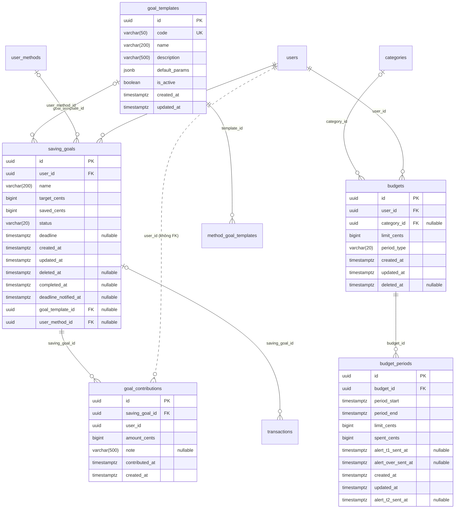

Bảng ngoài nhóm xuất hiện trong sơ đồ (chỉ để nối quan hệ, xem cột ở nhóm của chúng): `categories`, `method_goal_templates`, `transactions`, `user_methods`, `users`.

##### `budgets` — Budget

Ngân sách tháng: tổng (`category_id` NULL) hoặc theo danh mục; `limit_cents` là hạn mức áp cho các kỳ được tạo về sau.

| # | Cột | Kiểu | NULL | Mặc định | Khóa |
| --- | --- | --- | --- | --- | --- |
| 1 | `id` | uuid |  | `gen_random_uuid()` | PK |
| 2 | `user_id` | uuid |  |  | FK → `users.id` |
| 3 | `category_id` | uuid | có |  | FK → `categories.id` |
| 4 | `limit_cents` | bigint |  |  |  |
| 5 | `period_type` | varchar(20) |  |  |  |
| 6 | `created_at` | timestamptz |  |  |  |
| 7 | `updated_at` | timestamptz |  |  |  |
| 8 | `deleted_at` | timestamptz | có |  |  |

Khóa ngoại:
- `category_id` → `categories(id)` ON DELETE CASCADE
- `user_id` → `users(id)` ON DELETE CASCADE

Ràng buộc:
- CHECK `chk_budgets_limit_cents`: `limit_cents > 0`
- CHECK `chk_budgets_period_type`: `period_type = 'monthly'`

Index:
- `IX_budgets_category_id` `(category_id)`
- UNIQUE `uq_budgets_user_category` `(user_id, category_id, period_type) WHERE (category_id IS NOT NULL) AND (deleted_at IS NULL)`
- UNIQUE `uq_budgets_user_total` `(user_id, period_type) WHERE (category_id IS NULL) AND (deleted_at IS NULL)`

##### `budget_periods` — BudgetPeriod

Một kỳ (tháng) của ngân sách: snapshot hạn mức, đã chi (tính sẵn), mốc đã gửi cảnh báo T1 / T2 / vượt.

| # | Cột | Kiểu | NULL | Mặc định | Khóa |
| --- | --- | --- | --- | --- | --- |
| 1 | `id` | uuid |  | `gen_random_uuid()` | PK |
| 2 | `budget_id` | uuid |  |  | FK → `budgets.id` |
| 3 | `period_start` | timestamptz |  |  |  |
| 4 | `period_end` | timestamptz |  |  |  |
| 5 | `limit_cents` | bigint |  |  |  |
| 6 | `spent_cents` | bigint |  | `0` |  |
| 7 | `alert_t1_sent_at` | timestamptz | có |  |  |
| 8 | `alert_over_sent_at` | timestamptz | có |  |  |
| 9 | `created_at` | timestamptz |  |  |  |
| 10 | `updated_at` | timestamptz |  |  |  |
| 11 | `alert_t2_sent_at` | timestamptz | có |  |  |

Khóa ngoại:
- `budget_id` → `budgets(id)` ON DELETE CASCADE

Index:
- `idx_budget_periods_period_end` `(period_end)`
- UNIQUE `uq_budget_periods_budget_start` `(budget_id, period_start)`

##### `saving_goals` — SavingGoal

Mục tiêu tiết kiệm: số tiền cần, đã góp (tính sẵn), hạn chót, trạng thái; có thể tạo từ mẫu / theo phương pháp.

| # | Cột | Kiểu | NULL | Mặc định | Khóa |
| --- | --- | --- | --- | --- | --- |
| 1 | `id` | uuid |  | `gen_random_uuid()` | PK |
| 2 | `user_id` | uuid |  |  | FK → `users.id` |
| 3 | `name` | varchar(200) |  |  |  |
| 4 | `target_cents` | bigint |  |  |  |
| 5 | `saved_cents` | bigint |  | `0` |  |
| 6 | `status` | varchar(20) |  | `'active'::character varying` |  |
| 7 | `deadline` | timestamptz | có |  |  |
| 8 | `created_at` | timestamptz |  |  |  |
| 9 | `updated_at` | timestamptz |  |  |  |
| 10 | `deleted_at` | timestamptz | có |  |  |
| 11 | `completed_at` | timestamptz | có |  |  |
| 12 | `deadline_notified_at` | timestamptz | có |  |  |
| 13 | `goal_template_id` | uuid | có |  | FK → `goal_templates.id` |
| 14 | `user_method_id` | uuid | có |  | FK → `user_methods.id` |

Khóa ngoại:
- `goal_template_id` → `goal_templates(id)` ON DELETE SET NULL
- `user_method_id` → `user_methods(id)` ON DELETE SET NULL
- `user_id` → `users(id)` ON DELETE CASCADE

Ràng buộc:
- CHECK `chk_saving_goals_status`: `status IN ('active', 'completed', 'cancelled')`
- CHECK `chk_saving_goals_target_cents`: `target_cents > 0`

Index:
- `IX_saving_goals_goal_template_id` `(goal_template_id)`
- `IX_saving_goals_user_method_id` `(user_method_id)`
- `idx_saving_goals_user_id` `(user_id)`

##### `goal_contributions` — GoalContribution

Khoản góp vào mục tiêu. `user_id` lặp lại để lọc theo người dùng (không có FK riêng; xóa theo mục tiêu).

| # | Cột | Kiểu | NULL | Mặc định | Khóa |
| --- | --- | --- | --- | --- | --- |
| 1 | `id` | uuid |  | `gen_random_uuid()` | PK |
| 2 | `saving_goal_id` | uuid |  |  | FK → `saving_goals.id` |
| 3 | `user_id` | uuid |  |  |  |
| 4 | `amount_cents` | bigint |  |  |  |
| 5 | `note` | varchar(500) | có |  |  |
| 6 | `contributed_at` | timestamptz |  |  |  |
| 7 | `created_at` | timestamptz |  |  |  |

Khóa ngoại:
- `saving_goal_id` → `saving_goals(id)` ON DELETE CASCADE

Ràng buộc:
- CHECK `chk_goal_contributions_amount_cents`: `amount_cents > 0`

Index:
- `idx_goal_contributions_goal_contributed_at` `(saving_goal_id, contributed_at)`

##### `goal_templates` — GoalTemplate

Mẫu mục tiêu do quản trị viên quản lý.

| # | Cột | Kiểu | NULL | Mặc định | Khóa |
| --- | --- | --- | --- | --- | --- |
| 1 | `id` | uuid |  | `gen_random_uuid()` | PK |
| 2 | `code` | varchar(50) |  |  | UK |
| 3 | `name` | varchar(200) |  |  |  |
| 4 | `description` | varchar(500) |  |  |  |
| 5 | `default_params` | jsonb |  | `'{}'::jsonb` |  |
| 6 | `is_active` | boolean |  | `true` |  |
| 7 | `created_at` | timestamptz |  |  |  |
| 8 | `updated_at` | timestamptz |  |  |  |

Ràng buộc:
- CHECK `chk_goal_templates_default_params`: `jsonb_typeof(default_params) = 'object'`

Index:
- UNIQUE `uq_goal_templates_code` `(code)`

#### 3.1.5 Phương pháp tài chính và khảo sát

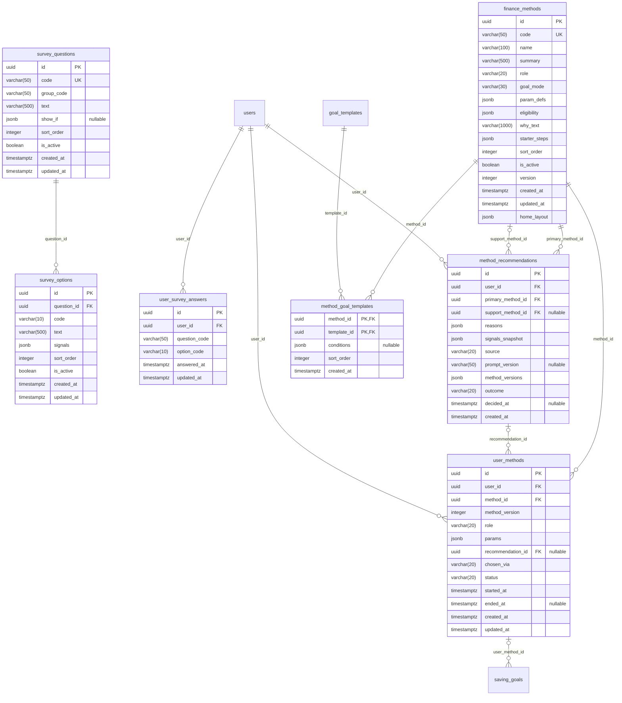

Bảng ngoài nhóm xuất hiện trong sơ đồ (chỉ để nối quan hệ, xem cột ở nhóm của chúng): `goal_templates`, `saving_goals`, `users`.

##### `finance_methods` — FinanceMethod

Phương pháp quản lý tài chính (13 cách): tham số, điều kiện phù hợp, bố cục màn hình chính, phiên bản.

| # | Cột | Kiểu | NULL | Mặc định | Khóa |
| --- | --- | --- | --- | --- | --- |
| 1 | `id` | uuid |  | `gen_random_uuid()` | PK |
| 2 | `code` | varchar(50) |  |  | UK |
| 3 | `name` | varchar(100) |  |  |  |
| 4 | `summary` | varchar(500) |  |  |  |
| 5 | `role` | varchar(20) |  |  |  |
| 6 | `goal_mode` | varchar(30) |  |  |  |
| 7 | `param_defs` | jsonb |  | `'[]'::jsonb` |  |
| 8 | `eligibility` | jsonb |  | `'{}'::jsonb` |  |
| 9 | `why_text` | varchar(1000) |  |  |  |
| 10 | `starter_steps` | jsonb |  | `'[]'::jsonb` |  |
| 11 | `sort_order` | integer |  | `0` |  |
| 12 | `is_active` | boolean |  | `true` |  |
| 13 | `version` | integer |  | `1` |  |
| 14 | `created_at` | timestamptz |  |  |  |
| 15 | `updated_at` | timestamptz |  |  |  |
| 16 | `home_layout` | jsonb |  | `'[]'::jsonb` |  |

Ràng buộc:
- CHECK `chk_finance_methods_eligibility`: `jsonb_typeof(eligibility) = 'object'`
- CHECK `chk_finance_methods_goal_mode`: `goal_mode IN ('reserve_first', 'envelope', 'available_to_spend', 'track_only')`
- CHECK `chk_finance_methods_home_layout`: `jsonb_typeof(home_layout) = 'array'`
- CHECK `chk_finance_methods_param_defs`: `jsonb_typeof(param_defs) = 'array'`
- CHECK `chk_finance_methods_role`: `role IN ('primary', 'supporting', 'both')`
- CHECK `chk_finance_methods_starter_steps`: `jsonb_typeof(starter_steps) = 'array'`
- CHECK `chk_finance_methods_version`: `version >= 1`

Index:
- `idx_finance_methods_active_order` `(is_active, sort_order)`
- UNIQUE `uq_finance_methods_code` `(code)`

##### `survey_questions` — SurveyQuestion

Câu hỏi khảo sát đầu vào (`show_if` để hỏi có điều kiện).

| # | Cột | Kiểu | NULL | Mặc định | Khóa |
| --- | --- | --- | --- | --- | --- |
| 1 | `id` | uuid |  | `gen_random_uuid()` | PK |
| 2 | `code` | varchar(50) |  |  | UK |
| 3 | `group_code` | varchar(50) |  |  |  |
| 4 | `text` | varchar(500) |  |  |  |
| 5 | `show_if` | jsonb | có |  |  |
| 6 | `sort_order` | integer |  | `0` |  |
| 7 | `is_active` | boolean |  | `true` |  |
| 8 | `created_at` | timestamptz |  |  |  |
| 9 | `updated_at` | timestamptz |  |  |  |

Ràng buộc:
- CHECK `chk_survey_questions_show_if`: `(show_if IS NULL) OR (jsonb_typeof(show_if) = 'object')`

Index:
- `idx_survey_questions_active_order` `(is_active, sort_order)`
- UNIQUE `uq_survey_questions_code` `(code)`

##### `survey_options` — SurveyOption

Lựa chọn của câu hỏi, kèm tín hiệu ẩn danh (`signals`).

| # | Cột | Kiểu | NULL | Mặc định | Khóa |
| --- | --- | --- | --- | --- | --- |
| 1 | `id` | uuid |  | `gen_random_uuid()` | PK |
| 2 | `question_id` | uuid |  |  | FK → `survey_questions.id` |
| 3 | `code` | varchar(10) |  |  |  |
| 4 | `text` | varchar(500) |  |  |  |
| 5 | `signals` | jsonb |  | `'{}'::jsonb` |  |
| 6 | `sort_order` | integer |  | `0` |  |
| 7 | `is_active` | boolean |  | `true` |  |
| 8 | `created_at` | timestamptz |  |  |  |
| 9 | `updated_at` | timestamptz |  |  |  |

Khóa ngoại:
- `question_id` → `survey_questions(id)` ON DELETE RESTRICT

Ràng buộc:
- CHECK `chk_survey_options_signals`: `jsonb_typeof(signals) = 'object'`

Index:
- UNIQUE `uq_survey_options_question_code` `(question_id, code)`

##### `user_survey_answers` — UserSurveyAnswer

Câu trả lời của người dùng, theo mã câu hỏi / mã lựa chọn.

| # | Cột | Kiểu | NULL | Mặc định | Khóa |
| --- | --- | --- | --- | --- | --- |
| 1 | `id` | uuid |  | `gen_random_uuid()` | PK |
| 2 | `user_id` | uuid |  |  | FK → `users.id` |
| 3 | `question_code` | varchar(50) |  |  |  |
| 4 | `option_code` | varchar(10) |  |  |  |
| 5 | `answered_at` | timestamptz |  |  |  |
| 6 | `updated_at` | timestamptz |  |  |  |

Khóa ngoại:
- `user_id` → `users(id)` ON DELETE CASCADE

Index:
- UNIQUE `uq_user_survey_answers_user_question` `(user_id, question_code)`

##### `method_recommendations` — MethodRecommendation

Một lần đề xuất phương pháp (AI hoặc luật): phương pháp chính + hỗ trợ, lý do, ảnh chụp tín hiệu.

| # | Cột | Kiểu | NULL | Mặc định | Khóa |
| --- | --- | --- | --- | --- | --- |
| 1 | `id` | uuid |  | `gen_random_uuid()` | PK |
| 2 | `user_id` | uuid |  |  | FK → `users.id` |
| 3 | `primary_method_id` | uuid |  |  | FK → `finance_methods.id` |
| 4 | `support_method_id` | uuid | có |  | FK → `finance_methods.id` |
| 5 | `reasons` | jsonb |  | `'[]'::jsonb` |  |
| 6 | `signals_snapshot` | jsonb |  | `'{}'::jsonb` |  |
| 7 | `source` | varchar(20) |  |  |  |
| 8 | `prompt_version` | varchar(50) | có |  |  |
| 9 | `method_versions` | jsonb |  | `'{}'::jsonb` |  |
| 10 | `outcome` | varchar(20) |  | `'shown'::character varying` |  |
| 11 | `decided_at` | timestamptz | có |  |  |
| 12 | `created_at` | timestamptz |  |  |  |

Khóa ngoại:
- `primary_method_id` → `finance_methods(id)` ON DELETE RESTRICT
- `support_method_id` → `finance_methods(id)` ON DELETE RESTRICT
- `user_id` → `users(id)` ON DELETE CASCADE

Ràng buộc:
- CHECK `chk_method_recommendations_decided`: `(outcome = 'shown') = (decided_at IS NULL)`
- CHECK `chk_method_recommendations_method_versions`: `jsonb_typeof(method_versions) = 'object'`
- CHECK `chk_method_recommendations_outcome`: `outcome IN ('shown', 'accepted', 'changed', 'skipped')`
- CHECK `chk_method_recommendations_prompt_version`: `(source <> 'ai') OR (prompt_version IS NOT NULL)`
- CHECK `chk_method_recommendations_reasons`: `jsonb_typeof(reasons) = 'array'`
- CHECK `chk_method_recommendations_signals_snapshot`: `jsonb_typeof(signals_snapshot) = 'object'`
- CHECK `chk_method_recommendations_source`: `source IN ('ai', 'rule_fallback')`
- CHECK `chk_method_recommendations_support_differs`: `(support_method_id IS NULL) OR (support_method_id <> primary_method_id)`

Index:
- `IX_method_recommendations_primary_method_id` `(primary_method_id)`
- `IX_method_recommendations_support_method_id` `(support_method_id)`
- `idx_method_recommendations_user_created` `(user_id, created_at DESC)`

##### `user_methods` — UserMethod

Phương pháp người dùng đang / đã dùng (vai trò chính / hỗ trợ, tham số riêng).

| # | Cột | Kiểu | NULL | Mặc định | Khóa |
| --- | --- | --- | --- | --- | --- |
| 1 | `id` | uuid |  | `gen_random_uuid()` | PK |
| 2 | `user_id` | uuid |  |  | FK → `users.id` |
| 3 | `method_id` | uuid |  |  | FK → `finance_methods.id` |
| 4 | `method_version` | integer |  |  |  |
| 5 | `role` | varchar(20) |  |  |  |
| 6 | `params` | jsonb |  | `'{}'::jsonb` |  |
| 7 | `recommendation_id` | uuid | có |  | FK → `method_recommendations.id` |
| 8 | `chosen_via` | varchar(20) |  |  |  |
| 9 | `status` | varchar(20) |  | `'active'::character varying` |  |
| 10 | `started_at` | timestamptz |  |  |  |
| 11 | `ended_at` | timestamptz | có |  |  |
| 12 | `created_at` | timestamptz |  |  |  |
| 13 | `updated_at` | timestamptz |  |  |  |

Khóa ngoại:
- `method_id` → `finance_methods(id)` ON DELETE RESTRICT
- `recommendation_id` → `method_recommendations(id)` ON DELETE SET NULL
- `user_id` → `users(id)` ON DELETE CASCADE

Ràng buộc:
- CHECK `chk_user_methods_chosen_via`: `chosen_via IN ('recommended', 'manual')`
- CHECK `chk_user_methods_ended`: `(status = 'ended') = (ended_at IS NOT NULL)`
- CHECK `chk_user_methods_method_version`: `method_version >= 1`
- CHECK `chk_user_methods_params`: `jsonb_typeof(params) = 'object'`
- CHECK `chk_user_methods_period`: `(ended_at IS NULL) OR (ended_at >= started_at)`
- CHECK `chk_user_methods_role`: `role IN ('primary', 'supporting')`
- CHECK `chk_user_methods_status`: `status IN ('active', 'ended')`

Index:
- `IX_user_methods_method_id` `(method_id)`
- `IX_user_methods_recommendation_id` `(recommendation_id)`
- `idx_user_methods_user_status` `(user_id, status)`
- UNIQUE `uq_user_methods_active_role` `(user_id, role) WHERE status = 'active'`

##### `method_goal_templates` — MethodGoalTemplate

Bảng nối phương pháp ↔ mẫu mục tiêu.

| # | Cột | Kiểu | NULL | Mặc định | Khóa |
| --- | --- | --- | --- | --- | --- |
| 1 | `method_id` | uuid |  |  | PK · FK → `finance_methods.id` |
| 2 | `template_id` | uuid |  |  | PK · FK → `goal_templates.id` |
| 3 | `conditions` | jsonb | có |  |  |
| 4 | `sort_order` | integer |  | `0` |  |
| 5 | `created_at` | timestamptz |  |  |  |

Khóa ngoại:
- `method_id` → `finance_methods(id)` ON DELETE RESTRICT
- `template_id` → `goal_templates(id)` ON DELETE RESTRICT

Ràng buộc:
- CHECK `chk_method_goal_templates_conditions`: `(conditions IS NULL) OR (jsonb_typeof(conditions) = 'object')`

Index:
- `idx_method_goal_templates_template_id` `(template_id)`

#### 3.1.6 Báo cáo và dự báo tài chính

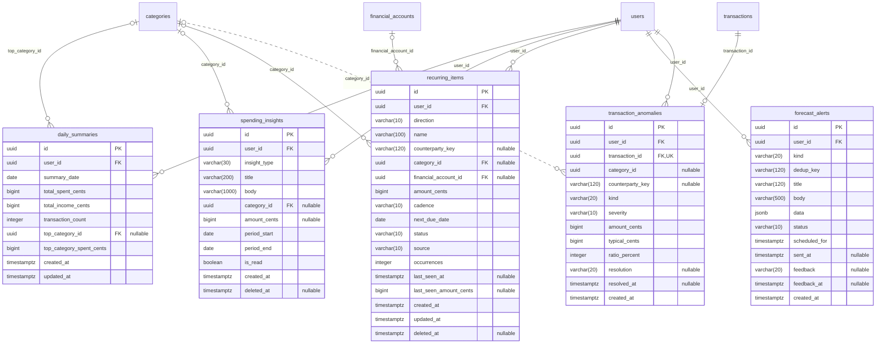

Bảng ngoài nhóm xuất hiện trong sơ đồ (chỉ để nối quan hệ, xem cột ở nhóm của chúng): `categories`, `financial_accounts`, `transactions`, `users`.

##### `daily_summaries` — DailySummary

Tổng thu / chi theo ngày, tính sẵn bởi `DailySummaryJob`.

| # | Cột | Kiểu | NULL | Mặc định | Khóa |
| --- | --- | --- | --- | --- | --- |
| 1 | `id` | uuid |  | `gen_random_uuid()` | PK |
| 2 | `user_id` | uuid |  |  | FK → `users.id` |
| 3 | `summary_date` | date |  |  |  |
| 4 | `total_spent_cents` | bigint |  | `0` |  |
| 5 | `total_income_cents` | bigint |  | `0` |  |
| 6 | `transaction_count` | integer |  | `0` |  |
| 7 | `top_category_id` | uuid | có |  | FK → `categories.id` |
| 8 | `top_category_spent_cents` | bigint |  | `0` |  |
| 9 | `created_at` | timestamptz |  |  |  |
| 10 | `updated_at` | timestamptz |  |  |  |

Khóa ngoại:
- `top_category_id` → `categories(id)` ON DELETE SET NULL
- `user_id` → `users(id)` ON DELETE CASCADE

Index:
- `IX_daily_summaries_top_category_id` `(top_category_id)`
- UNIQUE `uq_daily_summaries_user_date` `(user_id, summary_date)`

##### `spending_insights` — SpendingInsight

Insight chi tiêu (hiện chỉ còn sinh loại so với tháng trước).

| # | Cột | Kiểu | NULL | Mặc định | Khóa |
| --- | --- | --- | --- | --- | --- |
| 1 | `id` | uuid |  | `gen_random_uuid()` | PK |
| 2 | `user_id` | uuid |  |  | FK → `users.id` |
| 3 | `insight_type` | varchar(30) |  |  |  |
| 4 | `title` | varchar(200) |  |  |  |
| 5 | `body` | varchar(1000) |  |  |  |
| 6 | `category_id` | uuid | có |  | FK → `categories.id` |
| 7 | `amount_cents` | bigint | có |  |  |
| 8 | `period_start` | date |  |  |  |
| 9 | `period_end` | date |  |  |  |
| 10 | `is_read` | boolean |  | `false` |  |
| 11 | `created_at` | timestamptz |  |  |  |
| 12 | `deleted_at` | timestamptz | có |  |  |

Khóa ngoại:
- `category_id` → `categories(id)` ON DELETE SET NULL
- `user_id` → `users(id)` ON DELETE CASCADE

Ràng buộc:
- CHECK `chk_spending_insights_insight_type`: `insight_type IN ('vs_last_month', 'recurring_detected', 'unusual_spending')`

Index:
- `IX_spending_insights_category_id` `(category_id)`
- `idx_spending_insights_user_created_at` `(user_id, created_at)`
- UNIQUE `uq_spending_insights_user_type_category_period` `(user_id, insight_type, category_id, period_start) WHERE (category_id IS NOT NULL) AND (deleted_at IS NULL)`
- UNIQUE `uq_spending_insights_user_type_period` `(user_id, insight_type, period_start) WHERE (category_id IS NULL) AND (deleted_at IS NULL)`

##### `recurring_items` — RecurringItem

Khoản định kỳ (hóa đơn, thu nhập) cho dự báo: tự phát hiện hoặc thêm tay; ngày đến hạn kế tiếp, trạng thái.

| # | Cột | Kiểu | NULL | Mặc định | Khóa |
| --- | --- | --- | --- | --- | --- |
| 1 | `id` | uuid |  | `gen_random_uuid()` | PK |
| 2 | `user_id` | uuid |  |  | FK → `users.id` |
| 3 | `direction` | varchar(10) |  |  |  |
| 4 | `name` | varchar(100) |  |  |  |
| 5 | `counterparty_key` | varchar(120) | có |  |  |
| 6 | `category_id` | uuid | có |  | FK → `categories.id` |
| 7 | `financial_account_id` | uuid | có |  | FK → `financial_accounts.id` |
| 8 | `amount_cents` | bigint |  |  |  |
| 9 | `cadence` | varchar(10) |  |  |  |
| 10 | `next_due_date` | date |  |  |  |
| 11 | `status` | varchar(10) |  |  |  |
| 12 | `source` | varchar(10) |  |  |  |
| 13 | `occurrences` | integer |  | `0` |  |
| 14 | `last_seen_at` | timestamptz | có |  |  |
| 15 | `last_seen_amount_cents` | bigint | có |  |  |
| 16 | `created_at` | timestamptz |  |  |  |
| 17 | `updated_at` | timestamptz |  |  |  |
| 18 | `deleted_at` | timestamptz | có |  |  |

Khóa ngoại:
- `category_id` → `categories(id)` ON DELETE SET NULL
- `financial_account_id` → `financial_accounts(id)` ON DELETE SET NULL
- `user_id` → `users(id)` ON DELETE CASCADE

Ràng buộc:
- CHECK `chk_recurring_items_amount`: `amount_cents > 0`
- CHECK `chk_recurring_items_cadence`: `cadence IN ('weekly', 'monthly', 'yearly')`
- CHECK `chk_recurring_items_direction`: `direction IN ('inflow', 'outflow')`
- CHECK `chk_recurring_items_occurrences`: `occurrences >= 0`
- CHECK `chk_recurring_items_source`: `source IN ('detected', 'manual')`
- CHECK `chk_recurring_items_status`: `status IN ('suggested', 'active', 'paused', 'rejected', 'cancelled')`

Index:
- `IX_recurring_items_category_id` `(category_id)`
- `IX_recurring_items_financial_account_id` `(financial_account_id)`
- `ix_recurring_items_user_status` `(user_id, status)`
- UNIQUE `uq_recurring_items_user_direction_counterparty` `(user_id, direction, counterparty_key) WHERE (counterparty_key IS NOT NULL) AND (deleted_at IS NULL)`

##### `forecast_alerts` — ForecastAlert

Hộp thư cảnh báo dự báo: chống lặp theo `(user_id, kind, dedup_key)`, hẹn giờ gửi, phản hồi "không chính xác".

| # | Cột | Kiểu | NULL | Mặc định | Khóa |
| --- | --- | --- | --- | --- | --- |
| 1 | `id` | uuid |  | `gen_random_uuid()` | PK |
| 2 | `user_id` | uuid |  |  | FK → `users.id` |
| 3 | `kind` | varchar(20) |  |  |  |
| 4 | `dedup_key` | varchar(120) |  |  |  |
| 5 | `title` | varchar(120) |  |  |  |
| 6 | `body` | varchar(500) |  |  |  |
| 7 | `data` | jsonb |  |  |  |
| 8 | `status` | varchar(10) |  |  |  |
| 9 | `scheduled_for` | timestamptz |  |  |  |
| 10 | `sent_at` | timestamptz | có |  |  |
| 11 | `feedback` | varchar(20) | có |  |  |
| 12 | `feedback_at` | timestamptz | có |  |  |
| 13 | `created_at` | timestamptz |  |  |  |

Khóa ngoại:
- `user_id` → `users(id)` ON DELETE CASCADE

Ràng buộc:
- CHECK `chk_forecast_alerts_feedback`: `(feedback IS NULL) OR (feedback = 'inaccurate')`
- CHECK `chk_forecast_alerts_kind`: `kind IN ('low_balance', 'budget_risk', 'bill_due', 'bill_status_check', 'income_late', 'price_change', 'anomaly')`
- CHECK `chk_forecast_alerts_sent_at`: `(status = 'sent') = (sent_at IS NOT NULL)`
- CHECK `chk_forecast_alerts_status`: `status IN ('pending', 'sent')`

Index:
- `ix_forecast_alerts_pending_due` `(scheduled_for) WHERE status = 'pending'`
- `ix_forecast_alerts_user_created` `(user_id, created_at DESC)`
- UNIQUE `uq_forecast_alerts_user_kind_dedup` `(user_id, kind, dedup_key)`

##### `transaction_anomalies` — TransactionAnomaly

Đánh dấu chi tiêu bất thường (một dòng mỗi giao dịch) và phản hồi của người dùng. `category_id` là ảnh chụp lúc phát hiện, không có FK.

| # | Cột | Kiểu | NULL | Mặc định | Khóa |
| --- | --- | --- | --- | --- | --- |
| 1 | `id` | uuid |  | `gen_random_uuid()` | PK |
| 2 | `user_id` | uuid |  |  | FK → `users.id` |
| 3 | `transaction_id` | uuid |  |  | FK → `transactions.id` · UK |
| 4 | `category_id` | uuid | có |  |  |
| 5 | `counterparty_key` | varchar(120) | có |  |  |
| 6 | `kind` | varchar(20) |  |  |  |
| 7 | `severity` | varchar(10) |  |  |  |
| 8 | `amount_cents` | bigint |  |  |  |
| 9 | `typical_cents` | bigint |  |  |  |
| 10 | `ratio_percent` | integer |  |  |  |
| 11 | `resolution` | varchar(20) | có |  |  |
| 12 | `resolved_at` | timestamptz | có |  |  |
| 13 | `created_at` | timestamptz |  |  |  |

Khóa ngoại:
- `transaction_id` → `transactions(id)` ON DELETE CASCADE
- `user_id` → `users(id)` ON DELETE CASCADE

Ràng buộc:
- CHECK `chk_transaction_anomalies_amounts`: `(amount_cents > 0) AND (typical_cents > 0) AND (ratio_percent > 0)`
- CHECK `chk_transaction_anomalies_kind`: `kind IN ('category_spike', 'merchant_spike', 'duplicate')`
- CHECK `chk_transaction_anomalies_resolution`: `(resolution IS NULL) OR resolution IN ('normal', 'one_off', 'wrong_entry', 'suspicious')`
- CHECK `chk_transaction_anomalies_resolved_at`: `(resolution IS NULL) = (resolved_at IS NULL)`
- CHECK `chk_transaction_anomalies_severity`: `severity IN ('normal', 'high')`

Index:
- `ix_transaction_anomalies_user_created` `(user_id, created_at DESC)`
- `ix_transaction_anomalies_user_normal` `(user_id, category_id) WHERE resolution = 'normal'`
- UNIQUE `uq_transaction_anomalies_transaction` `(transaction_id)`

#### 3.1.7 Cấu hình hệ thống

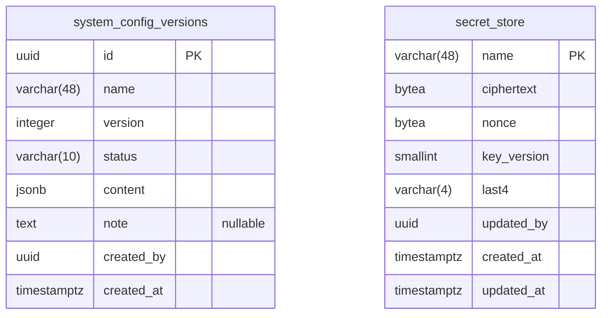

##### `system_config_versions` — SystemConfigVersion

Các phiên bản cấu hình hệ thống (JSON) có lịch sử và hoàn tác.

| # | Cột | Kiểu | NULL | Mặc định | Khóa |
| --- | --- | --- | --- | --- | --- |
| 1 | `id` | uuid |  | `gen_random_uuid()` | PK |
| 2 | `name` | varchar(48) |  |  |  |
| 3 | `version` | integer |  |  |  |
| 4 | `status` | varchar(10) |  |  |  |
| 5 | `content` | jsonb |  |  |  |
| 6 | `note` | text | có |  |  |
| 7 | `created_by` | uuid |  |  |  |
| 8 | `created_at` | timestamptz |  |  |  |

Ràng buộc:
- CHECK `chk_system_config_versions_content_object`: `jsonb_typeof(content) = 'object'`
- CHECK `chk_system_config_versions_status`: `status IN ('active', 'archived')`

Index:
- UNIQUE `uq_system_config_versions_active` `(name) WHERE status = 'active'`
- UNIQUE `uq_system_config_versions_name_version` `(name, version)`

##### `secret_store` — SecretEntry

Khóa bên thứ ba mã hóa AES-256-GCM (bản riêng của ai-service).

| # | Cột | Kiểu | NULL | Mặc định | Khóa |
| --- | --- | --- | --- | --- | --- |
| 1 | `name` | varchar(48) |  |  | PK |
| 2 | `ciphertext` | bytea |  |  |  |
| 3 | `nonce` | bytea |  |  |  |
| 4 | `key_version` | smallint |  | `1` |  |
| 5 | `last4` | varchar(4) |  |  |  |
| 6 | `updated_by` | uuid |  |  |  |
| 7 | `created_at` | timestamptz |  |  |  |
| 8 | `updated_at` | timestamptz |  |  |  |

Ràng buộc:
- CHECK `chk_secret_store_nonce`: `octet_length(nonce) = 12`

### 3.2 AI Service — `finmate_ai`

#### 3.2.1 Danh mục và tri thức phân loại

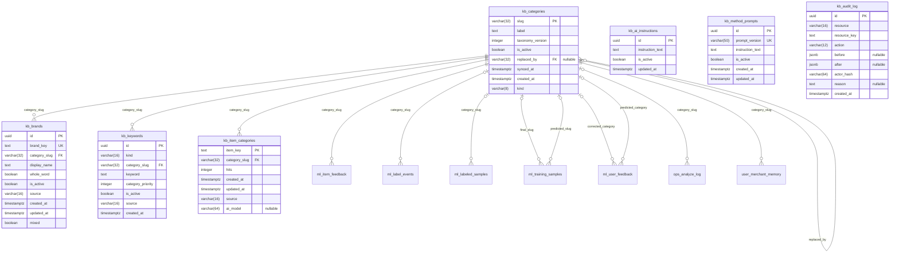

Bảng ngoài nhóm xuất hiện trong sơ đồ (chỉ để nối quan hệ, xem cột ở nhóm của chúng): `ml_item_feedback`, `ml_label_events`, `ml_labeled_samples`, `ml_training_samples`, `ml_user_feedback`, `ops_analyze_log`, `user_merchant_memory`.

##### `kb_categories` — KbCategory

Danh mục phía AI (đồng bộ từ backend); `replaced_by` khi đổi taxonomy.

| # | Cột | Kiểu | NULL | Mặc định | Khóa |
| --- | --- | --- | --- | --- | --- |
| 1 | `slug` | varchar(32) |  |  | PK |
| 2 | `label` | text |  |  |  |
| 3 | `taxonomy_version` | integer |  | `1` |  |
| 4 | `is_active` | boolean |  | `true` |  |
| 5 | `replaced_by` | varchar(32) | có |  | FK → `kb_categories.slug` |
| 6 | `synced_at` | timestamptz |  | `now()` |  |
| 7 | `created_at` | timestamptz |  | `now()` |  |
| 8 | `kind` | varchar(8) |  | `'expense'::character varying` |  |

Khóa ngoại:
- `replaced_by` → `kb_categories(slug)` ON DELETE SET NULL

Ràng buộc:
- CHECK `chk_kb_categories_kind`: `kind IN ('expense', 'income', 'legacy')`
- CHECK `chk_kb_categories_not_self`: `(replaced_by IS NULL) OR (replaced_by <> slug)`
- CHECK `chk_kb_categories_slug`: `slug ~ '^[a-z_]+$'`
- CHECK `chk_kb_categories_taxonomy_version`: `taxonomy_version >= 1`

Index:
- `idx_kb_categories_replaced_by` `(replaced_by) WHERE replaced_by IS NOT NULL`

##### `kb_brands` — BillBrand

Thương hiệu / cửa hàng → danh mục, dùng phân loại hóa đơn.

| # | Cột | Kiểu | NULL | Mặc định | Khóa |
| --- | --- | --- | --- | --- | --- |
| 1 | `id` | uuid |  | `gen_random_uuid()` | PK |
| 2 | `brand_key` | text |  |  | UK |
| 3 | `category_slug` | varchar(32) |  |  | FK → `kb_categories.slug` |
| 4 | `display_name` | text |  |  |  |
| 5 | `whole_word` | boolean |  | `false` |  |
| 6 | `is_active` | boolean |  | `true` |  |
| 7 | `source` | varchar(16) |  | `'seed'::character varying` |  |
| 8 | `created_at` | timestamptz |  | `now()` |  |
| 9 | `updated_at` | timestamptz |  | `now()` |  |
| 10 | `mixed` | boolean |  | `false` |  |

Khóa ngoại:
- `category_slug` → `kb_categories(slug)` ON DELETE RESTRICT

Ràng buộc:
- CHECK `chk_kb_brands_key_lower`: `brand_key = lower(brand_key)`
- UNIQUE `uq_bill_brands_brand_key`: `brand_key`

Index:
- `idx_kb_brands_category` `(category_slug)`

##### `kb_keywords` — BillKeyword

Từ khóa → danh mục (có độ ưu tiên).

| # | Cột | Kiểu | NULL | Mặc định | Khóa |
| --- | --- | --- | --- | --- | --- |
| 1 | `id` | uuid |  | `gen_random_uuid()` | PK |
| 2 | `kind` | varchar(16) |  |  |  |
| 3 | `category_slug` | varchar(32) |  |  | FK → `kb_categories.slug` |
| 4 | `keyword` | text |  |  |  |
| 5 | `category_priority` | integer |  | `100` |  |
| 6 | `is_active` | boolean |  | `true` |  |
| 7 | `source` | varchar(16) |  | `'seed'::character varying` |  |
| 8 | `created_at` | timestamptz |  | `now()` |  |

Khóa ngoại:
- `category_slug` → `kb_categories(slug)` ON DELETE RESTRICT

Ràng buộc:
- CHECK `chk_bill_keywords_kind`: `kind IN ('merchant', 'product')`
- CHECK `chk_kb_keywords_priority`: `category_priority >= 0`
- UNIQUE `uq_bill_keyword`: `kind, category_slug, keyword`

Index:
- `idx_kb_keywords_active_load` `(category_priority, category_slug, keyword) WHERE is_active`

##### `kb_item_categories` — BillItemCache

Bộ nhớ chung: tên món → danh mục (câu trả lời của Gemini), không có cột người dùng.

| # | Cột | Kiểu | NULL | Mặc định | Khóa |
| --- | --- | --- | --- | --- | --- |
| 1 | `item_key` | text |  |  | PK |
| 2 | `category_slug` | varchar(32) |  |  | FK → `kb_categories.slug` |
| 3 | `hits` | integer |  | `1` |  |
| 4 | `created_at` | timestamptz |  | `now()` |  |
| 5 | `updated_at` | timestamptz |  | `now()` |  |
| 6 | `source` | varchar(16) |  | `'ai'::character varying` |  |
| 7 | `ai_model` | varchar(64) | có |  |  |

Khóa ngoại:
- `category_slug` → `kb_categories(slug)` ON DELETE RESTRICT

Ràng buộc:
- CHECK `chk_kb_item_categories_hits`: `hits >= 1`
- CHECK `chk_kb_item_categories_key_len`: `(char_length(item_key) >= 3) AND (char_length(item_key) <= 60)`
- CHECK `chk_kb_item_categories_source`: `source IN ('ai', 'admin', 'consensus')`

Index:
- `idx_kb_item_categories_hits` `(hits)`

##### `kb_ai_instructions` — BillAiInstruction

Luật phân loại món cho Gemini; đúng một dòng `is_active`.

| # | Cột | Kiểu | NULL | Mặc định | Khóa |
| --- | --- | --- | --- | --- | --- |
| 1 | `id` | uuid |  | `gen_random_uuid()` | PK |
| 2 | `instruction_text` | text |  |  |  |
| 3 | `is_active` | boolean |  | `true` |  |
| 4 | `updated_at` | timestamptz |  | `now()` |  |

Ràng buộc:
- CHECK `chk_kb_ai_instructions_text`: `char_length(instruction_text) > 0`

Index:
- UNIQUE `uq_bill_ai_instructions_one_active` `(is_active) WHERE is_active`

##### `kb_method_prompts` — MethodPrompt

Prompt đề xuất phương pháp tài chính, có phiên bản; một bản `is_active`.

| # | Cột | Kiểu | NULL | Mặc định | Khóa |
| --- | --- | --- | --- | --- | --- |
| 1 | `id` | uuid |  | `gen_random_uuid()` | PK |
| 2 | `prompt_version` | varchar(50) |  |  | UK |
| 3 | `instruction_text` | text |  |  |  |
| 4 | `is_active` | boolean |  | `true` |  |
| 5 | `created_at` | timestamptz |  | `now()` |  |
| 6 | `updated_at` | timestamptz |  | `now()` |  |

Ràng buộc:
- CHECK `chk_kb_method_prompts_text`: `char_length(instruction_text) > 0`
- CHECK `chk_kb_method_prompts_version`: `prompt_version ~ '^[A-Za-z0-9._-]+$'`
- UNIQUE `uq_kb_method_prompts_version`: `prompt_version`

Index:
- UNIQUE `uq_kb_method_prompts_one_active` `(is_active) WHERE is_active`

##### `kb_audit_log` — BillRuleAudit

Nhật ký thay đổi luật qua API quản trị (trước / sau, `actor_hash`), dùng để hoàn tác.

| # | Cột | Kiểu | NULL | Mặc định | Khóa |
| --- | --- | --- | --- | --- | --- |
| 1 | `id` | uuid |  | `gen_random_uuid()` | PK |
| 2 | `resource` | varchar(16) |  |  |  |
| 3 | `resource_key` | text |  |  |  |
| 4 | `action` | varchar(12) |  |  |  |
| 5 | `before` | jsonb | có |  |  |
| 6 | `after` | jsonb | có |  |  |
| 7 | `actor_hash` | varchar(64) |  |  |  |
| 8 | `reason` | text | có |  |  |
| 9 | `created_at` | timestamptz |  | `now()` |  |

Ràng buộc:
- CHECK `chk_kb_audit_log_action`: `action IN ('create', 'update', 'activate', 'deactivate', 'delete', 'revert')`
- CHECK `chk_kb_audit_log_actor_hash`: `actor_hash ~ '^[0-9a-f]{64}$'`
- CHECK `chk_kb_audit_log_resource`: `resource IN ('brand', 'keyword', 'item_cache', 'instruction', 'provider_format', 'category', 'secret')`

Index:
- `idx_bill_rule_audit_created` `(created_at)`
- `idx_bill_rule_audit_resource` `(resource, resource_key)`

#### 3.2.2 Định dạng thông báo ngân hàng

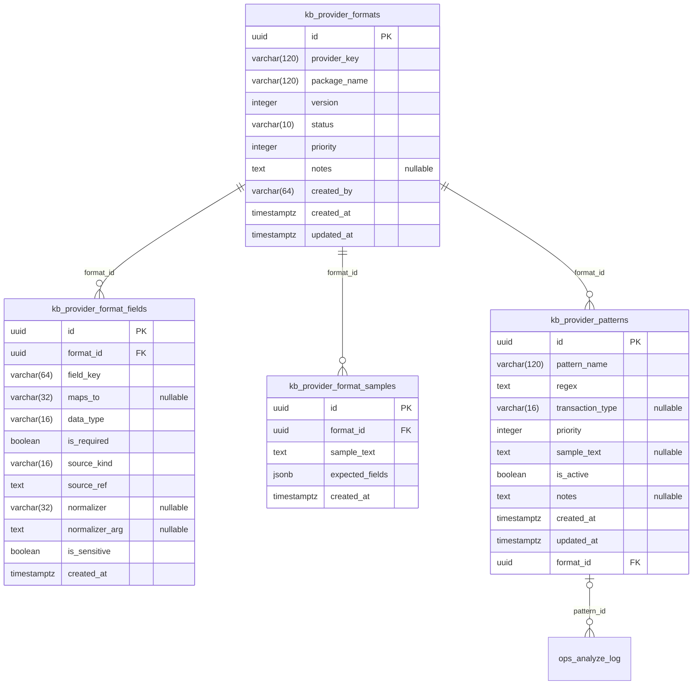

Bảng ngoài nhóm xuất hiện trong sơ đồ (chỉ để nối quan hệ, xem cột ở nhóm của chúng): `ops_analyze_log`.

##### `kb_provider_formats` — ProviderFormat

Định dạng thông báo của từng ngân hàng / ví, có phiên bản và trạng thái.

| # | Cột | Kiểu | NULL | Mặc định | Khóa |
| --- | --- | --- | --- | --- | --- |
| 1 | `id` | uuid |  | `gen_random_uuid()` | PK |
| 2 | `provider_key` | varchar(120) |  |  |  |
| 3 | `package_name` | varchar(120) |  |  |  |
| 4 | `version` | integer |  |  |  |
| 5 | `status` | varchar(10) |  |  |  |
| 6 | `priority` | integer |  | `100` |  |
| 7 | `notes` | text | có |  |  |
| 8 | `created_by` | varchar(64) |  |  |  |
| 9 | `created_at` | timestamptz |  | `now()` |  |
| 10 | `updated_at` | timestamptz |  | `now()` |  |

Ràng buộc:
- CHECK `chk_kb_provider_formats_created_by`: `created_by ~ '^[0-9a-f]{64}$'`
- CHECK `chk_kb_provider_formats_priority`: `priority >= 0`
- CHECK `chk_kb_provider_formats_status`: `status IN ('draft', 'active', 'archived')`
- CHECK `chk_kb_provider_formats_version`: `version >= 1`
- UNIQUE `uq_kb_provider_formats_package_version`: `package_name, version`

Index:
- `idx_kb_provider_formats_match` `(package_name, status, priority)`

##### `kb_provider_format_fields` — ProviderFormatField

Trường cần bóc của một định dạng (map sang trường giao dịch, chuẩn hóa, cờ nhạy cảm).

| # | Cột | Kiểu | NULL | Mặc định | Khóa |
| --- | --- | --- | --- | --- | --- |
| 1 | `id` | uuid |  | `gen_random_uuid()` | PK |
| 2 | `format_id` | uuid |  |  | FK → `kb_provider_formats.id` |
| 3 | `field_key` | varchar(64) |  |  |  |
| 4 | `maps_to` | varchar(32) | có |  |  |
| 5 | `data_type` | varchar(16) |  |  |  |
| 6 | `is_required` | boolean |  | `false` |  |
| 7 | `source_kind` | varchar(16) |  |  |  |
| 8 | `source_ref` | text |  |  |  |
| 9 | `normalizer` | varchar(32) | có |  |  |
| 10 | `normalizer_arg` | text | có |  |  |
| 11 | `is_sensitive` | boolean |  | `false` |  |
| 12 | `created_at` | timestamptz |  | `now()` |  |

Khóa ngoại:
- `format_id` → `kb_provider_formats(id)` ON DELETE CASCADE

Ràng buộc:
- CHECK `chk_kb_provider_format_fields_data_type`: `data_type IN ('text', 'amount', 'datetime')`
- CHECK `chk_kb_provider_format_fields_maps_to`: `(maps_to IS NULL) OR maps_to IN ('amount_cents', 'transaction_type', 'merchant_name', 'description', 'transacted_at', 'balance_after_cents')`
- CHECK `chk_kb_provider_format_fields_normalizer`: `(normalizer IS NULL) OR normalizer IN ('vnd_amount', 'clean_text')`
- CHECK `chk_kb_provider_format_fields_sensitive_mapped`: `NOT (is_sensitive AND (maps_to IS NULL))`
- CHECK `chk_kb_provider_format_fields_source_kind`: `source_kind IN ('regex_group', 'literal')`
- UNIQUE `uq_kb_provider_format_fields_key`: `format_id, field_key`

Index:
- UNIQUE `uq_kb_provider_format_fields_maps_to` `(format_id, maps_to) WHERE maps_to IS NOT NULL`

##### `kb_provider_format_samples` — ProviderFormatSample

Thông báo mẫu kèm kết quả mong đợi để kiểm định dạng.

| # | Cột | Kiểu | NULL | Mặc định | Khóa |
| --- | --- | --- | --- | --- | --- |
| 1 | `id` | uuid |  | `gen_random_uuid()` | PK |
| 2 | `format_id` | uuid |  |  | FK → `kb_provider_formats.id` |
| 3 | `sample_text` | text |  |  |  |
| 4 | `expected_fields` | jsonb |  |  |  |
| 5 | `created_at` | timestamptz |  | `now()` |  |

Khóa ngoại:
- `format_id` → `kb_provider_formats(id)` ON DELETE CASCADE

Ràng buộc:
- CHECK `chk_kb_provider_format_samples_expected`: `jsonb_typeof(expected_fields) = 'object'`
- CHECK `chk_kb_provider_format_samples_text_len`: `char_length(sample_text) <= 2000`

Index:
- `idx_kb_provider_format_samples_format` `(format_id)`

##### `kb_provider_patterns` — ProviderPattern

Regex bóc thông báo theo định dạng (luật trích xuất).

| # | Cột | Kiểu | NULL | Mặc định | Khóa |
| --- | --- | --- | --- | --- | --- |
| 1 | `id` | uuid |  | `gen_random_uuid()` | PK |
| 2 | `pattern_name` | varchar(120) |  |  |  |
| 3 | `regex` | text |  |  |  |
| 4 | `transaction_type` | varchar(16) | có |  |  |
| 5 | `priority` | integer |  | `100` |  |
| 6 | `sample_text` | text | có |  |  |
| 7 | `is_active` | boolean |  | `true` |  |
| 8 | `notes` | text | có |  |  |
| 9 | `created_at` | timestamptz |  | `now()` |  |
| 10 | `updated_at` | timestamptz |  | `now()` |  |
| 11 | `format_id` | uuid |  |  | FK → `kb_provider_formats.id` |

Khóa ngoại:
- `format_id` → `kb_provider_formats(id)` ON DELETE RESTRICT

Ràng buộc:
- CHECK `chk_kb_provider_patterns_priority`: `priority >= 0`
- CHECK `chk_provider_patterns_transaction_type`: `(transaction_type IS NULL) OR transaction_type IN ('debit', 'credit')`
- UNIQUE `uq_kb_provider_patterns_format_name`: `format_id, pattern_name`

Index:
- `idx_kb_provider_patterns_format` `(format_id, is_active, priority)`

#### 3.2.3 Pipeline và vận hành

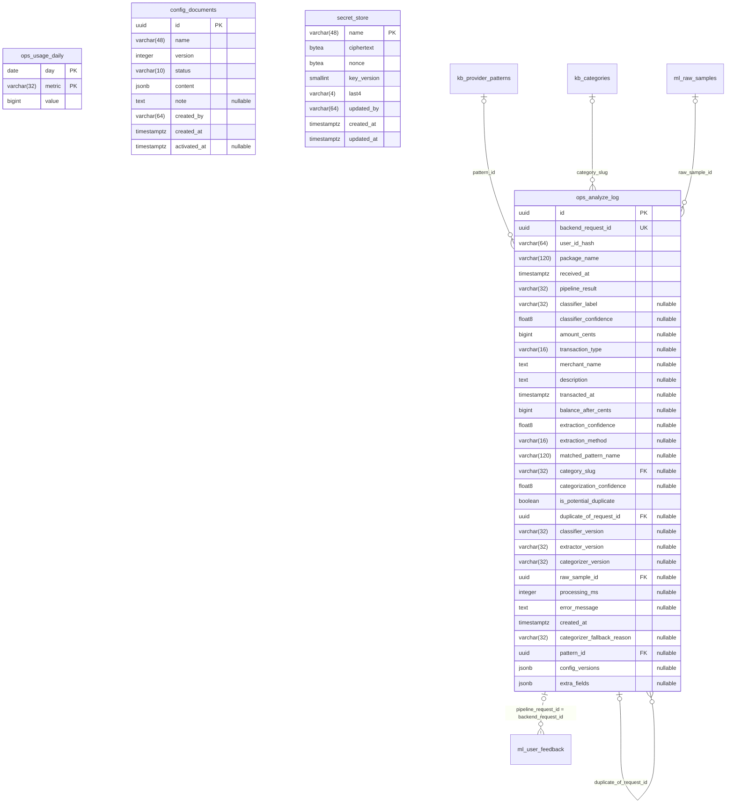

Bảng ngoài nhóm xuất hiện trong sơ đồ (chỉ để nối quan hệ, xem cột ở nhóm của chúng): `kb_categories`, `kb_provider_patterns`, `ml_raw_samples`.

##### `ops_analyze_log` — PipelineRequest

Mỗi lần gọi `/analyze`: kết quả từng bước, độ tin cậy, phiên bản model / cấu hình. `backend_request_id` là id `notification_logs` bên backend.

| # | Cột | Kiểu | NULL | Mặc định | Khóa |
| --- | --- | --- | --- | --- | --- |
| 1 | `id` | uuid |  | `gen_random_uuid()` | PK |
| 2 | `backend_request_id` | uuid |  |  | UK |
| 3 | `user_id_hash` | varchar(64) |  |  |  |
| 4 | `package_name` | varchar(120) |  |  |  |
| 5 | `received_at` | timestamptz |  |  |  |
| 6 | `pipeline_result` | varchar(32) |  |  |  |
| 7 | `classifier_label` | varchar(32) | có |  |  |
| 8 | `classifier_confidence` | float8 | có |  |  |
| 9 | `amount_cents` | bigint | có |  |  |
| 10 | `transaction_type` | varchar(16) | có |  |  |
| 11 | `merchant_name` | text | có |  |  |
| 12 | `description` | text | có |  |  |
| 13 | `transacted_at` | timestamptz | có |  |  |
| 14 | `balance_after_cents` | bigint | có |  |  |
| 15 | `extraction_confidence` | float8 | có |  |  |
| 16 | `extraction_method` | varchar(16) | có |  |  |
| 17 | `matched_pattern_name` | varchar(120) | có |  |  |
| 18 | `category_slug` | varchar(32) | có |  | FK → `kb_categories.slug` |
| 19 | `categorization_confidence` | float8 | có |  |  |
| 20 | `is_potential_duplicate` | boolean |  | `false` |  |
| 21 | `duplicate_of_request_id` | uuid | có |  | FK → `ops_analyze_log.id` |
| 22 | `classifier_version` | varchar(32) | có |  |  |
| 23 | `extractor_version` | varchar(32) | có |  |  |
| 24 | `categorizer_version` | varchar(32) | có |  |  |
| 25 | `raw_sample_id` | uuid | có |  | FK → `ml_raw_samples.id` |
| 26 | `processing_ms` | integer | có |  |  |
| 27 | `error_message` | text | có |  |  |
| 28 | `created_at` | timestamptz |  | `now()` |  |
| 29 | `categorizer_fallback_reason` | varchar(32) | có |  |  |
| 30 | `pattern_id` | uuid | có |  | FK → `kb_provider_patterns.id` |
| 31 | `config_versions` | jsonb | có |  |  |
| 32 | `extra_fields` | jsonb | có |  |  |

Khóa ngoại:
- `pattern_id` → `kb_provider_patterns(id)` ON DELETE SET NULL
- `category_slug` → `kb_categories(slug)` ON DELETE RESTRICT
- `duplicate_of_request_id` → `ops_analyze_log(id)` ON DELETE SET NULL
- `raw_sample_id` → `ml_raw_samples(id)` ON DELETE SET NULL

Ràng buộc:
- CHECK `chk_ops_analyze_log_amount`: `(amount_cents IS NULL) OR (amount_cents >= 0)`
- CHECK `chk_ops_analyze_log_categorization_conf`: `(categorization_confidence IS NULL) OR ((categorization_confidence >= 0) AND (categorization_confidence <= 1))`
- CHECK `chk_ops_analyze_log_classifier_conf`: `(classifier_confidence IS NULL) OR ((classifier_confidence >= 0) AND (classifier_confidence <= 1))`
- CHECK `chk_ops_analyze_log_extra_fields`: `(extra_fields IS NULL) OR (jsonb_typeof(extra_fields) = 'object')`
- CHECK `chk_ops_analyze_log_extraction_conf`: `(extraction_confidence IS NULL) OR ((extraction_confidence >= 0) AND (extraction_confidence <= 1))`
- CHECK `chk_ops_analyze_log_fallback_reason`: `(categorizer_fallback_reason IS NULL) OR categorizer_fallback_reason IN ('timeout', 'bad_json', 'out_of_taxonomy')`
- CHECK `chk_ops_analyze_log_processing_ms`: `(processing_ms IS NULL) OR (processing_ms >= 0)`
- CHECK `chk_ops_analyze_log_user_hash`: `user_id_hash ~ '^[0-9a-f]{64}$'`
- CHECK `chk_pipeline_requests_classifier_label`: `(classifier_label IS NULL) OR classifier_label IN ('financial', 'non_financial', 'uncertain')`
- CHECK `chk_pipeline_requests_result`: `pipeline_result IN ('financial', 'non_financial', 'uncertain', 'extraction_failed', 'error')`
- UNIQUE `uq_pipeline_requests_backend_id`: `backend_request_id`

Index:
- `idx_ops_analyze_log_duplicate_of` `(duplicate_of_request_id) WHERE duplicate_of_request_id IS NOT NULL`
- `idx_ops_analyze_log_pattern` `(pattern_id) WHERE pattern_id IS NOT NULL`
- `idx_pipeline_requests_created_at` `(created_at)`
- `idx_pipeline_requests_dedup` `(user_id_hash, transacted_at)`
- `idx_pipeline_requests_raw_sample` `(raw_sample_id) WHERE raw_sample_id IS NOT NULL`

##### `ops_usage_daily` — BillClassifyStat

Bộ đếm theo ngày (khóa `day` + `metric`); chỉ số đếm, không dữ liệu người dùng.

| # | Cột | Kiểu | NULL | Mặc định | Khóa |
| --- | --- | --- | --- | --- | --- |
| 1 | `day` | date |  |  | PK |
| 2 | `metric` | varchar(32) |  |  | PK |
| 3 | `value` | bigint |  | `0` |  |

Ràng buộc:
- CHECK `chk_ops_usage_daily_metric`: `metric ~ '^[a-z0-9_]+$'`
- CHECK `chk_ops_usage_daily_value`: `value >= 0`

##### `config_documents` — ConfigDocument

Cấu hình của ai-service (JSON) có phiên bản.

| # | Cột | Kiểu | NULL | Mặc định | Khóa |
| --- | --- | --- | --- | --- | --- |
| 1 | `id` | uuid |  | `gen_random_uuid()` | PK |
| 2 | `name` | varchar(48) |  |  |  |
| 3 | `version` | integer |  |  |  |
| 4 | `status` | varchar(10) |  |  |  |
| 5 | `content` | jsonb |  |  |  |
| 6 | `note` | text | có |  |  |
| 7 | `created_by` | varchar(64) |  |  |  |
| 8 | `created_at` | timestamptz |  | `now()` |  |
| 9 | `activated_at` | timestamptz | có |  |  |

Ràng buộc:
- CHECK `chk_config_documents_content_object`: `jsonb_typeof(content) = 'object'`
- CHECK `chk_config_documents_created_by`: `created_by ~ '^[0-9a-f]{64}$'`
- CHECK `chk_config_documents_status`: `status IN ('draft', 'active', 'archived')`
- CHECK `chk_config_documents_version`: `version >= 1`
- UNIQUE `uq_config_documents_name_version`: `name, version`

Index:
- UNIQUE `uq_config_documents_active` `(name) WHERE status = 'active'`

##### `secret_store` — SecretRow

Khóa bên thứ ba mã hóa AES-256-GCM (bản riêng của ai-service).

| # | Cột | Kiểu | NULL | Mặc định | Khóa |
| --- | --- | --- | --- | --- | --- |
| 1 | `name` | varchar(48) |  |  | PK |
| 2 | `ciphertext` | bytea |  |  |  |
| 3 | `nonce` | bytea |  |  |  |
| 4 | `key_version` | smallint |  | `1` |  |
| 5 | `last4` | varchar(4) |  |  |  |
| 6 | `updated_by` | varchar(64) |  |  |  |
| 7 | `created_at` | timestamptz |  | `now()` |  |
| 8 | `updated_at` | timestamptz |  | `now()` |  |

Ràng buộc:
- CHECK `chk_secret_store_nonce`: `octet_length(nonce) = 12`
- CHECK `chk_secret_store_updated_by`: `updated_by ~ '^[0-9a-f]{64}$'`

#### 3.2.4 Dữ liệu huấn luyện, phản hồi, bộ nhớ người dùng

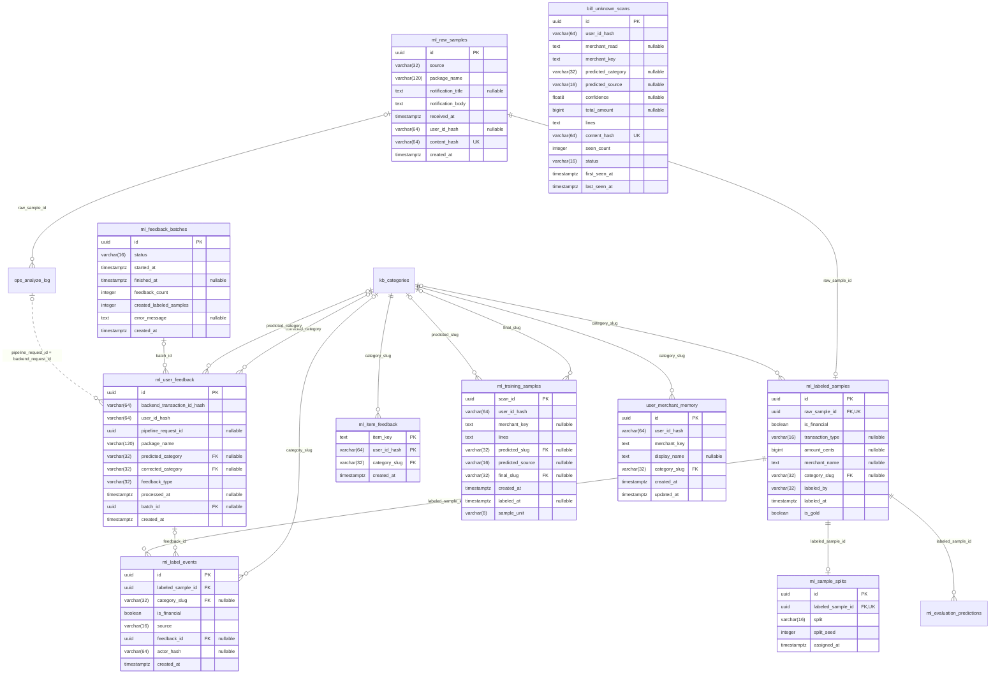

Bảng ngoài nhóm xuất hiện trong sơ đồ (chỉ để nối quan hệ, xem cột ở nhóm của chúng): `kb_categories`, `ml_evaluation_predictions`, `ops_analyze_log`.

##### `ml_raw_samples` — RawSample

Thông báo gốc dùng làm dữ liệu huấn luyện (có `notification_body`), theo `user_id_hash`.

| # | Cột | Kiểu | NULL | Mặc định | Khóa |
| --- | --- | --- | --- | --- | --- |
| 1 | `id` | uuid |  | `gen_random_uuid()` | PK |
| 2 | `source` | varchar(32) |  |  |  |
| 3 | `package_name` | varchar(120) |  |  |  |
| 4 | `notification_title` | text | có |  |  |
| 5 | `notification_body` | text |  |  |  |
| 6 | `received_at` | timestamptz |  |  |  |
| 7 | `user_id_hash` | varchar(64) | có |  |  |
| 8 | `content_hash` | varchar(64) |  |  | UK |
| 9 | `created_at` | timestamptz |  | `now()` |  |

Ràng buộc:
- CHECK `chk_ml_raw_samples_content_hash`: `content_hash ~ '^[0-9a-f]{64}$'`
- CHECK `chk_ml_raw_samples_user_hash`: `(user_id_hash IS NULL) OR (user_id_hash ~ '^[0-9a-f]{64}$')`
- CHECK `chk_raw_samples_source`: `source IN ('notification', 'manual_entry', 'receipt', 'seed')`
- UNIQUE `uq_raw_samples_content_hash`: `content_hash`

Index:
- `idx_raw_samples_created_at` `(created_at)`
- `idx_raw_samples_package_name` `(package_name)`

##### `ml_labeled_samples` — LabeledSample

Mẫu đã gắn nhãn (tài chính?, loại, số tiền, cửa hàng, danh mục); `is_gold` cho bộ chuẩn.

| # | Cột | Kiểu | NULL | Mặc định | Khóa |
| --- | --- | --- | --- | --- | --- |
| 1 | `id` | uuid |  | `gen_random_uuid()` | PK |
| 2 | `raw_sample_id` | uuid |  |  | FK → `ml_raw_samples.id` · UK |
| 3 | `is_financial` | boolean |  |  |  |
| 4 | `transaction_type` | varchar(16) | có |  |  |
| 5 | `amount_cents` | bigint | có |  |  |
| 6 | `merchant_name` | text | có |  |  |
| 7 | `category_slug` | varchar(32) | có |  | FK → `kb_categories.slug` |
| 8 | `labeled_by` | varchar(32) |  |  |  |
| 9 | `labeled_at` | timestamptz |  | `now()` |  |
| 10 | `is_gold` | boolean |  | `false` |  |

Khóa ngoại:
- `raw_sample_id` → `ml_raw_samples(id)` ON DELETE CASCADE
- `category_slug` → `kb_categories(slug)` ON DELETE RESTRICT

Ràng buộc:
- CHECK `chk_labeled_samples_non_financial_shape`: `is_financial OR ((amount_cents IS NULL) AND (category_slug IS NULL) AND (transaction_type IS NULL))`
- CHECK `chk_labeled_samples_transaction_type`: `(transaction_type IS NULL) OR transaction_type IN ('debit', 'credit')`
- CHECK `chk_ml_labeled_samples_labeled_by`: `labeled_by IN ('seed', 'user_feedback', 'human', 'user', 'imported', 'gold', 'synthetic_ocr')`
- UNIQUE `uq_labeled_samples_raw_sample`: `raw_sample_id`

Index:
- `idx_labeled_samples_category` `(category_slug)`
- `idx_ml_labeled_samples_gold` `(id) WHERE is_gold`

##### `ml_label_events` — MlLabelEvent

Lịch sử từng lần gắn / sửa nhãn.

| # | Cột | Kiểu | NULL | Mặc định | Khóa |
| --- | --- | --- | --- | --- | --- |
| 1 | `id` | uuid |  | `gen_random_uuid()` | PK |
| 2 | `labeled_sample_id` | uuid |  |  | FK → `ml_labeled_samples.id` |
| 3 | `category_slug` | varchar(32) | có |  | FK → `kb_categories.slug` |
| 4 | `is_financial` | boolean |  |  |  |
| 5 | `source` | varchar(16) |  |  |  |
| 6 | `feedback_id` | uuid | có |  | FK → `ml_user_feedback.id` |
| 7 | `actor_hash` | varchar(64) | có |  |  |
| 8 | `created_at` | timestamptz |  | `now()` |  |

Khóa ngoại:
- `category_slug` → `kb_categories(slug)` ON DELETE RESTRICT
- `feedback_id` → `ml_user_feedback(id)` ON DELETE SET NULL
- `labeled_sample_id` → `ml_labeled_samples(id)` ON DELETE CASCADE

Ràng buộc:
- CHECK `chk_ml_label_events_actor_hash`: `(actor_hash IS NULL) OR (actor_hash ~ '^[0-9a-f]{64}$')`
- CHECK `chk_ml_label_events_shape`: `is_financial OR (category_slug IS NULL)`
- CHECK `chk_ml_label_events_source`: `source IN ('feedback', 'gold', 'import', 'user', 'system')`

Index:
- `idx_ml_label_events_feedback` `(feedback_id) WHERE feedback_id IS NOT NULL`
- `idx_ml_label_events_sample_created` `(labeled_sample_id, created_at)`

##### `ml_sample_splits` — SampleSplit

Chia mẫu vào train / validation / test (cố định theo seed).

| # | Cột | Kiểu | NULL | Mặc định | Khóa |
| --- | --- | --- | --- | --- | --- |
| 1 | `id` | uuid |  | `gen_random_uuid()` | PK |
| 2 | `labeled_sample_id` | uuid |  |  | FK → `ml_labeled_samples.id` · UK |
| 3 | `split` | varchar(16) |  |  |  |
| 4 | `split_seed` | integer |  |  |  |
| 5 | `assigned_at` | timestamptz |  | `now()` |  |

Khóa ngoại:
- `labeled_sample_id` → `ml_labeled_samples(id)` ON DELETE CASCADE

Ràng buộc:
- CHECK `chk_sample_splits_split`: `split IN ('train', 'val', 'test')`
- UNIQUE `uq_sample_splits_labeled_sample`: `labeled_sample_id`

Index:
- `idx_sample_splits_split` `(split)`

##### `ml_user_feedback` — UserFeedback

Phản hồi sửa danh mục từ backend; id giao dịch chỉ lưu dạng hash.

| # | Cột | Kiểu | NULL | Mặc định | Khóa |
| --- | --- | --- | --- | --- | --- |
| 1 | `id` | uuid |  | `gen_random_uuid()` | PK |
| 2 | `backend_transaction_id_hash` | varchar(64) |  |  |  |
| 3 | `user_id_hash` | varchar(64) |  |  |  |
| 4 | `pipeline_request_id` | uuid | có |  |  |
| 5 | `package_name` | varchar(120) |  |  |  |
| 6 | `predicted_category` | varchar(32) | có |  | FK → `kb_categories.slug` |
| 7 | `corrected_category` | varchar(32) | có |  | FK → `kb_categories.slug` |
| 8 | `feedback_type` | varchar(32) |  |  |  |
| 9 | `processed_at` | timestamptz | có |  |  |
| 10 | `batch_id` | uuid | có |  | FK → `ml_feedback_batches.id` |
| 11 | `created_at` | timestamptz |  | `now()` |  |

Khóa ngoại:
- `corrected_category` → `kb_categories(slug)` ON DELETE RESTRICT
- `predicted_category` → `kb_categories(slug)` ON DELETE RESTRICT
- `batch_id` → `ml_feedback_batches(id)` ON DELETE SET NULL

Ràng buộc:
- CHECK `chk_ml_user_feedback_txn_hash`: `backend_transaction_id_hash ~ '^[0-9a-f]{64}$'`
- CHECK `chk_ml_user_feedback_user_hash`: `user_id_hash ~ '^[0-9a-f]{64}$'`
- CHECK `chk_user_feedback_type`: `feedback_type IN ('category_correction', 'amount_correction', 'not_a_transaction')`

Index:
- `idx_user_feedback_batch_job` `(batch_id) WHERE batch_id IS NOT NULL`
- `idx_user_feedback_pipeline_request` `(pipeline_request_id)`
- `idx_user_feedback_unprocessed` `(created_at) WHERE processed_at IS NULL`

##### `ml_feedback_batches` — FeedbackBatchJob

Lô xử lý phản hồi thành mẫu gắn nhãn.

| # | Cột | Kiểu | NULL | Mặc định | Khóa |
| --- | --- | --- | --- | --- | --- |
| 1 | `id` | uuid |  | `gen_random_uuid()` | PK |
| 2 | `status` | varchar(16) |  |  |  |
| 3 | `started_at` | timestamptz |  |  |  |
| 4 | `finished_at` | timestamptz | có |  |  |
| 5 | `feedback_count` | integer |  | `0` |  |
| 6 | `created_labeled_samples` | integer |  | `0` |  |
| 7 | `error_message` | text | có |  |  |
| 8 | `created_at` | timestamptz |  | `now()` |  |

Ràng buộc:
- CHECK `chk_feedback_batch_jobs_status`: `status IN ('pending', 'running', 'succeeded', 'failed')`
- CHECK `chk_ml_feedback_batches_counts`: `(feedback_count >= 0) AND (created_labeled_samples >= 0)`
- CHECK `chk_ml_feedback_batches_times`: `(finished_at IS NULL) OR (finished_at >= started_at)`

##### `ml_item_feedback` — MlItemFeedback

Danh mục người dùng chốt cho một tên món (khóa `item_key` + `user_id_hash`).

| # | Cột | Kiểu | NULL | Mặc định | Khóa |
| --- | --- | --- | --- | --- | --- |
| 1 | `item_key` | text |  |  | PK |
| 2 | `user_id_hash` | varchar(64) |  |  | PK |
| 3 | `category_slug` | varchar(32) |  |  | FK → `kb_categories.slug` |
| 4 | `created_at` | timestamptz |  | `now()` |  |

Khóa ngoại:
- `category_slug` → `kb_categories(slug)` ON DELETE RESTRICT

Ràng buộc:
- CHECK `chk_ml_item_feedback_key_len`: `(char_length(item_key) >= 3) AND (char_length(item_key) <= 60)`
- CHECK `chk_ml_item_feedback_key_lower`: `item_key = lower(item_key)`
- CHECK `chk_ml_item_feedback_user_hash`: `user_id_hash ~ '^[0-9a-f]{64}$'`

Index:
- `idx_ml_item_feedback_item_category` `(item_key, category_slug)`

##### `ml_training_samples` — BillTrainingSample

Dữ liệu hóa đơn đã lọc + nhãn cuối của người dùng (chỉ khi đồng ý chia sẻ); `scan_id` là id lần quét bên backend.

| # | Cột | Kiểu | NULL | Mặc định | Khóa |
| --- | --- | --- | --- | --- | --- |
| 1 | `scan_id` | uuid |  |  | PK |
| 2 | `user_id_hash` | varchar(64) |  |  |  |
| 3 | `merchant_key` | text | có |  |  |
| 4 | `lines` | text |  |  |  |
| 5 | `predicted_slug` | varchar(32) | có |  | FK → `kb_categories.slug` |
| 6 | `predicted_source` | varchar(16) | có |  |  |
| 7 | `final_slug` | varchar(32) | có |  | FK → `kb_categories.slug` |
| 8 | `created_at` | timestamptz |  | `now()` |  |
| 9 | `labeled_at` | timestamptz | có |  |  |
| 10 | `sample_unit` | varchar(8) |  | `'bill'::character varying` |  |

Khóa ngoại:
- `final_slug` → `kb_categories(slug)` ON DELETE RESTRICT
- `predicted_slug` → `kb_categories(slug)` ON DELETE RESTRICT

Ràng buộc:
- CHECK `chk_ml_training_samples_unit`: `sample_unit IN ('bill', 'item')`
- CHECK `chk_ml_training_samples_user_hash`: `user_id_hash ~ '^[0-9a-f]{64}$'`

Index:
- `idx_ml_training_samples_merchant_slug` `(merchant_key, final_slug) WHERE final_slug IS NOT NULL`
- `ix_bill_training_samples_pending` `(created_at) WHERE final_slug IS NULL`
- `ix_bill_training_samples_user` `(user_id_hash)`

##### `user_merchant_memory` — BillUserMerchantChoice

Cửa hàng → danh mục người dùng đã chốt, theo `user_id_hash`.

| # | Cột | Kiểu | NULL | Mặc định | Khóa |
| --- | --- | --- | --- | --- | --- |
| 1 | `id` | uuid |  | `gen_random_uuid()` | PK |
| 2 | `user_id_hash` | varchar(64) |  |  |  |
| 3 | `merchant_key` | text |  |  |  |
| 4 | `display_name` | text | có |  |  |
| 5 | `category_slug` | varchar(32) |  |  | FK → `kb_categories.slug` |
| 6 | `created_at` | timestamptz |  | `now()` |  |
| 7 | `updated_at` | timestamptz |  | `now()` |  |

Khóa ngoại:
- `category_slug` → `kb_categories(slug)` ON DELETE RESTRICT

Ràng buộc:
- CHECK `chk_user_merchant_memory_key_lower`: `merchant_key = lower(merchant_key)`
- CHECK `chk_user_merchant_memory_user_hash`: `user_id_hash ~ '^[0-9a-f]{64}$'`
- UNIQUE `uq_bill_user_merchant_choice`: `user_id_hash, merchant_key`

##### `bill_unknown_scans` — BillUnknownScan

Hóa đơn của cửa hàng chưa nhận ra (chỉ khi người dùng đồng ý); được dọn khi quá hạn.

| # | Cột | Kiểu | NULL | Mặc định | Khóa |
| --- | --- | --- | --- | --- | --- |
| 1 | `id` | uuid |  | `gen_random_uuid()` | PK |
| 2 | `user_id_hash` | varchar(64) |  |  |  |
| 3 | `merchant_read` | text | có |  |  |
| 4 | `merchant_key` | text |  | `''::text` |  |
| 5 | `predicted_category` | varchar(32) | có |  |  |
| 6 | `predicted_source` | varchar(16) | có |  |  |
| 7 | `confidence` | float8 | có |  |  |
| 8 | `total_amount` | bigint | có |  |  |
| 9 | `lines` | text |  |  |  |
| 10 | `content_hash` | varchar(64) |  |  | UK |
| 11 | `seen_count` | integer |  | `1` |  |
| 12 | `status` | varchar(16) |  | `'new'::character varying` |  |
| 13 | `first_seen_at` | timestamptz |  | `now()` |  |
| 14 | `last_seen_at` | timestamptz |  | `now()` |  |

Ràng buộc:
- CHECK `chk_bill_unknown_scans_content_hash`: `content_hash ~ '^[0-9a-f]{64}$'`
- CHECK `chk_bill_unknown_scans_status`: `status IN ('new', 'labeled', 'ignored')`
- CHECK `chk_bill_unknown_scans_user_hash`: `user_id_hash ~ '^[0-9a-f]{64}$'`
- UNIQUE `uq_bill_unknown_scans_content_hash`: `content_hash`

Index:
- `idx_bill_unknown_scans_status_merchant` `(status, merchant_key)`

#### 3.2.5 Model và đánh giá

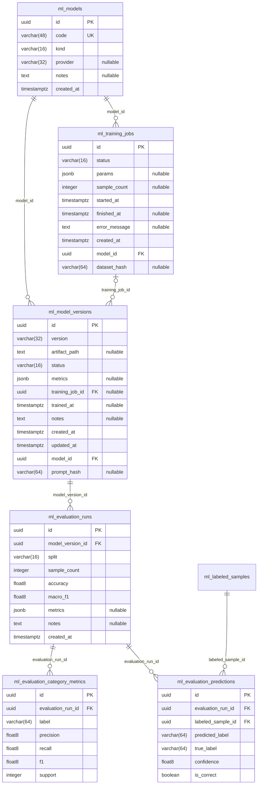

Bảng ngoài nhóm xuất hiện trong sơ đồ (chỉ để nối quan hệ, xem cột ở nhóm của chúng): `ml_labeled_samples`.

##### `ml_models` — MlModel

Danh mục các model (mã, loại, nhà cung cấp).

| # | Cột | Kiểu | NULL | Mặc định | Khóa |
| --- | --- | --- | --- | --- | --- |
| 1 | `id` | uuid |  | `gen_random_uuid()` | PK |
| 2 | `code` | varchar(48) |  |  | UK |
| 3 | `kind` | varchar(16) |  |  |  |
| 4 | `provider` | varchar(32) | có |  |  |
| 5 | `notes` | text | có |  |  |
| 6 | `created_at` | timestamptz |  | `now()` |  |

Ràng buộc:
- CHECK `chk_ml_models_kind`: `kind IN ('sklearn', 'rasa', 'llm', 'rules')`
- UNIQUE `uq_ml_models_code`: `code`

##### `ml_training_jobs` — TrainingJob

Lần huấn luyện: tham số, số mẫu, hash bộ dữ liệu, trạng thái.

| # | Cột | Kiểu | NULL | Mặc định | Khóa |
| --- | --- | --- | --- | --- | --- |
| 1 | `id` | uuid |  | `gen_random_uuid()` | PK |
| 2 | `status` | varchar(16) |  |  |  |
| 3 | `params` | jsonb | có |  |  |
| 4 | `sample_count` | integer | có |  |  |
| 5 | `started_at` | timestamptz |  |  |  |
| 6 | `finished_at` | timestamptz | có |  |  |
| 7 | `error_message` | text | có |  |  |
| 8 | `created_at` | timestamptz |  | `now()` |  |
| 9 | `model_id` | uuid |  |  | FK → `ml_models.id` |
| 10 | `dataset_hash` | varchar(64) | có |  |  |

Khóa ngoại:
- `model_id` → `ml_models(id)` ON DELETE RESTRICT

Ràng buộc:
- CHECK `chk_ml_training_jobs_dataset_hash`: `(dataset_hash IS NULL) OR (dataset_hash ~ '^[0-9a-f]{64}$')`
- CHECK `chk_ml_training_jobs_params`: `(params IS NULL) OR (jsonb_typeof(params) = 'object')`
- CHECK `chk_ml_training_jobs_sample_count`: `(sample_count IS NULL) OR (sample_count >= 0)`
- CHECK `chk_ml_training_jobs_times`: `(finished_at IS NULL) OR (finished_at >= started_at)`
- CHECK `chk_training_jobs_status`: `status IN ('pending', 'running', 'succeeded', 'failed')`

Index:
- `idx_ml_training_jobs_model_created` `(model_id, created_at)`

##### `ml_model_versions` — ModelVersion

Phiên bản model: đường dẫn artifact, trạng thái (candidate / active …), chỉ số.

| # | Cột | Kiểu | NULL | Mặc định | Khóa |
| --- | --- | --- | --- | --- | --- |
| 1 | `id` | uuid |  | `gen_random_uuid()` | PK |
| 2 | `version` | varchar(32) |  |  |  |
| 3 | `artifact_path` | text | có |  |  |
| 4 | `status` | varchar(16) |  |  |  |
| 5 | `metrics` | jsonb | có |  |  |
| 6 | `training_job_id` | uuid | có |  | FK → `ml_training_jobs.id` |
| 7 | `trained_at` | timestamptz | có |  |  |
| 8 | `notes` | text | có |  |  |
| 9 | `created_at` | timestamptz |  | `now()` |  |
| 10 | `updated_at` | timestamptz |  | `now()` |  |
| 11 | `model_id` | uuid |  |  | FK → `ml_models.id` |
| 12 | `prompt_hash` | varchar(64) | có |  |  |

Khóa ngoại:
- `model_id` → `ml_models(id)` ON DELETE RESTRICT
- `training_job_id` → `ml_training_jobs(id)` ON DELETE SET NULL

Ràng buộc:
- CHECK `chk_ml_model_versions_prompt_hash`: `(prompt_hash IS NULL) OR (prompt_hash ~ '^[0-9a-f]{64}$')`
- CHECK `chk_ml_model_versions_status`: `status IN ('candidate', 'active', 'retired', 'rejected')`
- UNIQUE `uq_ml_model_versions_model_version`: `model_id, version`

Index:
- `idx_model_versions_training_job` `(training_job_id) WHERE training_job_id IS NOT NULL`
- UNIQUE `uq_ml_model_versions_active` `(model_id) WHERE status = 'active'`

##### `ml_evaluation_runs` — EvaluationRun

Lần đánh giá một phiên bản trên một split.

| # | Cột | Kiểu | NULL | Mặc định | Khóa |
| --- | --- | --- | --- | --- | --- |
| 1 | `id` | uuid |  | `gen_random_uuid()` | PK |
| 2 | `model_version_id` | uuid |  |  | FK → `ml_model_versions.id` |
| 3 | `split` | varchar(16) |  |  |  |
| 4 | `sample_count` | integer |  |  |  |
| 5 | `accuracy` | float8 |  |  |  |
| 6 | `macro_f1` | float8 |  |  |  |
| 7 | `metrics` | jsonb | có |  |  |
| 8 | `notes` | text | có |  |  |
| 9 | `created_at` | timestamptz |  | `now()` |  |

Khóa ngoại:
- `model_version_id` → `ml_model_versions(id)` ON DELETE CASCADE

Ràng buộc:
- CHECK `chk_ml_evaluation_runs_sample_count`: `sample_count >= 0`
- CHECK `chk_ml_evaluation_runs_scores`: `((accuracy >= 0) AND (accuracy <= 1)) AND ((macro_f1 >= 0) AND (macro_f1 <= 1))`
- CHECK `chk_ml_evaluation_runs_split`: `split IN ('train', 'val', 'test', 'cv')`

Index:
- `idx_evaluation_runs_model_version` `(model_version_id, created_at)`

##### `ml_evaluation_category_metrics` — EvaluationCategoryMetric

Precision / recall / F1 theo từng nhãn của một lần đánh giá.

| # | Cột | Kiểu | NULL | Mặc định | Khóa |
| --- | --- | --- | --- | --- | --- |
| 1 | `id` | uuid |  | `gen_random_uuid()` | PK |
| 2 | `evaluation_run_id` | uuid |  |  | FK → `ml_evaluation_runs.id` |
| 3 | `label` | varchar(64) |  |  |  |
| 4 | `precision` | float8 |  |  |  |
| 5 | `recall` | float8 |  |  |  |
| 6 | `f1` | float8 |  |  |  |
| 7 | `support` | integer |  |  |  |

Khóa ngoại:
- `evaluation_run_id` → `ml_evaluation_runs(id)` ON DELETE CASCADE

Ràng buộc:
- CHECK `chk_ml_evaluation_category_metrics_scores`: `(("precision" >= 0) AND ("precision" <= 1)) AND ((recall >= 0) AND (recall <= 1)) AND ((f1 >= 0) AND (f1 <= 1))`
- CHECK `chk_ml_evaluation_category_metrics_support`: `support >= 0`
- UNIQUE `uq_eval_category_metrics`: `evaluation_run_id, label`

##### `ml_evaluation_predictions` — EvaluationPrediction

Dự đoán từng mẫu trong một lần đánh giá.

| # | Cột | Kiểu | NULL | Mặc định | Khóa |
| --- | --- | --- | --- | --- | --- |
| 1 | `id` | uuid |  | `gen_random_uuid()` | PK |
| 2 | `evaluation_run_id` | uuid |  |  | FK → `ml_evaluation_runs.id` |
| 3 | `labeled_sample_id` | uuid |  |  | FK → `ml_labeled_samples.id` |
| 4 | `predicted_label` | varchar(64) |  |  |  |
| 5 | `true_label` | varchar(64) |  |  |  |
| 6 | `confidence` | float8 |  |  |  |
| 7 | `is_correct` | boolean |  |  |  |

Khóa ngoại:
- `evaluation_run_id` → `ml_evaluation_runs(id)` ON DELETE CASCADE
- `labeled_sample_id` → `ml_labeled_samples(id)` ON DELETE CASCADE

Ràng buộc:
- CHECK `chk_ml_evaluation_predictions_confidence`: `(confidence >= 0) AND (confidence <= 1)`
- UNIQUE `uq_ml_evaluation_predictions_run_sample`: `evaluation_run_id, labeled_sample_id`

Index:
- `idx_evaluation_predictions_labeled_sample` `(labeled_sample_id)`
- `idx_evaluation_predictions_run` `(evaluation_run_id, is_correct)`

#### 3.2.6 NLU (Rasa)

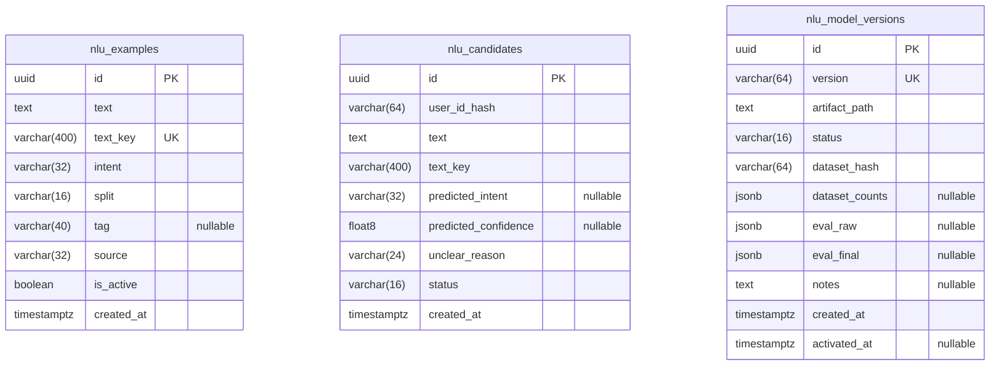

##### `nlu_examples` — NluExample

Câu ví dụ huấn luyện NLU (intent, split).

| # | Cột | Kiểu | NULL | Mặc định | Khóa |
| --- | --- | --- | --- | --- | --- |
| 1 | `id` | uuid |  | `gen_random_uuid()` | PK |
| 2 | `text` | text |  |  |  |
| 3 | `text_key` | varchar(400) |  |  | UK |
| 4 | `intent` | varchar(32) |  |  |  |
| 5 | `split` | varchar(16) |  |  |  |
| 6 | `tag` | varchar(40) | có |  |  |
| 7 | `source` | varchar(32) |  |  |  |
| 8 | `is_active` | boolean |  | `true` |  |
| 9 | `created_at` | timestamptz |  | `now()` |  |

Ràng buộc:
- CHECK `chk_nlu_examples_source`: `source IN ('seed', 'user_feedback', 'human')`
- CHECK `chk_nlu_examples_split`: `split IN ('train', 'val', 'test')`
- CHECK `chk_nlu_examples_text_len`: `char_length(text) <= 200`
- UNIQUE `uq_nlu_examples_text_key`: `text_key`

Index:
- `idx_nlu_examples_split_intent` `(split, intent)`

##### `nlu_candidates` — NluCandidate

Câu người dùng mà NLU chưa chắc, chờ duyệt để thành ví dụ.

| # | Cột | Kiểu | NULL | Mặc định | Khóa |
| --- | --- | --- | --- | --- | --- |
| 1 | `id` | uuid |  | `gen_random_uuid()` | PK |
| 2 | `user_id_hash` | varchar(64) |  |  |  |
| 3 | `text` | text |  |  |  |
| 4 | `text_key` | varchar(400) |  |  |  |
| 5 | `predicted_intent` | varchar(32) | có |  |  |
| 6 | `predicted_confidence` | float8 | có |  |  |
| 7 | `unclear_reason` | varchar(24) |  |  |  |
| 8 | `status` | varchar(16) |  | `'pending'::character varying` |  |
| 9 | `created_at` | timestamptz |  | `now()` |  |

Ràng buộc:
- CHECK `chk_nlu_candidates_status`: `status IN ('pending', 'rejected')`
- CHECK `chk_nlu_candidates_user_hash`: `user_id_hash ~ '^[0-9a-f]{64}$'`
- UNIQUE `uq_nlu_candidates_user_text`: `user_id_hash, text_key`

Index:
- `idx_nlu_candidates_status_created` `(status, created_at)`

##### `nlu_model_versions` — NluModelVersion

Phiên bản model Rasa và kết quả đánh giá.

| # | Cột | Kiểu | NULL | Mặc định | Khóa |
| --- | --- | --- | --- | --- | --- |
| 1 | `id` | uuid |  | `gen_random_uuid()` | PK |
| 2 | `version` | varchar(64) |  |  | UK |
| 3 | `artifact_path` | text |  |  |  |
| 4 | `status` | varchar(16) |  |  |  |
| 5 | `dataset_hash` | varchar(64) |  |  |  |
| 6 | `dataset_counts` | jsonb | có |  |  |
| 7 | `eval_raw` | jsonb | có |  |  |
| 8 | `eval_final` | jsonb | có |  |  |
| 9 | `notes` | text | có |  |  |
| 10 | `created_at` | timestamptz |  | `now()` |  |
| 11 | `activated_at` | timestamptz | có |  |  |

Ràng buộc:
- CHECK `chk_nlu_model_versions_dataset_hash`: `(dataset_hash = 'unknown') OR (dataset_hash ~ '^[0-9a-f]{64}$')`
- CHECK `chk_nlu_model_versions_status`: `status IN ('candidate', 'active', 'retired', 'rejected')`
- UNIQUE `uq_nlu_model_versions_version`: `version`

Index:
- UNIQUE `uq_nlu_model_versions_active` `(status) WHERE status = 'active'`

#### 3.2.7 View

##### `bill_unknown_merchants` (view)

Gộp `bill_unknown_scans` theo cửa hàng: số hóa đơn, số lần quét, số người.

Cột: `merchant_key` text, `sample_name` text, `bills` bigint, `scans` bigint, `users` bigint, `predicted_category` varchar.

<details><summary>Định nghĩa</summary>

```sql
SELECT merchant_key,
    max(merchant_read) AS sample_name,
    count(*) AS bills,
    sum(seen_count) AS scans,
    count(DISTINCT user_id_hash) AS users,
    mode() WITHIN GROUP (ORDER BY bill_unknown_scans.predicted_category) AS predicted_category
   FROM bill_unknown_scans
  WHERE (((status)::text = 'new'::text) AND (merchant_key <> ''::text))
  GROUP BY merchant_key;
```

</details>

##### `v_item_consensus` (view)

Đồng thuận danh mục theo tên món giữa nhiều người dùng (từ `ml_item_feedback`).

Cột: `item_key` text, `category_slug` varchar(32), `users` bigint, `agreement` float8.

<details><summary>Định nghĩa</summary>

```sql
WITH votes AS (
         SELECT ml_item_feedback.item_key,
            ml_item_feedback.category_slug,
            count(*) AS users
           FROM ml_item_feedback
          GROUP BY ml_item_feedback.item_key, ml_item_feedback.category_slug
        )
 SELECT item_key,
    category_slug,
    users,
    ((users)::double precision / (sum(users) OVER (PARTITION BY item_key))::double precision) AS agreement
   FROM votes;
```

</details>

##### `v_merchant_consensus` (view)

Đồng thuận danh mục theo cửa hàng giữa nhiều người dùng (từ `user_merchant_memory`).

Cột: `merchant_key` text, `category_slug` varchar(32), `users` bigint, `agreement` float8.

<details><summary>Định nghĩa</summary>

```sql
WITH latest AS (
         SELECT DISTINCT ON (ml_training_samples.merchant_key, ml_training_samples.user_id_hash) ml_training_samples.merchant_key,
            ml_training_samples.user_id_hash,
            ml_training_samples.final_slug
           FROM ml_training_samples
          WHERE (((ml_training_samples.sample_unit)::text = 'bill'::text) AND (ml_training_samples.final_slug IS NOT NULL) AND (ml_training_samples.merchant_key IS NOT NULL) AND (ml_training_samples.merchant_key <> ''::text))
          ORDER BY ml_training_samples.merchant_key, ml_training_samples.user_id_hash, ml_training_samples.labeled_at DESC NULLS LAST, ml_training_samples.created_at DESC
        ), votes AS (
         SELECT latest.merchant_key,
            latest.final_slug AS category_slug,
            count(*) AS users
           FROM latest
          GROUP BY latest.merchant_key, latest.final_slug
        )
 SELECT merchant_key,
    category_slug,
    users,
    ((users)::double precision / (sum(users) OVER (PARTITION BY merchant_key))::double precision) AS agreement
   FROM votes;
```

</details>
