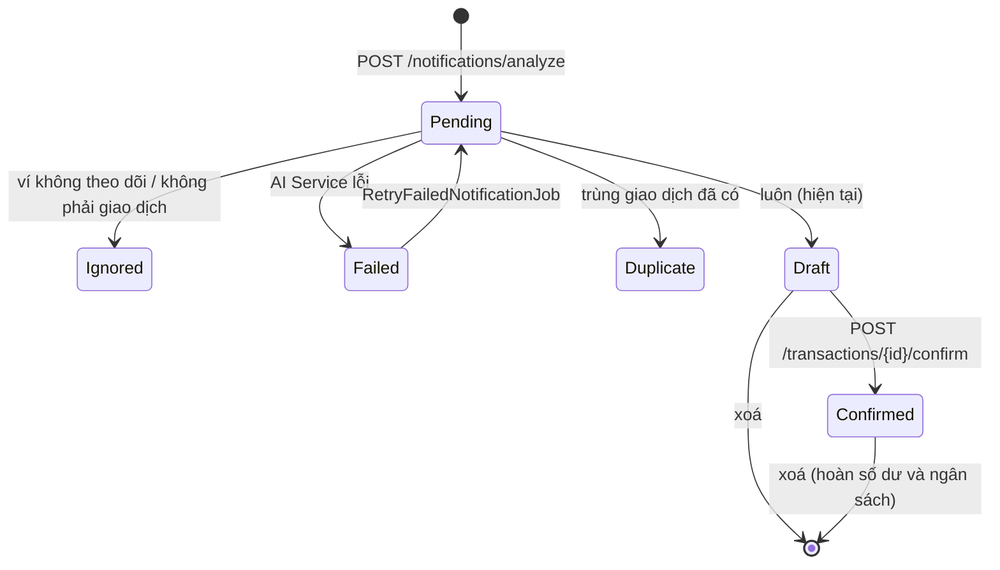

# FinMate — Đặc tả yêu cầu chức năng & phi chức năng

Cập nhật: 2026-11-02 · Đối chiếu với code trên `main` tại commit `b2e97b4` (Phase 1–51). Bản trước: 2026-09-24 (Phase 1–18).

## 1. Giới thiệu

Tài liệu này liệt kê các yêu cầu chức năng (FR) và phi chức năng (NFR) mà phía server của FinMate phải đáp ứng. Nguồn nghiệp vụ là tài liệu **"FinMate — Đặc tả chi tiết các Core User Flows"** (bản hiện hành: 3 Core Flow và Admin Flow ở vai trò hỗ trợ). Phần mô tả hành vi hiện có được viết lại từ hệ thống đang chạy và **kiểm lại trên code** ngày 2026-11-02, không chỉ từ `.context/`. Mỗi yêu cầu có mã riêng, mức ưu tiên và tiêu chí kiểm chứng được.

**Phạm vi.** Năm dịch vụ server, dựng bằng một `docker-compose.yml`:

| Dịch vụ | Công nghệ | Vai trò |
| --- | --- | --- |
| Backend | ASP.NET Core 9, PostgreSQL 16 (`finmate_main`), Redis 7, Hangfire | Nơi **duy nhất** client gọi; mọi thứ có hậu quả (giao dịch, số dư, ngân sách) |
| AI Service | Python 3.11 FastAPI, PostgreSQL 16 (`finmate_ai`) | Hiểu thông báo, câu chat, tên món; chọn phương pháp tài chính; kho kiến thức và vòng học |
| `ocr-service` | Python 3.10, PaddleOCR + VietOCR ONNX, Google Cloud Vision (tuỳ chọn) | Đọc ảnh hoá đơn, lọc dữ liệu cá nhân, tách món. Không có DB, ghi qua API của AI Service |
| `stt-service` | Python, GIPFormer 1.5 ONNX (CPU) | Giọng nói → chữ |
| `rasa` | Rasa 3.6 NLU | Ý định và thực thể của câu chat; chỉ AI Service gọi |

Client là app **Flutter** ở repo riêng `FinMate_FE` (tài liệu cũ ghi `android/` Kotlin — đã đổi). Client nằm ngoài phạm vi; các yêu cầu đặc tả giao cho app được gom ở mục 2.3 để truy vết.

**Quy ước mã.** `FR-<NHÓM>-<số>` cho chức năng, `NFR-<NHÓM>-<số>` cho phi chức năng. Nhóm: AUTH, CONS, ACC, CAT, TXN, SCAN, CHAT, QR, BUD, GOAL, FIN, RPT, NOTI, GAME, AI, ADM, CFG; SEC, DATA, REL, PERF, OPS, MNT, USE. Mã của bản 2026-09-24 được giữ nguyên.

**Nhãn đối chiếu với đặc tả.** Yêu cầu không mang nhãn là hệ thống đã đáp ứng (đã kiểm trên code).

| Nhãn | Ý nghĩa |
| --- | --- |
| **[Mới]** | Đặc tả yêu cầu, hệ thống chưa có |
| **[Đổi]** | Đặc tả quy định hành vi khác với hệ thống đang chạy |
| **[Một phần]** | Hệ thống có một phần, còn thiếu so với đặc tả |
| **[Ngoài đặc tả]** | Hệ thống có, đặc tả Core Flows không nhắc tới (thêm theo quyết định chủ sản phẩm, Phase 19–51) |
| **[Sai lệch]** | Tài liệu cũ ghi là đã đáp ứng nhưng code không có |

Toàn bộ các mục mang nhãn được tổng hợp ở mục 13.1.

**Mức ưu tiên** (MoSCoW):

| Mức | Ý nghĩa |
| --- | --- |
| Must | Thiếu thì sản phẩm không phát hành được hoặc gây mất tiền / lộ dữ liệu |
| Should | Quan trọng, có cách vòng tạm thời |
| Could | Cải thiện trải nghiệm, có thể lùi sang bản sau |
| Won't (MVP) | Đã quyết định không làm trong MVP |

## 2. Tác nhân, luồng nghiệp vụ và kênh đầu vào

### 2.1 Tác nhân

| Tác nhân | Loại | Tương tác với hệ thống |
| --- | --- | --- |
| User | Người dùng cuối qua app Flutter | Ví, giao dịch, chat/giọng nói/quét bill, QR chuyển khoản, ngân sách, mục tiêu, phương pháp tài chính, báo cáo, nhiệm vụ |
| Admin | Nhân sự vận hành, vai trò `Admin` trong JWT | Người dùng, provider và định dạng thông báo, danh mục, nhiệm vụ, phương pháp/khảo sát/mẫu mục tiêu, kiến thức AI, Rasa, cấu hình hệ thống, key bên thứ ba, audit |
| Android OS | Nguồn sự kiện, chuyển qua app | Thông báo biến động số dư từ app ngân hàng / ví được chọn. FinMate **không** kết nối tài khoản ngân hàng |
| AI Service, `ocr-service`, `stt-service`, `rasa` | Dịch vụ nội bộ, Bearer key riêng, không mở cổng ra máy chủ | Xem mục 1 |
| Google | OAuth 2.0 / OIDC; Cloud Vision; Gemini | Đăng nhập; đọc chữ ảnh hoá đơn (tuỳ chọn); phân loại tên món / cụm sản phẩm và chọn phương pháp (khi được đồng ý) |
| OpenRouter | LLM dự phòng (model `:free`, `data_collection = deny`) | Dự phòng khi Gemini lỗi |
| VietQR (`dl.vietqr.io`) | Liên kết mở app ngân hàng | Client mở app ngân hàng với số tài khoản/số tiền/nội dung đã điền |
| Firebase Cloud Messaging | Push | Gửi thông báo tới thiết bị đã đăng ký |
| Brevo | Email giao dịch | Mã OTP xác minh email và đặt lại mật khẩu |
| Hangfire scheduler | Tác nhân thời gian | 9 job định kỳ (mục 11.2) |

### 2.2 Ba Core Flow

| Core Flow | Kích hoạt | Mục yêu cầu |
| --- | --- | --- |
| Flow 1 — Ghi nhận tự động từ thông báo | Android hiển thị thông báo biến động số dư từ app được chọn | 5.1, 8 |
| Flow 2 — Ghi nhận chi tiêu tiền mặt đa kênh | User chạm "Thêm giao dịch" | 5.2, 5.4, 5.5 |
| Flow 3 — Quản lý & phân tích tài chính cùng AI | Lưu cấu hình ngân sách / ngưỡng, giao dịch chi mới, nạp mục tiêu, mở tab Báo cáo, lịch dự báo | 6 |
| Onboarding phương pháp tài chính **[Ngoài đặc tả]** | Sau đăng ký, hoặc user mở lại từ Hồ sơ | 6.4 |
| QR chuyển khoản **[Ngoài đặc tả]** | User quét mã VietQR của người nhận | 5.6 |
| Admin Flow (hỗ trợ) | Quản trị viên thao tác | 9 |

**Các kênh nhập giao dịch** — giá trị ghi vào `transactions.source`:

| Kênh | Core Flow | Đường vào server | Ai tạo giá trị tiền |
| --- | --- | --- | --- |
| Thông báo ngân hàng / ví | Flow 1 | `POST /notifications/analyze` | Định dạng thông báo theo provider (regex trong DB của AI Service) |
| Chat (gõ câu tự nhiên) | Flow 2 | `POST /transactions/chat` (lưu được) · `POST /transactions/parse` và `POST /chat/analyze` (chỉ phân tích) | Luật số tiền của AI Service ("75k", "1.5tr", số bằng chữ); Rasa chỉ hỗ trợ khi luật không thấy số |
| Giọng nói | Flow 2 | `POST /transactions/voice` · `POST /chat/analyze-voice` (file âm thanh) | `stt-service` ra chữ, rồi như kênh chat |
| Ảnh hoá đơn | Flow 2 | `POST /transactions/scan-receipt` | `ocr-service` bóc tổng tiền; luôn cần user rà soát |
| Form nhập tay | Flow 2 | `POST /transactions` | User |

Chuyển khoản nội bộ đi qua `POST /transactions/transfer`. Form nhập tay cũng là đường dự phòng khi mất mạng.

### 2.3 Yêu cầu đặc tả giao cho app (ngoài phạm vi server)

| Đặc tả | Yêu cầu phía app | Hệ quả với server |
| --- | --- | --- |
| Flow 1, bước 1.3–1.4 | Hướng dẫn bật thông báo ngân hàng và cấp quyền Notification Access | Không có |
| Flow 1, bước 2.2 | Heartbeat `NotificationListenerService`; hướng dẫn Auto-start / whitelist | Không có |
| Flow 1, bước 3.1 | Lọc 3 tầng trên thiết bị (Package → Keyword/Regex → TFLite) | Classifier phía server vẫn giữ làm lớp phòng vệ thứ hai (FR-AI-01) |
| Flow 1, bước 5.3 | Draft không được phản hồi trước timeout → hàng đợi Chờ duyệt | Draft giữ nguyên trạng thái (FR-TXN-09) |
| Flow 1, bước 6.1 · Flow 2, bước 10 | Lưu vào hàng đợi cục bộ khi mất mạng, đồng bộ khi có mạng | Chống trùng khi đồng bộ (FR-TXN-02, FR-TXN-12, NFR-REL-04) |
| Flow 2, bước 4 | Mất mạng → chuyển sang form (graceful fallback) | Không có |
| Flow 3 | Biểu cảm Mascot, biểu đồ Donut / Line, thẻ Insight, màn ăn mừng | Server cung cấp dữ liệu và trạng thái (mục 6) |
| Điều khoản / đồng ý | Hiển thị Điều khoản và chặn dùng app khi `termsAccepted = false` | Server lưu phiên bản đồng ý (mục 3.1) nhưng **không** chặn đăng ký (FR-AUTH-00) |

## 3. FR — Xác thực, tài khoản người dùng và đồng ý

| Mã | Yêu cầu | Ưu tiên | Tiêu chí chấp nhận |
| --- | --- | --- | --- |
| FR-AUTH-00 | **[Một phần]** Ghi nhận chấp thuận Điều khoản + Chính sách quyền riêng tư (Flow 1 bước 1.0) | Must | Đã có: `POST /users/me/consents` loại `terms` lưu `terms_version` + `terms_accepted_at`; `GET /users/me` trả `termsAccepted`; đổi `ConsentVersions.Terms` (hiện **3**) thì mọi đồng ý cũ hết hiệu lực. Còn thiếu: đăng ký **không** đòi đồng ý (không trả 400), việc chặn hoàn toàn do app |
| FR-AUTH-01 | Đăng ký bằng email, mật khẩu, tên hiển thị | Must | Email đúng định dạng, ≤ 320 ký tự, chưa tồn tại; mật khẩu ≥ 8 ký tự; tên ≤ 200 ký tự. Gửi OTP xác minh sau khi tạo |
| FR-AUTH-02 | Xác minh email bằng OTP 6 chữ số (`verify-email`, `resend-verification`) | Must | Mã hết hạn sau 10 phút, dùng một lần, huỷ sau 5 lần sai; gửi lại cách nhau ≥ 60 giây. `REQUIRE_EMAIL_VERIFICATION` bật thì chưa xác minh không đăng nhập được |
| FR-AUTH-03 | Đăng nhập email/mật khẩu | Must | Access token JWT (15 phút) + refresh token opaque (30 ngày). Tài khoản bị khoá hoặc đã yêu cầu xoá thì từ chối |
| FR-AUTH-04 | Đăng nhập Google native (`POST /auth/google`, ID token) | Must | Xác minh chữ ký và `aud`; tạo user mới nếu email chưa có |
| FR-AUTH-05 | Đăng nhập Google qua trình duyệt (`/auth/google/start` → `callback` → `exchange`) | Should | `state` dùng một lần; redirect chỉ mang **handoff code** dùng một lần. Thiếu client secret (biến môi trường hoặc kho key, FR-CFG-03) → 422, route native vẫn chạy |
| FR-AUTH-06 | Làm mới token có xoay vòng (`/auth/refresh`) | Must | Token đã dùng bị dùng lại → huỷ **tất cả** refresh token của user. Vai trò đọc lại từ DB |
| FR-AUTH-07 | Đăng xuất một / tất cả thiết bị | Must | Refresh token bị thu hồi, dùng lại trả 401 |
| FR-AUTH-08 | Quên mật khẩu (`forgot-password`) | Must | Phản hồi giống hệt từng byte cho email có thật, không tồn tại và đang cooldown |
| FR-AUTH-09 | Đặt lại mật khẩu bằng OTP | Must | OTP theo mục đích; thành công thì thu hồi mọi refresh token |
| FR-AUTH-10 | Đổi mật khẩu khi đã đăng nhập | Must | Phải đúng mật khẩu cũ |
| FR-AUTH-11 | Xem và sửa hồ sơ (`GET/PATCH /users/me`) | Must | Sửa tên và thu nhập dự kiến hàng tháng (`monthly_income_cents`); cache hồ sơ bị vô hiệu ngay |
| FR-AUTH-12 | Cài đặt thông báo (`PATCH /users/me/notification-prefs`) | Must | Bật/tắt push và từng loại cảnh báo |
| FR-AUTH-13 | Yêu cầu xoá tài khoản (`DELETE /auth/account`) | Must | Xoá mềm ngay; xoá cứng sau 30 ngày bởi `DataDeletionJob` (03:00), kèm xoá mẫu huấn luyện ở AI Service (FR-CONS-04). Chỉ Admin huỷ được (FR-ADM-07) |
| FR-AUTH-14 | Đăng ký / gỡ thiết bị nhận push (`POST/DELETE /devices`) | Must | Token FCM duy nhất toàn hệ thống: đăng ký dưới tài khoản khác thì **chuyển** chủ |
| FR-AUTH-15 | Đăng ký bằng SĐT + OTP SMS | Won't (MVP) | Quyết định 2026-09-11: chỉ email OTP |

### 3.1 Đồng ý (consent) **[Ngoài đặc tả]**

Bốn loại đồng ý, mỗi loại có phiên bản câu chữ trong `ConsentVersions`; tăng số phiên bản thì mọi đồng ý cũ hết hiệu lực. API: `POST /users/me/consents`, `DELETE /users/me/consents/{kind}`.

| Mã | Yêu cầu | Ưu tiên | Tiêu chí chấp nhận |
| --- | --- | --- | --- |
| FR-CONS-01 | Đồng ý Điều khoản (`terms`, bản 3) bao trùm việc gửi tên món / cụm sản phẩm cho Gemini/OpenRouter, đọc thông báo ngân hàng và đăng nhập Google | Must | Đồng ý Điều khoản thì bật luôn đồng ý AI (`ai`, bản 3), **trừ** người đã chủ động tắt AI (`AiConsentVersion = 0` khác `null`) |
| FR-CONS-02 | Tắt/bật AI trong Hồ sơ | Must | Tắt AI thì chat, giọng nói, quét bill vẫn chạy, chỉ phân loại bằng luật; server đọc đồng ý **từ DB mỗi lần**, không tin client |
| FR-CONS-03 | Đồng ý đóng góp dữ liệu huấn luyện (`training`, bản 1) là lựa chọn riêng, không bao giờ đi kèm Điều khoản | Must | Chỉ khi đang đồng ý mới gửi chữ hoá đơn **đã lọc** sang AI Service; nhãn chỉ từ user, không từ Gemini; mẫu chưa nhãn bị xoá sau 7 ngày |
| FR-CONS-04 | Rút đồng ý huấn luyện xoá dữ liệu đã đóng góp | Must | `DELETE /users/me/consents/training` gọi `POST /bill/samples/erase`; lỗi xoá → 503 (bấm lại), **không** nuốt lỗi |
| FR-CONS-05 | **[Đổi]** Câu chữ đồng ý phải nêu đúng mọi luồng gửi dữ liệu ra bên thứ ba | Must | Ảnh hoá đơn **luôn** được gửi nguyên (chưa che dữ liệu cá nhân) tới Google Cloud Vision khi có key (NFR-SEC-24), nhưng Điều khoản bản 3 không nhắc tới. Cần sửa câu chữ + tăng `ConsentVersions.Terms`, hoặc tắt Vision (mục 13.4) |
| FR-CONS-06 | Đồng ý khảo sát-AI (`surveyAi`, bản 2) | Could | Từ 2026-11-01 không còn được kiểm khi gợi ý phương pháp (signals ẩn danh luôn được gửi). Endpoint còn nhưng không có tác dụng; comment của `ConsentVersions.SurveyAi` vẫn mô tả hành vi cũ |

## 4. FR — Tài khoản tài chính và danh mục

### 4.1 Tài khoản tài chính

| Mã | Yêu cầu | Ưu tiên | Tiêu chí chấp nhận |
| --- | --- | --- | --- |
| FR-ACC-01 | Liệt kê nhà cung cấp đang hoạt động (`GET /financial-accounts/providers`) | Must | Chỉ trả provider `is_active`. `ProviderConfigSeeder` là nguồn duy nhất của danh sách provider (ngân hàng và ví VN) |
| FR-ACC-02 | Tạo tài khoản: tên, loại (`Bank`, `EWallet`, `Cash`), số dư ban đầu | Must | Tên 1–100 ký tự; số dư ≥ 0; `Cash` không có provider, `Bank`/`EWallet` bắt buộc có |
| FR-ACC-03 | Sửa tên tài khoản | Must | Tên 1–100 ký tự |
| FR-ACC-04 | Bật/tắt theo dõi thông báo (`PATCH …/monitoring`) | Must | Thông báo từ ví đang tắt → `Ignored`, không tạo nháp |
| FR-ACC-05 | Xem số dư | Must | Giá trị cộng dồn, không tính lại từ lịch sử |
| FR-ACC-06 | Xoá tài khoản | Must | Xoá mềm; còn giao dịch → 409 `HasTransactions` |
| FR-ACC-07 | Chỉ thao tác trên tài khoản của chính user | Must | Tài khoản người khác → 404 |

### 4.2 Danh mục

| Mã | Yêu cầu | Ưu tiên | Tiêu chí chấp nhận |
| --- | --- | --- | --- |
| FR-CAT-01 | Liệt kê danh mục = hệ thống đang hoạt động + danh mục riêng của user | Must | Danh mục hệ thống cache 60 phút |
| FR-CAT-02 | Tạo / sửa danh mục riêng | Must | Tên 1–100 ký tự, icon ≤ 50 ký tự |
| FR-CAT-03 | Xoá danh mục riêng | Must | Xoá mềm; còn giao dịch → 409 |
| FR-CAT-04 | Danh mục hệ thống nhận diện bằng `slug` bất biến (11 slug: `food, transport, shopping, education, housing, bills, entertainment, health, family, income, other`) | Must | Mọi đầu ra của AI Service về backend dùng 11 slug này; slug lạ bị lọc |
| FR-CAT-05 | "Chưa phân loại" là trạng thái hợp lệ | Must | `category_id` NULL; dòng riêng trong cơ cấu chi |
| FR-CAT-06 | **[Ngoài đặc tả]** Đồng bộ danh mục hệ thống sang AI Service | Should | `AiCategorySyncJob` và `PUT /categories/sync` của AI Service giữ `kb_categories` khớp backend; AI Service phân biệt loại danh mục bằng `kind` thay vì CHECK liệt kê slug |

## 5. FR — Giao dịch (Core Flow 1 & 2)

Giao dịch từ thông báo luôn vào `Draft` và không ảnh hưởng số dư, ngân sách, báo cáo cho tới khi được xác nhận. Giao dịch nhập tay được xác nhận ngay; chat chỉ tự lưu khi đủ điều kiện (FR-CHAT-02).

Vòng đời hiện tại của một thông báo ngân hàng. Đặc tả muốn thêm nhánh `Pending → Confirmed` (auto-commit, FR-TXN-05) và lưu bản trùng có liên kết (FR-TXN-17) — cả hai là **[Đổi]**, chưa làm.

### 5.1 Flow 1 — Từ thông báo ngân hàng

| Mã | Yêu cầu | Ưu tiên | Tiêu chí chấp nhận |
| --- | --- | --- | --- |
| FR-TXN-01 | Nhận thông báo từ client (`POST /notifications/analyze`) | Must | Ghi `notification_logs`, gọi AI Service (kèm cờ `allow_ai` theo đồng ý của user), trả kết quả khi là giao dịch |
| FR-TXN-02 | Chống trùng khi đồng bộ offline | Must | Khoá = `contentHash` (gồm `ReceivedAt` làm tròn phút), không cửa sổ thời gian |
| FR-TXN-03 | Thông báo từ ví chưa theo dõi → `Ignored` | Must | `Ignored` chỉ chặn trùng trong cửa sổ ngắn để được đánh giá lại khi user thêm ví |
| FR-TXN-04 | Thử lại khi AI Service lỗi | Should | `RetryFailedNotificationJob`; khoảng chạy (mặc định 15 phút) và số lần tối đa (mặc định 5) đặt ở cấu hình hệ thống (FR-CFG-01) |
| FR-TXN-05 | **[Đổi]** Auto-commit theo trường cốt lõi và `extraction_confidence ≥ 0,85` | Must | Đặc tả: đủ số tiền, chiều, thời điểm **và** extraction ≥ 0,85 → `Confirmed` ngay. Hiện tại: luôn tạo `Draft`; `min(extraction, categorization) ≥ 0,85` (`TransactionReviewPush.OneTapThreshold`) chỉ đổi loại push sang xác nhận một chạm |
| FR-TXN-05a | **[Đổi]** Danh mục khi auto-commit | Must | Đặc tả: categorization < 0,85 → "Chưa phân loại", không chặn auto-commit. Phụ thuộc FR-TXN-05 |
| FR-TXN-06 | Push mang dữ liệu có cấu trúc | Must | Payload `data` gồm `action` (`confirm_one_tap` / `choose_category`), `transactionId`, `amountCents`…; không bao giờ log. **[Đổi]** nếu làm FR-TXN-05 thì `action` phải phân biệt "đã tự ghi nhận" và "cần bổ sung" |
| FR-TXN-07 | Xác nhận nháp (`POST /transactions/{id}/confirm`), kèm `categoryId` tuỳ chọn | Must | Áp danh mục **trước** khi cộng ngân sách; cập nhật số dư, ngân sách, streak, nhiệm vụ, EXP. Danh mục bị sửa → gửi `category_correction` về AI |
| FR-TXN-08 | Tab "Chờ duyệt" (`GET /transactions?status=Draft`) | Must | Chỉ nháp của user hiện tại |
| FR-TXN-09 | Draft không phản hồi nằm lại hàng đợi | Must | Server không tự huỷ hay tự xác nhận Draft |
| FR-TXN-17 | **[Đổi]** Bản trùng được ghi lại và liên kết tới giao dịch gốc | Must | Hiện tại: AI trả `is_potential_duplicate` + `duplicate_request_id`, backend không tạo nháp và không lưu liên kết tới giao dịch gốc |
| FR-TXN-18 | **[Mới]** Sự kiện liên quan: chuyển khoản nội bộ, nạp ví, hoàn tiền, đảo giao dịch | Should | Chưa có trong code (không có loại `refund`/`reversal`) |
| FR-TXN-26 | **[Ngoài đặc tả]** Tách phần nội dung chuyển khoản bằng nhãn (`ND:`…) và phân loại bằng AI khi từ điển không chắc | Should | Nhãn nằm trong DB (tài liệu `narrative_labels`); nội dung bị cắt ở trường kế tiếp; định danh bị che; nội dung không bao giờ được cache |

### 5.2 Flow 2 — Nhập thủ công và chuyển khoản

| Mã | Yêu cầu | Ưu tiên | Tiêu chí chấp nhận |
| --- | --- | --- | --- |
| FR-TXN-10 | Tạo giao dịch tay (`POST /transactions`) | Must | Tiền > 0 (đồng VND), `Debit`/`Credit`, merchant ≤ 200, mô tả ≤ 500 ký tự. Trả 201 |
| FR-TXN-11 | Client không được tự khai `source = Notification` | Must | Trả 400 |
| FR-TXN-12 | Idempotency qua `clientRequestId` tuỳ chọn | Must | Duy nhất theo `(user_id, client_request_id)`; gửi lại → **200** với giao dịch cũ |
| FR-TXN-13 | Phân tích câu tự nhiên không lưu (`POST /transactions/parse`, `POST /chat/analyze`) | Must | Text 1–500 ký tự; trả đề xuất số tiền, thời gian, merchant, danh mục; **không** lưu |
| FR-TXN-14 | Nhập bằng giọng nói | Must | Xem FR-CHAT-06. Số bằng chữ có dấu ("bốn mươi lăm ngàn" = 45.000); phân biệt mười/mươi, từ/tư, "công ty"/tỷ; số lớn không bị gộp sai |
| FR-TXN-15 | Quét hoá đơn | Must | Xem mục 5.4 |
| FR-TXN-16 | Chuyển khoản nội bộ (`POST /transactions/transfer`) | Must | Hai ví khác nhau cùng thuộc user; không danh mục; **không** tính vào chi tiêu, thu nhập, ngân sách, báo cáo, dự báo, hũ |
| FR-TXN-19 | Báo trường bắt buộc còn thiếu | Must | Chat trả `missingFields` (`category`/`account`/`accounts`) hoặc `needs_amount`; `POST /transactions` từ chối khi thiếu |
| FR-TXN-24 | Phân loại Chi tiêu / Thu nhập / Chuyển khoản nội bộ từ câu chat | Should | Chat nhận ý định `transfer_money` và trả bản nháp chuyển khoản (luôn qua xác nhận). Đã đáp ứng ở `/transactions/chat`; `/parse` cũ vẫn chỉ ra `Debit`/`Credit` |

### 5.3 Xem, sửa, xoá

| Mã | Yêu cầu | Ưu tiên | Tiêu chí chấp nhận |
| --- | --- | --- | --- |
| FR-TXN-20 | Danh sách có lọc và phân trang (`GET /transactions`) | Must | Lọc theo trạng thái, ví, danh mục, khoảng ngày |
| FR-TXN-21 | Xem chi tiết | Must | Giao dịch người khác → 404 |
| FR-TXN-22 | Sửa giao dịch (`PATCH`) | Must | Đã xác nhận thì hoàn tác tác động cũ rồi áp tác động mới trong một lượt lưu. Đổi danh mục → `category_correction` (thông báo), dạy lại bộ nhớ cửa hàng (hoá đơn chưa tách), ghi nhớ người nhận (QR đã khớp) |
| FR-TXN-23 | Xoá giao dịch | Must | Xoá mềm; đã xác nhận thì hoàn số dư (cả ví đích với chuyển khoản) và trừ ngân sách |

### 5.4 Quét hoá đơn **[Ngoài đặc tả: chi tiết]**

Đặc tả chỉ yêu cầu "chụp hoá đơn, AI bóc tách". Hệ thống hiện đi đường Ảnh → backend → `ocr-service` → AI Service phân loại → backend.

| Mã | Yêu cầu | Ưu tiên | Tiêu chí chấp nhận |
| --- | --- | --- | --- |
| FR-SCAN-01 | `POST /transactions/scan-receipt` (multipart `file`) | Must | Ảnh rỗng, > 5 MB hoặc không phải JPEG/PNG/WebP/HEIC/HEIF → lỗi nghiệp vụ, không gọi mạng. Có `OCR_SERVICE_URL` thì bắt buộc có `OCR_SERVICE_API_KEY` (thiếu → không khởi động) |
| FR-SCAN-02 | Ba kết quả: `success`, `no_amount`, `unreadable` | Must | `ocr-service` trả 422 `not_a_receipt` → `unreadable`; lỗi mạng → lần quét thất bại (không quay sang `/api/v1/ocr`) |
| FR-SCAN-03 | Độ tin cậy do backend tính, luôn < 0,85 | Must | 0,55 nếu tổng đọc từ dòng có nhãn, 0,35 nếu không; +0,15 tên cửa hàng; +0,10 ngày; trần 0,80; `needs_review` → trần 0,50 |
| FR-SCAN-04 | Mọi lần quét ghi `receipt_scans` (không ảnh, không chữ OCR) và trả `scanId` | Must | Không tạo giao dịch ở bước quét; app gửi `receiptScanId` khi bấm Lưu |
| FR-SCAN-05 | Tách hoá đơn theo từng món thành nhiều giao dịch | Could | Chỉ khi cờ `Receipt:SplitByItemsEnabled` bật (mặc định **tắt**), ≥ 2 món chính, ≥ 2 nhóm có danh mục thật và tổng các nhóm bằng đúng tổng bill. Mỗi nhóm một giao dịch, `clientRequestId` = uuid v5 từ `scanId` + nhóm. Mọi lỗi → một nhóm như cũ |
| FR-SCAN-06 | Ghi nhớ cửa hàng → danh mục | Should | Chỉ khi `source = Receipt`, có tên cửa hàng, danh mục hệ thống khác `income`, bill không bị tách. `/bill/learn` timeout 3 giây, lỗi bị nuốt |
| FR-SCAN-07 | Cảnh báo trùng khi quét | Should | Có khoản Debit cùng số tiền gần thời điểm bill → trả `possibleDuplicateTransactionId` |
| FR-SCAN-08 | Tính năng bật/tắt từ xa | Should | Cờ `features.billScan` trong cấu hình hệ thống (FR-CFG-01) |

### 5.5 Chat và giọng nói **[Ngoài đặc tả: chi tiết]**

| Mã | Yêu cầu | Ưu tiên | Tiêu chí chấp nhận |
| --- | --- | --- | --- |
| FR-CHAT-01 | `POST /transactions/chat` (`{text, financialAccountId?, clientRequestId?}`) | Must | Text 1–500 ký tự. AI Service (`/chat/parse` = Rasa tuỳ chọn + luật + Gemini khi có đồng ý) chỉ trả quyết định; backend quyết mọi hậu quả |
| FR-CHAT-02 | Tự lưu khi đủ điều kiện, còn lại hỏi xác nhận | Must | Tự lưu (`action = saved`) chỉ khi: một khoản, `auto_save_ok`, là chi tiêu, chọn được ví (ví user chọn hoặc ví duy nhất), slug ra danh mục hệ thống, không có khoản Debit cùng số tiền trong ±10 phút. Thu nhập, chuyển khoản và câu nhiều khoản **luôn** `action = confirm` |
| FR-CHAT-03 | Hỏi tổng chi/thu theo kỳ | Should | `action = summary`; backend tự cộng (AI Service không thấy số liệu); xin chi tiết thì kèm tối đa 20 khoản và `transactionsHasMore` |
| FR-CHAT-04 | Ngày trong câu ("hôm qua") | Should | Dùng làm `transactedAt` |
| FR-CHAT-05 | AI phân loại cụm sản phẩm khi có đồng ý | Should | Chỉ gửi cụm sản phẩm đã bỏ số tiền; thuốc/đồ y tế không gửi; AI khác luật thì không tự lưu; AI lỗi hoặc quá hạn → kết quả luật |
| FR-CHAT-06 | Giọng nói (`POST /transactions/voice`, `POST /chat/analyze-voice`) | Must | File ≤ 10 MiB, ≤ 60 giây; `stt-service` (GIPFormer) ra chữ rồi đi luồng chat; quá tải → 429. Âm thanh không được lưu |
| FR-CHAT-07 | Bật/tắt từ xa | Should | Cờ `features.chatAi`, `features.voice` trong cấu hình hệ thống |

### 5.6 QR chuyển khoản **[Ngoài đặc tả]**

FinMate **không chạm vào tiền**: chỉ ghi "ý định chuyển tiền" rồi khớp với thông báo ngân hàng khi nó về.

| Mã | Yêu cầu | Ưu tiên | Tiêu chí chấp nhận |
| --- | --- | --- | --- |
| FR-QR-01 | Danh mục ngân hàng VietQR (`GET /qr/banks`) | Should | `VietQrBankSeeder` nạp 33 ngân hàng (BIN, tên, mã app, `provider_key`) |
| FR-QR-02 | Ghi ý định chuyển tiền (`POST /qr/transfers`), xem, huỷ | Should | Lưu người nhận, ngân hàng **gửi**, số tiền, nội dung, danh mục đã chọn; số tài khoản chỉ đi trong body; ý định quá hạn (mặc định 24 giờ) đánh dấu `isExpired` |
| FR-QR-03 | Khớp với thông báo chi tiền | Should | Package → `provider_configs` → `vietqr_banks` → BIN ngân hàng gửi; ý định `pending` cùng BIN, cùng số tiền, trong cửa sổ trước thông báo (mặc định 30 phút, lệch đồng hồ 2 phút — cấu hình hệ thống). Khớp thì danh mục user đã chọn thắng gợi ý AI |
| FR-QR-04 | Ghi nhớ người nhận → danh mục | Should | Chỉ khi user **chủ động** chọn (lúc quét hoặc sửa tay giao dịch đã khớp); quản lý qua `/qr/counterparties` |

## 6. FR — Ngân sách, mục tiêu, phương pháp tài chính, báo cáo (Core Flow 3)

Cảnh báo ngân sách tới ngay khi giao dịch được lưu; mọi con số tổng hợp loại trừ chuyển khoản nội bộ.

### 6.1 Giám sát ngân sách (phân luồng 3.1)

| Mã | Yêu cầu | Ưu tiên | Tiêu chí chấp nhận |
| --- | --- | --- | --- |
| FR-BUD-01 | Tạo ngân sách tháng theo danh mục hoặc tổng | Must | Hạn mức > 0; trùng (user, danh mục, kỳ) → 409; `spent_cents` backfill khi tạo |
| FR-BUD-02 | Xem, sửa, xoá ngân sách | Must | Cache tóm tắt 5 phút bị vô hiệu khi thay đổi |
| FR-BUD-03 | Cảnh báo tức thì theo T1, T2 và mốc vượt 100% | Must | Đánh giá trong cùng thao tác tạo/xác nhận/sửa giao dịch; push gửi **sau** khi lưu. Cờ `alert_t1/t2/over_sent_at` |
| FR-BUD-04 | Mỗi ngưỡng báo đúng một lần mỗi kỳ | Must | Vượt thẳng lên mốc cao chỉ báo mốc cao nhất; user tắt cảnh báo thì **không** đóng cờ |
| FR-BUD-05 | Lưới vét `BudgetAlertJob` mỗi giờ | Should | Hạ hạn mức, backfill, đổi ngưỡng |
| FR-BUD-06 | Ngưỡng T1/T2 theo ba tầng | Must | Thứ tự: phương pháp đang dùng (`t1_pct`/`t2_pct`, user ghi đè được) → ngưỡng cá nhân (`GET/PUT/DELETE /me/alert-thresholds`) → mặc định hệ thống 70/90 (FR-CFG-01). Ràng buộc `1 ≤ T1 < T2 ≤ 99` (đặc tả ghi `0 < T1 < T2 ≤ 100`); sai → 422 `ALERT_THRESHOLD_INVALID`; mốc vượt luôn 100% |
| FR-BUD-07 | **[Một phần]** Trạng thái Mascot cho từng ngân sách | Must | Có `level` = `none/ok/t1/t2/over` cho **hũ** (`GET /me/jars`). Tóm tắt ngân sách (`BudgetSummaryItemDto`) vẫn chỉ có `PercentUsed` và `IsOverLimit` |

### 6.2 Mục tiêu tiết kiệm (phân luồng 3.2)

| Mã | Yêu cầu | Ưu tiên | Tiêu chí chấp nhận |
| --- | --- | --- | --- |
| FR-GOAL-01 | Tạo / sửa mục tiêu | Must | Tên ≤ 200; đích > 0; hạn ở tương lai; tuỳ chọn `goal_template_id` |
| FR-GOAL-02 | Đóng góp (`/contribute`) | Must | Chỉ mục tiêu `Active` |
| FR-GOAL-03 | **[Một phần]** Tự hoàn thành và vinh danh | Must | Có `Completed`, EXP, push. Chưa có **Honor Badge** |
| FR-GOAL-04 | Huỷ mục tiêu | Must | Chỉ `Active` |
| FR-GOAL-05 | Xem tiến độ (`/progress`) | Must | Đã góp, còn thiếu, %, lịch sử, thẩm định khả thi |
| FR-GOAL-06 | **[Một phần]** Thẩm định khả thi khi tạo và sửa | Must | Có `POST /saving-goals/feasibility` (xem trước) và `GoalFeasibilityCalculator` (khả dụng = thu nhập − tổng hạn mức ngân sách) dùng chung với `/progress`. Tạo/sửa mục tiêu vẫn **không** chặn mục tiêu bất khả thi |
| FR-GOAL-07 | Nhắc hạn mục tiêu | Could | `GoalDeadlineCheckJob` hằng ngày |

### 6.3 Báo cáo, phân tích hành vi và dự báo (phân luồng 3.3)

| Mã | Yêu cầu | Ưu tiên | Tiêu chí chấp nhận |
| --- | --- | --- | --- |
| FR-RPT-01 | **[Một phần]** Tóm tắt kỳ | Must | Có so với tháng trước, theo giờ VN. Chưa so với tuần trước |
| FR-RPT-02 | Cơ cấu chi theo danh mục | Must | Chỉ `Confirmed`, `Debit`; "Chưa phân loại" dòng riêng; loại khoản vay/mượn và chuyển khoản |
| FR-RPT-03 | Dòng tiền theo ngày | Must | Từ `daily_summaries` (`DailySummaryJob` 00:05) |
| FR-RPT-04 | **[Một phần]** Dự phóng số dư cuối tháng | Should | Có dự báo tổng chi (run-rate, rơi về lịch sử) và `ProjectedBalanceCents` = thu nhập − dự báo chi. Chưa cộng hoá đơn định kỳ, chưa tính trên số dư ví |
| FR-RPT-05 | **[Một phần]** Insight hành vi | Should | `InsightGeneratorJob` 02:00 có 3 loại (`VsLastMonth`, `RecurringDetected`, `UnusualSpending`). Chưa có cuối tuần/ngày thường, tỉ trọng nhóm con |
| FR-RPT-06 | **[Mới]** Lịch dự báo theo user, chạy lại khi chi đột biến | Should | Chưa có. Phương pháp tài chính đã khai báo tham số `forecast_minute` ("Giờ nhắc dự báo hằng ngày", mặc định 1320 = 22:00) nhưng không có code nào đọc nó |
| FR-RPT-07 | **[Mới]** Cảnh báo bội chi kèm khuyến nghị định lượng | Should | Chưa có |

### 6.4 Phương pháp quản lý tài chính và onboarding **[Ngoài đặc tả]**

Đăng ký → khảo sát 10 câu → backend suy ra *signals* → AI chọn MỘT cách chính và tối đa MỘT cách bổ trợ trong danh sách đang bật → user chọn → cách đó mang ngưỡng T1/T2, mẫu mục tiêu và bố cục trang chủ.

| Mã | Yêu cầu | Ưu tiên | Tiêu chí chấp nhận |
| --- | --- | --- | --- |
| FR-FIN-01 | Khảo sát đầu vào (`GET /survey`, `PUT /survey/answers`, `POST /survey/skip`, `DELETE /survey`) | Should | 10 câu, câu có `show_if`; mỗi đáp án mang `signals`; mã câu/đáp án bất biến; câu trả lời lưu ở server và xoá được; `users.onboarding_status` = pending/completed/skipped |
| FR-FIN-02 | Gợi ý phương pháp (`POST /finance-methods/recommendations`) | Should | Chỉ gửi signals ẩn danh (≤ 60 khoá) và danh sách được phép (≤ 20) cho AI Service; AI (Gemini → OpenRouter `:free`) phải trả mã trong danh sách, kết quả sai/lỗi/quá hạn → luật (`rule_fallback`). Xin lại với cùng signals trong `recommendationReuseMinutes` (mặc định 10) trả bản cũ. Mỗi lần ghi `method_recommendations` (nguồn, `prompt_version`, signals, kết quả shown/accepted/changed/skipped) |
| FR-FIN-03 | Danh mục 13 phương pháp | Should | Theo dõi tối giản, 50/30/20, Safe-to-spend, ngân sách dòng tiền, Phong bì, Trả cho mình trước, Quỹ khẩn cấp, Trả nợ, Tự động hoá ít công sức, 6 hũ, 70/20/10, 80/20, zero-based; mã bất biến; seeder chỉ thêm, không ghi đè bản admin đã sửa |
| FR-FIN-04 | Phương pháp đang dùng (`GET/POST /me/methods`, `PATCH …/params`, `DELETE`) | Should | Một chính + tối đa một bổ trợ `active`; chỉ lưu tham số user **ghi đè**; admin tắt một phương pháp thì user đang dùng không bị gỡ (`available = false`), người mới không chọn được (422 `FINANCE_METHOD_INACTIVE`) |
| FR-FIN-05 | Khối hũ (`GET /me/jars`) | Should | Tối đa 8 hũ; số được chia = thu nhập tháng × %; đã chi cùng nguồn báo cáo theo danh mục, ghép theo **ID** danh mục hệ thống; chưa khai thu nhập → số được chia `null` (không phải 0); chi ngoài hũ ở `unassignedSpentCents` |
| FR-FIN-06 | Tiền khả dụng và gợi ý mục tiêu (`GET /me/spendable`, `GET /me/goal-suggestions`) | Should | Một công thức khả dụng dùng chung với thẩm định mục tiêu |
| FR-FIN-07 | **[Sai lệch]** Gợi ý theo luật phải khớp hồ sơ mẫu | Should | Test `MethodSelectionOnSeedDataTests…GetsCashFlowBudget…` **đang đỏ** từ commit `b6f1c42`: hồ sơ "thu nhập biến động, đôi khi thiếu cuối tháng" được luật gợi ý `rule_80_20` thay vì `cash_flow_budget`. Cần chỉnh trọng số hoặc chốt lại kỳ vọng |

## 7. FR — Thông báo đẩy và gamification

### 7.1 Thông báo đẩy (FCM)

| Mã | Yêu cầu | Ưu tiên | Tiêu chí chấp nhận |
| --- | --- | --- | --- |
| FR-NOTI-01 | Push tới mọi thiết bị của user | Must | Draft cần xác nhận (Flow 1), cảnh báo ngân sách, hoàn thành mục tiêu, lên level. **[Mới]** cảnh báo bội chi (FR-RPT-07) |
| FR-NOTI-02 | Tôn trọng `PushEnabled` ở một điểm duy nhất | Must | `FcmPushNotificationService` |
| FR-NOTI-03 | Dọn token chết | Must | Chỉ khi `Unregistered`/`SenderIdMismatch` |
| FR-NOTI-04 | Push không làm hỏng thao tác gốc | Must | Lỗi gửi không ném ra |
| FR-NOTI-05 | Dự phòng khi thiếu thông tin FCM | Should | Ghi log thay vì gửi; log khởi động nêu chế độ |
| FR-NOTI-06 | Email OTP qua Brevo | Must | Key lấy từ kho key (FR-CFG-03) hoặc biến môi trường; thiếu → ghi mã ra log (chỉ dev/test) |

### 7.2 Gamification

| Mã | Yêu cầu | Ưu tiên | Tiêu chí chấp nhận |
| --- | --- | --- | --- |
| FR-GAME-01 | Cộng EXP khi ghi nhận hoạt động | Must | Tổng EXP cho level N = 50·N·(N−1); trần 999 |
| FR-GAME-02 | Thu hồi EXP khi xoá giao dịch đã xác nhận | Must | EXP không âm |
| FR-GAME-03 | Streak | Must | `StreakCheckJob` 23:55 giờ VN |
| FR-GAME-04 | Nhiệm vụ `Daily`, `Weekly`, `OneTime` | Must | `MissionResetJob` 00:01; tuần từ thứ Hai |
| FR-GAME-05 | Xem hồ sơ, nhiệm vụ, lịch sử | Must | `GET /gamification/profile`, `/missions`, `/missions/history` |
| FR-GAME-06 | Vật phẩm và trang phục Mascot | Won't (MVP) | Đã loại khỏi yêu cầu ngày 2026-09-24, **nhưng code vẫn còn** (`/gamification/mascot/*`, `mascot_items`, `user_mascot_items`, `MascotItemSeeder`). Chờ quyết định gỡ hay giữ (mục 13.4) |

## 8. FR — AI Service

AI Service chỉ phân tích: trích xuất, phân loại, tính độ tin cậy, phát hiện trùng, chọn phương pháp. Nó **không** tạo giao dịch và không quyết định lưu. Số tiền luôn do luật (regex theo provider, parser số tiền), không bao giờ do mô hình đoán. Kiến thức (định dạng thông báo, thương hiệu, từ khoá, chỉ dẫn LLM, nhãn nội dung, cấu hình) nằm trong DB và sửa được không cần build lại; bản trong code chỉ là seed và đường lui.

| Mã | Yêu cầu | Ưu tiên | Tiêu chí chấp nhận |
| --- | --- | --- | --- |
| FR-AI-01 | Phân loại thông báo `financial` / `non_financial` / `uncertain` | Must | Không phải `financial` → dừng pipeline. Từ khoá classifier nằm trong tài liệu cấu hình `notification_vocab` |
| FR-AI-02 | Trích xuất số tiền, chiều, merchant, mô tả, thời điểm, số dư kèm `extraction_confidence` | Must | Định dạng thông báo theo provider (bảng `provider_formats` + trường + mẫu + mẫu thử) quản trị qua admin; khớp chịu được dấu tiếng Việt; nhãn số dư chỉ áp cho số ngay sau nó; số tài khoản không bị nhận nhầm là số dư. Nhánh generic luôn < 0,85 |
| FR-AI-03 | Gán danh mục `category_slug` kèm `categorization_confidence` | Must | Từ điển → 0,90; chưa có mô hình được promote → luật. Từ điển không chắc và user đồng ý AI → AI phân loại nội dung (FR-TXN-26) |
| FR-AI-04 | **[Một phần]** Phát hiện trùng và sự kiện liên quan | Must | Hiện chỉ so user hash + số tiền + cửa sổ 5 phút, trả `is_potential_duplicate`. Đặc tả cần thêm provider, tài khoản, chiều, merchant, mã tham chiếu, event hash, loại quan hệ |
| FR-AI-05 | **[Đổi]** OCR hoá đơn | Must | Đường chính là `ocr-service` (FR-SCAN-*). `POST /api/v1/ocr` của AI Service vẫn còn: có `OCR_SERVICE_URL` thì chuyển tiếp sang `ocr-service`, không thì Tesseract `--psm 6` (bản cũ) |
| FR-AI-06 | Nhận phản hồi (`POST /api/v1/feedback`) | Must | Lưu `category_correction` |
| FR-AI-07 | Thống kê mô hình (`GET /api/v1/stats`) | Must | Không chứa dữ liệu theo user |
| FR-AI-08 | Vòng đời mô hình thông báo: `seed_dataset` → `train` → `evaluate` → `promote` → `feedback_batch` | Must | `promote` từ chối khi chưa đánh giá trên test hoặc accuracy < 0,70; nạp nóng trong 60 giây |
| FR-AI-09 | Dọn dữ liệu | Should | Script cron ngoài: mẫu thô chưa nhãn, `pipeline_requests` > 90 ngày, `bill_unknown_scans` > 90 ngày; mẫu bill chưa nhãn > 7 ngày (`purge_loop` trong service) |
| FR-AI-10 | A/B testing mô hình (bảng `ab_*`) | Won't (MVP) | Hoãn |
| FR-AI-11 | **[Ngoài đặc tả]** Phân loại hoá đơn (`/bill/classify`, `/bill/classify-items`) | Should | Bộ nhớ user → luật/thương hiệu → Gemini (nếu đồng ý, ≤ 20 món mỗi lần, chỉ tên món đã bỏ giá) → `unknown`; câu trả lời Gemini cache dùng chung theo tên món; đếm theo ngày không kèm tên món/user |
| FR-AI-12 | **[Ngoài đặc tả]** Hiểu câu chat (`/chat/parse`) | Must | Rasa (10 intent, timeout 2 giây, cầu dao 30 giây) + luật trong `intent_cues.json`; số tiền và danh mục luôn do luật; Gemini cho chat có client và cầu dao riêng (3,5 s mỗi model < 7,5 s cả chuỗi < 9 s bước AI) |
| FR-AI-13 | **[Ngoài đặc tả]** Chọn phương pháp tài chính (`/finance-methods/recommend`) | Should | Tự kiểm đầu ra (mã trong danh sách, lý do 1–240 ký tự); chỉ dẫn ở `kb_method_prompts` (có phiên bản, một dòng active); OpenRouter dự phòng, trần route 24 giây |
| FR-AI-14 | **[Ngoài đặc tả]** Vòng học hoá đơn và Rasa | Could | Mẫu bill đã lọc + nhãn user; phiếu bầu món; mô hình bill và mô hình Rasa có phiên bản, đánh giá và chặn bản tệ hơn trước khi promote (`scripts/nlu_model.py train|eval|promote`) |
| FR-AI-15 | **[Ngoài đặc tả]** Kho dữ liệu cho `ocr-service` (`/api/v1/ocr-store/*`) | Must | `ocr-service` không nối DB; mọi đọc/ghi kiến thức và bộ nhớ cửa hàng đi qua API này |

## 9. FR — Quản trị (Admin Flow, hỗ trợ)

Mọi endpoint `/api/v1/admin/*` (18 controller) kế thừa `AdminControllerBase` (policy `AdminOnly`), không xoá cứng, mọi thao tác ghi vào `audit_logs`. Các route quản trị kiến thức AI được backend **chuyển tiếp** tới AI Service bằng khoá nội bộ.

| Mã | Yêu cầu | Ưu tiên | Tiêu chí chấp nhận |
| --- | --- | --- | --- |
| FR-ADM-01 | Danh sách và chi tiết người dùng | Must | Không trả số tiền hay mô tả giao dịch |
| FR-ADM-02 | Khoá / mở khoá | Must | Không tự khoá mình; khoá thì thu hồi refresh token |
| FR-ADM-03 | Đổi vai trò | Must | Không đổi vai trò chính mình; không hạ admin đang hoạt động cuối cùng; không nâng tài khoản chờ xoá; hạ cấp → thu hồi token |
| FR-ADM-04 | Cấu hình provider | Must | `provider_key` bất biến |
| FR-ADM-05 | Danh mục hệ thống | Must | `slug` bất biến; đồng bộ sang AI Service (FR-CAT-06) |
| FR-ADM-06 | Nhiệm vụ | Must | `code` bất biến |
| FR-ADM-07 | Hàng đợi xoá dữ liệu và huỷ yêu cầu | Must | Huỷ xoá `user.DeletedAt`; không có endpoint xoá ngay |
| FR-ADM-08 | Audit log (chỉ đọc) | Must | Mọi thao tác ghi của admin |
| FR-ADM-09 | Thống kê chất lượng AI (`/admin/ai-stats`) | Should | AI Service chết vẫn trả 200 với phần của backend |
| FR-ADM-10 | Tài khoản admin hạt giống | Must | Sửa vai trò, khoá, xoá mềm mỗi lần khởi động — không đổi mật khẩu |
| FR-ADM-11 | Quản trị định dạng thông báo (`/admin/provider-formats`, 17 route) | Should | Tạo/sửa/clone/archive/activate định dạng, trường, mẫu regex, mẫu thử; `try`/`check` chạy thử trước khi bật |
| FR-ADM-12 | **[Ngoài đặc tả]** Quản trị kiến thức AI (`/admin/ai-rules`, `/admin/ai-config`) | Should | Thương hiệu, từ khoá, bộ nhớ cửa hàng, cache món, chỉ dẫn Gemini, mẫu đã nhãn, mô hình; tài liệu cấu hình có phiên bản, bản nháp, xem trước, kích hoạt, lịch sử và hoàn tác |
| FR-ADM-13 | **[Ngoài đặc tả]** Quản trị phương pháp tài chính | Should | `/admin/finance-methods` (kèm `activeUserCount` trước khi tắt), `/admin/survey-questions`, `/admin/goal-templates`, `/admin/finance-method-prompts`; bố cục trang chủ và hũ |
| FR-ADM-14 | **[Ngoài đặc tả]** Quản trị Rasa (`/admin/rasa`) | Could | Trạng thái, danh sách phiên bản model, chọn phiên bản |

### 9.1 Cấu hình hệ thống và key bên thứ ba **[Ngoài đặc tả]**

| Mã | Yêu cầu | Ưu tiên | Tiêu chí chấp nhận |
| --- | --- | --- | --- |
| FR-CFG-01 | Cấu hình hệ thống có phiên bản (`/admin/system-config`) | Must | Một tài liệu JSON đã kiểm hợp lệ: bảo trì, phiên bản app tối thiểu / bắt buộc cập nhật, cờ tính năng (`chatAi`, `voice`, `billScan`, `notificationReading`), ngưỡng T1/T2 mặc định, retry thông báo, QR, phương pháp tài chính. Hằng số nghiệp vụ không viết cứng trong code |
| FR-CFG-02 | Chế độ bảo trì và cấu hình công khai | Must | `MaintenanceMiddleware` chặn API khi bật; `GET /app-config` (ẩn danh) cho app biết bảo trì, phiên bản tối thiểu, cờ tính năng |
| FR-CFG-03 | Kho key bên thứ ba (`/admin/secrets`) | Must | Mọi key (Gemini, OpenRouter, Google Vision, Brevo, Google OAuth, FCM) sửa trên trang admin, đọc lúc gọi (không cần khởi động lại). Mã hoá AES-256-GCM, khoá chủ `SECRETS_MASTER_KEY`, tên key làm AAD; key không bao giờ trả về nguyên văn. Thiếu khoá chủ thì kho tắt và chỉ dùng biến môi trường |

## 10. NFR — Bảo mật và quyền riêng tư

FinMate là **zero-credential**: không bao giờ hỏi tài khoản, mật khẩu hay OTP ngân hàng.

### 10.1 Xác thực và phân quyền

| Mã | Yêu cầu | Cách kiểm chứng |
| --- | --- | --- |
| NFR-SEC-01 | BCrypt work factor 12 | Unit test |
| NFR-SEC-02 | JWT HMAC, khoá ≥ 64 ký tự, `ClockSkew = 0`, access 15 phút | App từ chối khởi động khi khoá ngắn |
| NFR-SEC-03 | Refresh token lưu SHA-256 | Kiểm bảng |
| NFR-SEC-04 | Mọi endpoint `[Authorize]` trừ `/auth/*`, `/app-config` và health | Test không token → 401 |
| NFR-SEC-05 | Admin controller kế thừa `AdminControllerBase` | User thường → 403 |
| NFR-SEC-06 | Repository lọc theo `userId` từ JWT | Test cross-user → 404 |
| NFR-SEC-07 | AI Service, `ocr-service`, `stt-service`, `rasa` không mở cổng ra máy chủ; mỗi service có Bearer key riêng, so bằng hằng thời gian; `ocr-service` thiếu key → từ chối mọi request (503) | Gọi thiếu/sai key → 401/503 |
| NFR-SEC-08 | Client ↔ server qua TLS | TLS ở reverse proxy |

### 10.2 Chống lạm dụng

| Mã | Yêu cầu | Cách kiểm chứng |
| --- | --- | --- |
| NFR-SEC-10 | 120 request/phút theo user id (IP khi ẩn danh) | Vượt → 429 |
| NFR-SEC-11 | Endpoint xác thực 10 request/phút theo IP, cộng dồn | Request thứ 11 → 429 |
| NFR-SEC-12 | `TRUSTED_PROXIES` rỗng thì tắt forwarded headers | Giả `X-Forwarded-For` không thoát rate limit |
| NFR-SEC-13 | Endpoint ẩn danh không lộ email tồn tại | So `forgot-password` theo byte |
| NFR-SEC-14 | OAuth trình duyệt: `state` dùng một lần, URL không chứa token | `state` lạ → từ chối |
| NFR-SEC-15 | Tái sử dụng refresh token → thu hồi toàn bộ phiên | Test |

### 10.3 Quyền riêng tư và ghi log

| Mã | Yêu cầu | Cách kiểm chứng |
| --- | --- | --- |
| NFR-SEC-20 | Không log mật khẩu, token, key, `amount_cents`, `notification_body`, payload push | Review log |
| NFR-SEC-21 | CSDL AI chỉ lưu `SHA-256(user_id)` (cùng hàm `UserIdHasher` cho AI Service và `ocr-service`), không FK sang backend | Kiểm schema |
| NFR-SEC-22 | Nội dung thông báo vào tập huấn luyện đã che số tài khoản, thẻ, SĐT, email; chữ hoá đơn đã lọc dữ liệu cá nhân trước khi rời `ocr-service`; chuỗi ≥ 9 chữ số liền bị từ chối | Unit test `anonymizer`, `privacy.sanitize_lines` |
| NFR-SEC-23 | **[Sai lệch]** `notification_body` gốc bị xoá sau 90 ngày | Tài liệu cũ ghi `DataCleanupJob` đáp ứng, nhưng **job này chưa từng có trong code** (chỉ có trong skeleton ban đầu); không có job nào xoá `notification_logs.notification_body` |
| NFR-SEC-24 | **[Đổi]** Ảnh hoá đơn và âm thanh chỉ xử lý trong bộ nhớ, không ghi đĩa, blob hay DB | Đúng với FinMate. Nhưng khi có key Google Vision, **ảnh gốc chưa che** được gửi sang Google (`ocr-service/reading/ocr.py`). Phải được nêu trong câu chữ đồng ý (FR-CONS-05) |
| NFR-SEC-25 | Quyền được xoá: xoá cứng sau 30 ngày, kèm mẫu huấn luyện ở AI Service | Test `DataDeletionJob`; lỗi xoá ở AI Service → giữ user lại thử đêm sau |
| NFR-SEC-26 | Production không trả stack trace | Middleware + test |
| NFR-SEC-27 | **[Một phần]** Ngoài Development, từ chối khởi động nếu bí mật còn `change-me` | `StartupSecretGuard` kiểm `JWT_SECRET`, `AI_SERVICE_API_KEY`, `OCR_SERVICE_API_KEY`, `ADMIN_SEED_PASSWORD`, `HANGFIRE_DASHBOARD_PASS`, `BREVO_API_KEY`, `GOOGLE_CLIENT_ID`, `GOOGLE_CLIENT_SECRET`. Chưa có `STT_SERVICE_API_KEY` và `SECRETS_MASTER_KEY` (thiếu khoá chủ thì kho key tắt âm thầm) |
| NFR-SEC-28 | Chỉ xử lý thông báo của package gắn với tài khoản đang theo dõi | Package lạ → `Ignored` |
| NFR-SEC-29 | **[Một phần]** Bằng chứng đồng ý lưu lâu dài kể cả khi user yêu cầu xoá dữ liệu | Hiện lưu ở cột của `users`, bị xoá cùng user khi xoá cứng |
| NFR-SEC-30 | Gửi dữ liệu tới LLM bên thứ ba chỉ khi có đồng ý và chỉ phần tối thiểu | Tên món / cụm sản phẩm đã bỏ số tiền; signals khảo sát ẩn danh; OpenRouter luôn `data_collection = deny` |
| NFR-SEC-31 | Key bên thứ ba lưu mã hoá (FR-CFG-03) | Review `SecretCipher` |

## 11. NFR — Toàn vẹn dữ liệu, độ tin cậy, hiệu năng

### 11.1 Toàn vẹn dữ liệu

| Mã | Yêu cầu | Cách kiểm chứng |
| --- | --- | --- |
| NFR-DATA-01 | Tiền là `BIGINT` đồng VND | Review |
| NFR-DATA-02 | ID là UUID | Review |
| NFR-DATA-03 | `TIMESTAMPTZ` / `DateTimeOffset`; ranh giới ngày/tuần/tháng theo UTC+7 | Test 23:30 và 00:30 giờ VN |
| NFR-DATA-04 | Enum là `TEXT` + `CHECK` | Review migration |
| NFR-DATA-05 | Xoá mềm bằng `deleted_at` | Review |
| NFR-DATA-06 | Số dư, `spent_cents`, tóm tắt ngày tính sẵn | Test |
| NFR-DATA-07 | Chuyển khoản (và khoản vay/mượn ở báo cáo, hũ) bị loại khỏi phép cộng thu/chi | Test |
| NFR-DATA-08 | Idempotency ở CSDL (`client_request_id`, `contentHash`) | Test gửi lại song song |
| NFR-DATA-09 | Không tác dụng phụ ra ngoài trước khi lưu | Review handler |
| NFR-DATA-10 | Không ghi sai tiền: giao dịch tự lưu chỉ khi số tiền do luật trích ra; OCR luôn cần rà soát | Test |
| NFR-DATA-11 | Danh mục: hai bộ song song (11 slug backend, 9 nhóm bill/chat) quy đổi qua `SLUG_BY_LOCAL_CATEGORY`, có mất thông tin (`dining`, `groceries` → `food`) | Mọi đầu ra về backend lọc theo 11 slug |

### 11.2 Độ tin cậy và khả dụng

| Mã | Yêu cầu | Cách kiểm chứng |
| --- | --- | --- |
| NFR-REL-01 | AI Service chết không làm sập backend | Tắt container AI rồi gọi API |
| NFR-REL-02 | Mọi bước AI có đường lui bằng luật (mô hình chưa promote, Rasa tắt, Gemini/OpenRouter lỗi hoặc hết hạn mức) | Tắt từng phụ thuộc |
| NFR-REL-03 | FCM, Brevo, `/bill/learn` lỗi không làm hỏng thao tác gốc | Client giả ném lỗi |
| NFR-REL-04 | Chịu được đồng bộ hàng loạt từ hàng đợi offline | Replay hai lần |
| NFR-REL-05 | Job nền bền qua khởi động lại; 9 job: `BudgetAlertJob`, `StreakCheckJob`, `DailySummaryJob`, `InsightGeneratorJob`, `MissionResetJob`, `GoalDeadlineCheckJob`, `RetryFailedNotificationJob`, `DataDeletionJob`, `AiCategorySyncJob` | Restart giữa lúc job chạy |
| NFR-REL-06 | `/health/live` và `/health/ready` tách biệt | Tắt Postgres → ready lỗi, live OK |
| NFR-REL-07 | Khả dụng 99,5%/tháng (đề xuất) | Uptime monitor |
| NFR-REL-08 | Cầu dao cho phụ thuộc ngoài: Rasa 30 giây; Gemini chat, Gemini bill, route phương pháp có cầu dao riêng | Unit test |

### 11.3 Hiệu năng (đề xuất, chưa đo)

| Mã | Yêu cầu | Cách kiểm chứng |
| --- | --- | --- |
| NFR-PERF-01 | API thông thường p95 ≤ 300 ms | Load test |
| NFR-PERF-02 | `POST /notifications/analyze` p95 ≤ 1 s | `processing_ms` + backend |
| NFR-PERF-03 | Quét hoá đơn p95 ≤ 5 s. Đo 2026-10-27 trên 60 ảnh: OCR cục bộ 3,1 s/ảnh, Google Vision 1,4 s/ảnh | Benchmark `ocr-service/benchmark/` |
| NFR-PERF-04 | Cảnh báo ngân sách ≤ 10 s sau khi lưu | Đo log → FCM |
| NFR-PERF-05 | Cache Redis cho dữ liệu đọc nhiều | Review `CacheKeys` |
| NFR-PERF-06 | Danh sách phân trang; báo cáo đọc bảng tổng hợp | Review query |
| NFR-PERF-07 | **[Một phần]** Mọi lời gọi ra ngoài có timeout tường minh | Có: `ocr-service` 60 s, `stt-service` 60 s, chọn phương pháp 30 s, admin rules 15 s, `/bill/learn` 3 s. **Chưa có**: client Refit chính (`/analyze`, `/chat/parse`, `/bill/classify*`) dùng mặc định 100 s (`Program.cs`) |

## 12. NFR — Triển khai, vận hành, bảo trì

### 12.1 Triển khai và vận hành

| Mã | Yêu cầu | Cách kiểm chứng |
| --- | --- | --- |
| NFR-OPS-01 | Image backend multi-stage, user không root | `docker image ls` |
| NFR-OPS-02 | Stack: PostgreSQL × 2, Redis, backend, AI Service, `ocr-service`, `stt-service`, `rasa` | `docker compose ps` |
| NFR-OPS-03 | Cấu hình qua biến môi trường và cấu hình hệ thống trong DB; key bên thứ ba qua kho key | Grep repo |
| NFR-OPS-04 | Log Serilog ra stdout | `docker logs` |
| NFR-OPS-05 | Log khởi động nêu chế độ thật/dự phòng của push, email, OCR, STT | Log lúc boot |
| NFR-OPS-06 | Hangfire dashboard có mật khẩu riêng | Không mật khẩu → 401 |
| NFR-OPS-07 | Migration: EF Core (30) và Alembic (32); không sửa migration đã phát hành | Review |
| NFR-OPS-08 | Model không nằm trong git, phải tải riêng: Rasa (`ai-service/rasa/models/active.tar.gz`), GIPFormer (`stt-service/models/`), VietOCR (`ocr-service/models/`); PaddleOCR tải lúc build image | README từng service |
| NFR-OPS-09 | Build backend cần cả thư mục `ocr-service/data/` (embed `shared_words.json`) | `dotnet build` từ gốc repo |

### 12.2 Bảo trì và kiểm thử

| Mã | Yêu cầu | Cách kiểm chứng |
| --- | --- | --- |
| NFR-MNT-01 | Phân tầng API → Application → Domain ← Infrastructure | `ARCHITECTURE.md` §2.3 |
| NFR-MNT-02 | CQRS tự viết, không MediatR | Review |
| NFR-MNT-03 | Backend và AI Service không chia sẻ CSDL; `ocr-service` không nối DB | Review |
| NFR-MNT-04 | Backend: unit + integration (Testcontainers). 2026-11-02: 1352/1353 qua (1 đỏ, FR-FIN-07) | `dotnet test` |
| NFR-MNT-05 | AI Service: pytest. 2026-11-02: 1562 qua, 423 bỏ qua (cần Postgres). `ocr-service`, `stt-service` có pytest riêng (engine giả) | `pytest` |
| NFR-MNT-06 | Python đạt `black`, `ruff`, `isort` | Chạy công cụ |
| NFR-MNT-07 | Định danh bất biến: `provider_key`, `slug`, mission `code`, mã phương pháp, mã câu/đáp án khảo sát | Test API sửa bị từ chối |
| NFR-MNT-08 | Ngưỡng nghiệp vụ ở một nơi mỗi loại (0,85 một chạm; T1/T2 ở `LimitSettings`; 0,70 promote) | Grep |
| NFR-MNT-09 | API có phiên bản `/api/v1` | Review |
| NFR-MNT-10 | Thay đổi lớp luật chat phải qua cổng `scripts/audit_overrides.py`; thay đổi bộ đọc bill đo trên bộ ảnh thật, không được làm lùi bill nào | Chạy script / benchmark |

### 12.3 Khả năng sử dụng phía server

| Mã | Yêu cầu | Cách kiểm chứng |
| --- | --- | --- |
| NFR-USE-01 | Lỗi validation tiếng Việt kèm mã lỗi ổn định | Test API |
| NFR-USE-02 | Hiểu cách viết tiền phổ biến: "75k", "1.5tr", "2tr5", số bằng chữ có dấu | Unit test parser |
| NFR-USE-03 | Quét hoá đơn phân biệt ba trường hợp để client nhắc phù hợp | Test |

## 13. Khoảng cách, ràng buộc, giả định, vấn đề mở

### 13.1 Khoảng cách giữa đặc tả, tài liệu và hệ thống

Kiểm trên code ngày 2026-11-02.

| Mã | Nhãn | Hiện trạng | Việc cần làm | Ảnh hưởng |
| --- | --- | --- | --- | --- |
| NFR-SEC-23 | Sai lệch | Không có job xoá `notification_body` | Viết job (hoặc thêm vào `DataDeletionJob`) xoá nội dung > 90 ngày | Trung bình — quyền riêng tư |
| FR-CONS-05, NFR-SEC-24 | Đổi | Ảnh gốc gửi Google Vision, Điều khoản không nhắc | Sửa câu chữ + tăng `ConsentVersions.Terms`, hoặc tắt Vision | Lớn — pháp lý |
| FR-FIN-07 | Sai lệch | Test gợi ý theo luật đỏ | Chỉnh trọng số `rule_80_20` / `cash_flow_budget` hoặc chốt lại kỳ vọng | Nhỏ |
| NFR-PERF-07 | Một phần | Client Refit chính timeout 100 s | Đặt timeout tường minh | Nhỏ |
| NFR-SEC-27 | Một phần | Thiếu 2 key trong guard | Thêm `STT_SERVICE_API_KEY`, `SECRETS_MASTER_KEY` | Nhỏ |
| FR-GAME-06 | Won't nhưng còn code | Mascot items còn nguyên | Gỡ code hoặc đưa lại vào yêu cầu | Trung bình |
| FR-TXN-05, 05a, 06 | Đổi | Luôn Draft + một chạm | Auto-commit theo trường cốt lõi và extraction | Lớn — đảo Phase 15, đổi hợp đồng push |
| FR-TXN-17, FR-AI-04 | Đổi / Một phần | Bỏ bản trùng, không liên kết | Lưu bản trùng kèm liên kết; mở rộng khoá so khớp | Trung bình |
| FR-TXN-18 | Mới | Không có | Sự kiện liên quan (hoàn tiền, đảo giao dịch…) | Lớn |
| FR-AUTH-00, NFR-SEC-29 | Một phần | Có lưu phiên bản; đăng ký không đòi; bằng chứng xoá theo user | Bắt buộc đồng ý khi đăng ký; lưu bằng chứng tách khỏi `users` | Nhỏ |
| FR-BUD-07 | Một phần | `level` chỉ có ở hũ | Thêm `level` vào tóm tắt ngân sách | Nhỏ |
| FR-GOAL-03 | Một phần | Chưa có Honor Badge | Thêm huy hiệu | Nhỏ |
| FR-GOAL-06 | Một phần | Có endpoint xem trước, không chặn | Chặn khi tạo/sửa | Nhỏ |
| FR-RPT-01 | Một phần | Chỉ so tháng trước | So tuần trước | Nhỏ |
| FR-RPT-04, 06, 07 | Một phần / Mới | Dự báo chi + `ProjectedBalanceCents` | Hoá đơn định kỳ, lịch theo user, cảnh báo bội chi | Lớn |
| FR-RPT-05 | Một phần | 3 loại insight | Cuối tuần / ngày thường, tỉ trọng nhóm con | Trung bình |
| FR-CONS-06 | Một phần | Đồng ý khảo sát-AI không còn tác dụng | Gỡ hoặc sửa comment `ConsentVersions.SurveyAi` | Nhỏ |

**Đã đóng so với bản 2026-09-24:** ngưỡng T1/T2 theo user (FR-BUD-03, 06 — nay ba tầng), đề xuất chuyển khoản từ câu tự nhiên (FR-TXN-24, qua `/transactions/chat`), giao diện quản trị cấu hình AI (FR-ADM-11, 12).

### 13.2 Ràng buộc

- Backend: ASP.NET Core 9, EF Core, PostgreSQL 16, Redis 7, Hangfire. AI Service: Python 3.11, FastAPI, SQLAlchemy, scikit-learn, Rasa 3.6. `ocr-service`: Python 3.10, PaddleOCR, VietOCR ONNX. `stt-service`: GIPFormer ONNX.
- Đơn vị tiền duy nhất là VND; múi giờ nghiệp vụ duy nhất là UTC+7.
- Ứng dụng Flutter do nhóm khác phát triển ở repo riêng.
- LLM bên thứ ba (Gemini, OpenRouter) đang dùng gói miễn phí: Gemini trả 429 ở ~27 lượt/phút (đo 2026-10-17), nên chat hay rơi về luật khi tải cao. Cần gói trả phí trước khi có nhiều người dùng.

### 13.3 Giả định

- Thông báo ngân hàng là mẫu cố định theo provider, nên regex đủ chính xác cho số tiền.
- Client gửi `ReceivedAt` đúng thời điểm nhận thông báo.
- Mỗi user một ngân sách tháng trên mỗi danh mục; không có kỳ tuần hay năm.

### 13.4 Vấn đề mở (cần chủ sản phẩm quyết)

- [ ] **Google Vision và đồng ý.** Sửa Điều khoản để nêu rõ ảnh hoá đơn gửi Google (tăng `ConsentVersions.Terms` → mọi người đồng ý lại), hay tắt Vision và chỉ dùng OCR cục bộ (chậm hơn ~2,2 lần, độ chính xác tương đương).
- [ ] **Auto-commit (FR-TXN-05).** Làm theo đặc tả hay giữ xác nhận một chạm của Phase 15.
- [ ] **Mascot items (FR-GAME-06).** Gỡ khỏi code hay đưa lại vào yêu cầu.
- [ ] **Gợi ý phương pháp theo luật (FR-FIN-07).** Hồ sơ mẫu nên ra `cash_flow_budget` hay `rule_80_20`.
- [ ] **Đồng ý khảo sát-AI (FR-CONS-06).** Gỡ hẳn loại đồng ý này hay khôi phục việc kiểm.
- [ ] **Tách hoá đơn theo món (FR-SCAN-05).** Đang tắt mặc định; có bật cho production không.
- [ ] SMS OTP: đặc tả ghi "Email / Số điện thoại", quyết định 2026-09-11 chỉ làm email.
- [ ] Thống nhất với nhóm app: giao dịch tiền mặt vẫn phải đồng bộ lên server (qua `clientRequestId`).
- [ ] Định nghĩa "giao dịch chi đột biến" (FR-RPT-06) và nguồn "hoá đơn định kỳ" (FR-RPT-04).
- [ ] Chốt chỉ tiêu hiệu năng và khả dụng, đo bằng load test.
- [ ] Kiểm `package_name` của các provider đang tắt trên thông báo thật rồi bật lên.
- [ ] Gói trả phí cho Gemini/OpenRouter trước khi phát hành.

### 13.5 Truy vết yêu cầu → nguồn

| Nhóm | Nguồn nghiệp vụ | Phase triển khai (`TASKS.md`) |
| --- | --- | --- |
| FR-AUTH | Flow 1 bước 1.0–1.2 (SMS thay bằng email OTP) | 1, 12, 13, 16, 17, 18 |
| FR-CONS | Quyết định chủ sản phẩm | 23, 28, 30, 42 |
| FR-ACC | Flow 1 bước 1.2; Flow 2 phương thức 4 | 2, 11 |
| FR-CAT | Flow 1 bước 5.2; Flow 2 | 3, 38 |
| FR-TXN | Flow 1 giai đoạn D–F; Flow 2; mục V | 4, 10, 11, 14, 15, 48 |
| FR-SCAN | Flow 2 phương thức 3 | 19, 21–26, 41 |
| FR-CHAT | Flow 2 phương thức 1–2 | 20, 25–27, 31, 40 |
| FR-QR | Quyết định chủ sản phẩm | 51, 51b |
| FR-BUD | Flow 3 phân luồng 3.1 | 5, 11, 46 |
| FR-GOAL | Flow 3 phân luồng 3.2 | 5, 46 |
| FR-FIN | Quyết định chủ sản phẩm (file khảo sát) | 42–47 |
| FR-RPT | Flow 3 phân luồng 3.3 | 6 |
| FR-GAME | Flow 1 bước 6.2, Flow 2 bước 11; Flow 3 | 7 |
| FR-NOTI | Flow 1 giai đoạn E; Flow 3 | 12, 15 |
| FR-AI | Flow 1 giai đoạn D; Flow 2; `ARCHITECTURE.md` §3 | 9, 10, 28, 29, 32–39, 45, 48 |
| FR-ADM, FR-CFG | Admin Flow | 8, 13, 29, 46, 49, 50 |
